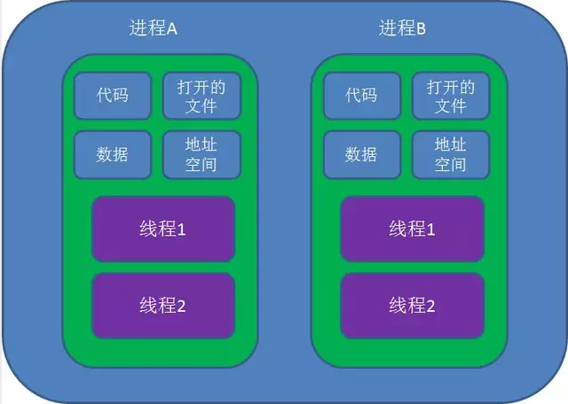
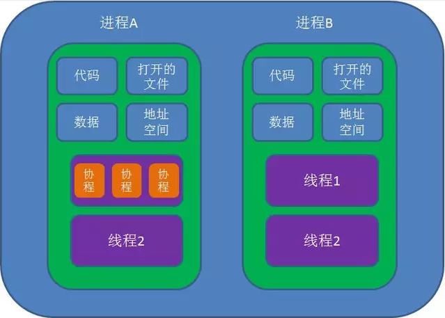

# 进程线程协程区别

## 进程线程协程对比

### 进程概念

进程是系统资源分配的最小单位, 系统由一个个进程(程序)组成 一般情况下，包括文本区域（text region）、数据区域（data region）和堆栈（stack region）。

文本区域存储处理器执行的代码，数据区域存储变量和进程执行期间使用的动态分配的内存，堆栈区域存储着活动过程调用的指令和本地变量。

因此进程的创建和销毁都是相对于系统资源,所以是一种比较昂贵的操作。 进程有三个状态:

| 状态 | 描述 |

| --- | --- |

| 等待态 | 等待某个事件的完成 |

| 就绪态 | 等待系统分配处理器以便运行 |

| 运行态 | 占有处理器正在运行 |

进程是抢占式的争夺 CPU 运行自身,而 CPU 单核的情况下同一时间只能执行一个进程的代码，但是多进程的实现则是通过 CPU 飞快的切换不同进程，因此使得看上去就像是多个进程在同时进行。

通信问题:由于进程间是隔离的，各自拥有自己的内存内存资源, 因此相对于线程比较安全, 所以不同进程之间的数据只能通过 DC02(Inter-Process Communication) 进行通信共享。

### 线程概念

线程属于进程，线程共享进程的内存地址空间并且线程几乎不占有系统资源。

通信问题: 进程相当于一个容器，而线程而是运行在容器里面的，因此对于容器内的东西，线程是共同享有的，因此线程间的通信可以直接通过全局变量进行通信。但是由此带来的例如多个线程读写同一个地址变量的时候则将带来不可预期的后果，因此这时候引入了各种锁的作用，例如互斥锁等。

同时多线程是不安全的，当一个线程崩溃了，会导致整个进程也崩溃了，即其他线程也挂了, 但多进程而不会，一个进程挂了，另一个进程依然照样运行。

进程是系统分配资源的最小单位，线程是 CPU 调度的最小单位。由于默认进程内只有一个线程，所以多核 CPU 处理多进程就像是一个进程一个核心。

### 协程概念

协程是属于线程的。协程程序是在线程里面跑的，因此协程又称微线程和纤程等，协没有线程的上下文切换消耗。协程的调度切换是用户(程序员)手动切换的，因此更加灵活，因此又叫用户空间线程。

原子操作性。由于协程是用户调度的，所以不会出现执行一半的代码片段被强制中断了，因此无需原子操作锁。

## 上下文切换

### 进程切换

1. 切换页目录以使用新的地址空间
2. 切换内核栈
3. 切换硬件上下文

### 线程切换

1. 切换内核栈
2. 切换硬件上下文

## 进程线程协程详解

### 进程

进程是具有一定独立功能的程序关于某个数据集合上的一次运行活动,进程是系统进行资源分配和调度的一个独立单位。每个进程都有自己的独立内存空间，不同进程通过进程间通信来通信。由于进程比较重量，占据独立的内存，所以上下文进程间的切换开销（栈、寄存器、虚拟内存、文件句柄等）比较大，但相对比较稳定安全。

### 线程

线程是进程的一个实体,是 CPU 调度和分派的基本单位,它是比进程更小的能独立运行的基本单位.线程自己基本上不拥有系统资源,只拥有一点在运行中必不可少的资源(如程序计数器,一组寄存器和栈),但是它可与同属一个进程的其他的线程共享进程所拥有的全部资源。线程间通信主要通过共享内存，上下文切换很快，资源开销较少，但相比进程不够稳定容易丢失数据。

### 协程

协程是一种用户态的轻量级线程，协程的调度完全由用户控制。协程拥有自己的寄存器上下文和栈。协程调度切换时，将寄存器上下文和栈保存到其他地方，在切回来的时候，恢复先前保存的寄存器上下文和栈，直接操作栈则基本没有内核切换的开销，可以不加锁的访问全局变量，所以上下文的切换非常快。

### 图解

线程图解如下：

协程图解如下：

## 进程多与线程比较

1. 地址空间:线程是进程内的一个执行单元，进程内至少有一个线程，它们共享进程的地址空间，而进程有自己独立的地址空间。
2. 资源拥有:进程是资源分配和拥有的单位，同一个进程内的线程共享进程的资源。
3. 线程是处理器调度的基本单位，但进程不是。
4. 二者均可并发执行。
5. 每个独立的线程有一个程序运行的入口、顺序执行序列和程序的出口，但是线程不能够独立执行，必须依存在应用程序中，由应用程序提供多个线程执行控制。

## 协程多与线程进行比较

1. 一个线程可以多个协程，一个进程也可以单独拥有多个协程。
2. 线程进程都是同步机制，而协程则是异步。
3. 协程能保留上一次调用时的状态，每次过程重入时，就相当于进入上一次调用的状态。

## 进程线程协程区别总结

进程是系统资源分配的最小单位, 系统由一个个进程(程序)组成 一般情况下，包括文本区域（text region）、数据区域（data region）和堆栈（stack region）。

线程属于进程，线程共享进程的内存地址空间并且线程几乎不占有系统资源。

协程是属于线程的。协程程序是在线程里面跑的，因此协程又称微线程和纤程等，协没有线程的上下文切换消耗。协程的调度切换是用户(程序员)手动切换的，因此更加灵活，因此又叫用户空间线程。
