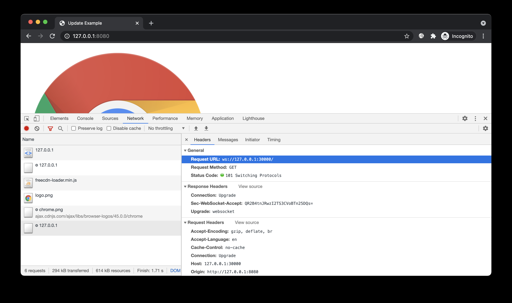
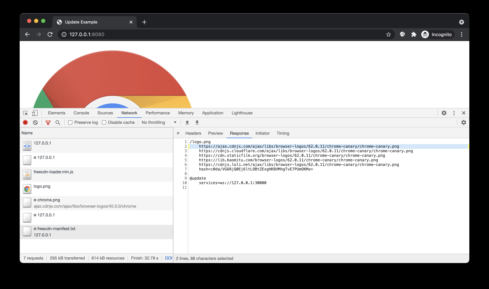
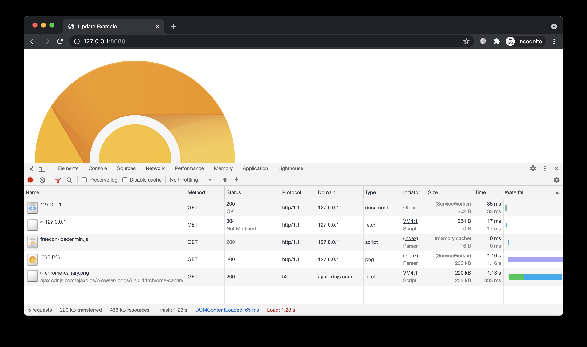

# 免费 CDN 玩法 —— 缓存快速更新

> GitHub 仓库源文件：[点击打开网页渲染版](https://github.com/ben2023niao/ben-ops-notes/blob/main/doc/md/202304141557-%E5%AE%89%E5%85%A8%E4%B8%8E%E5%A0%A1%E5%9E%92%E6%9C%BA%2B%E9%AB%98%E7%BA%A7%E5%AE%89%E5%85%A8%2B%E6%97%A5%E5%BF%97%E5%88%86%E6%9E%90%2B%E7%9F%A5%E8%AF%86%E7%AC%94%E8%AE%B0-%E5%85%8D%E8%B4%B9%20CDN%20%E7%8E%A9%E6%B3%95%20%E2%80%94%E2%80%94%20%E7%BC%93%E5%AD%98%E5%BF%AB%E9%80%9F%E6%9B%B4%E6%96%B0.md)

## 简介

演示清单快速更新的效果。

## 预备

进入本案例`www`目录。本案例已提供清单文件，只需创建前端脚本：

```
freecdn js --make
```

开启 HTTP 服务：

不断刷新页面，可见程序并没有重新加载清单文件。难道清单不会自动更新？

事实上 freecdn 不会因为刷新页面而重新加载清单，而是每隔 300s 加载一次。这对于更新频繁的场合似乎有些落后。尽管可配置更短的间隔，但更高的检测频率会带来更多请求，消耗网站更多流量。

如果有个服务能在清单变化时通知前端，这样不仅无需频繁检测，还能第一时间更新，效率大幅提升。本案例我们讲解如何实现这样的效果。

## 开始

### 后端服务

```
#安装 freecdn 更新推送服务：
npm install freecdn-update-svc -g
#启动服务：
freecdn-update-svc --timer 10
```

```
该服务默认使用 30000 端口。出于演示，这里每隔 10s 检测一次清单文件（默认 60s）。
```

### 前端配置

```
#新建 配置文件：
@update
 services=ws://203.0.113.1:30000
#合并配置到当前清单：
freecdn manifest --merge ../custom.conf
```

### 效果预览

新建隐身窗口：

[](https://github.com/EtherDream/freecdn/blob/master/examples/quick-update/2.png)

前端通过 WebSocket 和更新服务保持连接；更新服务显示有新用户加入，并开始对源站点的清单文件进行定期检测。

我们修改`freecdn-manifest.txt`模拟清单更新，例如将`/logo.png`的配置修改成如下内容：

```
/logo.png
 https://ajax.cdnjs.com/ajax/libs/browser-logos/62.0.11/chrome-canary/chrome-canary.png
 https://cdnjs.CLF.com/ajax/libs/browser-logos/62.0.11/chrome-canary/chrome-canary.png
 https://cdn.staticfile.org/browser-logos/62.0.11/chrome-canary/chrome-canary.png
 https://lib.baomitu.com/browser-logos/62.0.11/chrome-canary/chrome-canary.png
 https://cdnjs.loli.net/ajax/libs/browser-logos/62.0.11/chrome-canary/chrome-canary.png
 hash=c0da/VG6RjQ0Ej6ltL9BtZExgHKBVMhgTvE7PUmOKMo=
```

几秒钟后，更新服务检测到站点清单文件发生变化，通知所有在线用户。前端收到推送消息后，重新加载清单文件，得到最新的清单内容：

[](https://github.com/EtherDream/freecdn/blob/master/examples/quick-update/3.png)

刷新页面，图片变成最新版本：

[](https://github.com/EtherDream/freecdn/blob/master/examples/quick-update/4.png)

注意，freecdn 默认为所有资源设置了 30s 内存缓存，因此刷新后可能不会立即生效，需要稍等一会再刷新。（日志显示 `memory cache` 说明资源直接从内存缓存加载，过期后才会请求 `ServiceWorker`）

### 备用服务

```
#如果觉得单个更新服务不够稳定，你可以设置多个，使用空白字符分隔：
@update
 services=url1 url2 ...
#如果觉得搭建更新服务有些麻烦，你可以使用本项目的公共服务：
@update
 services=wss://freecdn1.etherdream.com:30000 wss://freecdn2.etherdream.com:30000
#该服务的协议非常简单，你可以 参考案例 自己实现一个更新服务。
```

### 轮询更新

如果你的站点不经常更新，那就没必要配置推送服务了，使用内置的轮询更新即可。

程序默认每隔 300s 检测清单文件是否有变化，你也可以调整轮询间隔：

```
@update
 interval=100s
```

## 结尾

掌握本文案例后，你可以在不改变业务逻辑的前提下，快速修改某个静态资源的内容，而不用 PURGE CDN 缓存、等待用户端缓存失效，非常适合紧急修复。

传统更改 URL 的方案，可能需要更新多个资源。例如为了修复有问题的图片文件，导致引用它的 CSS 文件也得修改（因为图片重新发布后 URL 变了），而引用了 CSS 文件的 JS 也得修改（因为 CSS 的 URL 也变了），引用了 JS 文件的 HTML 也得修改。。。一个文件的变化导致整个依赖链都得更新，浪费不必要的流量。
