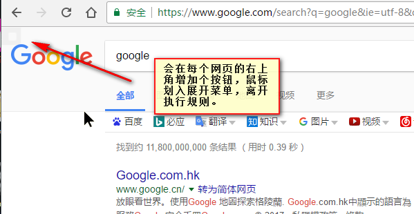
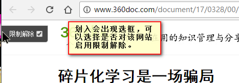

# 油猴脚本 网页限制解除(改)

> GitHub 仓库源文件：[点击打开网页渲染版](https://github.com/ben2023niao/ben-ops-notes/blob/main/doc/md/202304141557-%E5%AE%89%E5%85%A8%E4%B8%8E%E5%A0%A1%E5%9E%92%E6%9C%BA%2B%E9%AB%98%E7%BA%A7%E5%AE%89%E5%85%A8%2B%E6%97%A5%E5%BF%97%E5%88%86%E6%9E%90%2B%E7%9F%A5%E8%AF%86%E7%AC%94%E8%AE%B0-%E6%B2%B9%E7%8C%B4%E8%84%9A%E6%9C%AC%20%E7%BD%91%E9%A1%B5%E9%99%90%E5%88%B6%E8%A7%A3%E9%99%A4%28%E6%94%B9%29.md)

通杀大部分网站,可以解除禁止复制、剪切、选择文本、右键菜单的限制。原作者cat73,因为和搜索跳转脚本冲突,遂进行了改动。

[安装此脚本](https://greasyfork.org/scripts/28497-网页限制解除-改/code/Remove web limits(modified).user.js)

[提问、发表评价](https://greasyfork.org/zh-CN/scripts/28497-网页限制解除-改/feedback#post-discussion)，或者 [举报这个脚本](https://greasyfork.org/zh-CN/reports/new?item_class=script&item_id=28497)。

作者qxin i今日安装793总安装量1,722,413得分3942 40 16版本4.4.6创建日期2017/3/28最近更新2021/6/9许可证LGPLv3

应用到所有站点

修改自脚本[网页限制解除](https://greasyfork.org/zh-CN/scripts/14146-网页限制解除)
因为和 [搜索跳转脚本](https://greasyfork.org/zh-CN/scripts/27752-searchenginejump)起 [冲突](https://greasyfork.org/zh-CN/forum/discussion/21298/x?locale=zh-CN)，遂将其修改了下

问题Github反馈地址: [GitHub(qxin)](https://github.com/qxinGitHub/Remove-web-limits-)
项目原作者为 [cat7373](https://cat7373.github.io/remove-web-limits/), [项目主页](https://github.com/Cat7373/remove-web-limits)，可以去原作者的主页或者github感谢，但如果反馈问题请在此或者上面的 [GitHub(qxin)](https://github.com/qxinGitHub/Remove-web-limits-)连接中反馈，因为原作者不再更新，这个脚本原作者也并不负责

**更新日志见页面上方的 [历史版本](https://greasyfork.org/zh-CN/scripts/28497-网页限制解除/versions)或者[GitHub(qxin)](https://github.com/qxinGitHub/Remove-web-limits-)**

有问题欢迎反馈。
如果反馈具体网站的话请必要带上网址

~~源脚本有个很大的坑，应该只在有限制的网站使用，类似 360doc，知乎这类，建立一个黑名单，只对黑名单上的网站使用。而不是像现在这样全网通杀。尝试着处理了下，和之前脚本变化很大，~~**之前是白名单制度，针对哪些网站不启用，其他网站一律使用脚本，现在是黑名单制度，只对黑名单网站使用，其他网站一律放行，自行抉择取舍**

## 相关说明

- 1. flash页面上的文字无法复制
- 2. 链接上的文字可以通过按住alt键进行选择
- 3. 某些网站可以选择，但当右击复制时，文字选择会被取消，可以按 ctrl c 复制，后续会根据 [inDarkness 的建议](https://greasyfork.org/zh-CN/forum/discussion/38136/x) 增加快捷键复制的相关功能
- 4. 从3.0.0版本，当用户新增加黑名单时，会自动上传到我的服务器，自2017/11/28日至今(2018/6/11)195天中，共提交了114017次，29785个网址，重复提交了100次以上的有120左右的网址，粗略的看了遍，几乎全是废网址，和初衷有点偏差。想关闭的可以点击 tampermonkey - 控制面板 - 点击该脚本“网页限制解除(改)” - 存储 - "connectToTheServer" 将 true 改为 false 即可。
- 5. 关闭页面上的按钮同上一条一样进入，“存储” ，将 "addBtn" 后的 true 改为 false
