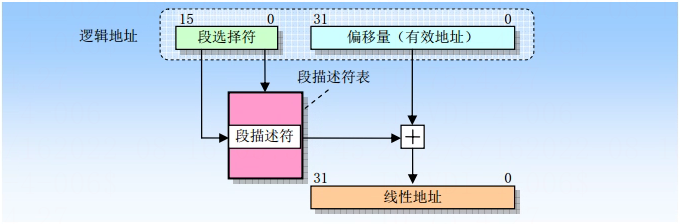
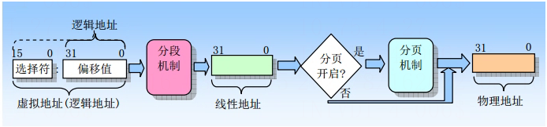
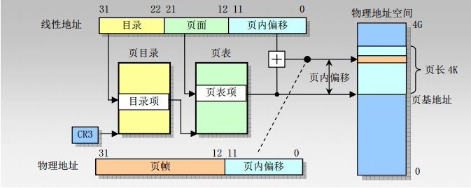

# 分段与分页机制

## 分段机制

### 什么是分段机制

分段机制就是把虚拟地址空间中的虚拟内存组织成一些长度可变的称为段的内存块单元。

### 什么是段

每个段由三个参数定义：段基地址、段限长和段属性。段的基地址、段限长以及段的保护属性存储在一个称为段描述符的结构项中。

### 段的作用

段可以用来存放程序的代码、数据和堆栈，或者用来存放系统数据结构。

### 段的存储地址

系统中所有使用的段都包含在处理器线性地址空间中。

### 段选择符

逻辑地址包括一个段选择符或一个偏移量，段选择符是一个段的唯一标识，提供了段描述符表，段描述符表指明短的大小、访问权限和段的特权级、段类型以及段的第一个字节在线性地址空间中的位置（称为段的基地址）。逻辑地址的偏移量部分到段的基地址上就可以定位段中某个字节的位置。因此基地址加上偏移量就形成了处理器线性地址空间中的地址。

### 逻辑地址到线性地址的变换过程

如果没有开启分页，那么处理器直接把线性地址映射到物理地址，即线性地址被送到处理器地址总线上；如果对线性地址空间进行了分页处理，那么就会使用二级地址转换把线性地址转换成物理地址。

### 虚拟地址到物理地址的变换过程

## 分页机制

### 什么是分页机制

分页机制在段机制之后进行的，它进一步将线性地址转换为物理地址。

### 分页机制的存储

分页机制支持虚拟存储技术，在使用虚拟存储的环境中，大容量的线性地址空间需要使用小块的物理内存（RAM 或 ROM）以及某些外部存储空间来模拟。当使用分页时，每个段被划分成页面（通常每页为 4K 大小），页面会被存储于物理内存中或硬盘中。

操作系统通过维护一个页目录和一些页表来留意这些页面。当程序（或任务）试图访问线性地址空间中的一个地址位置时，处理器就会使用页目录和页表把线性地址转换成一个物理地址，然后在该内存位置上执行所要求的操作。

### 线性地址和物理地址之间的变换过程

## 分段机制和分页机制的区别

1. 分页机制会使用大小固定的内存块，而分段管理则使用了大小可变的块来管理内存。
2. 分页使用固定大小的块更为适合管理物理内存，分段机制使用大小可变的块更适合处理复杂系统的逻辑分区。
3. 段表存储在线性地址空间，而页表则保存在物理地址空间。

## 分段分页优缺点

### 优点

1. 它减少了内存使用量。
2. 分页表大小受到分段大小的限制。
3. 分段表只有一个对应于一个实际分段的条目。
4. 外部碎片不存在。
5. 它简化了内存分配。

### 缺点

1. 内部碎片将在那里。
2. 与分页相比，分段复杂度要高得多。
3. 分页表需要连续存储在内存中。

---

---
