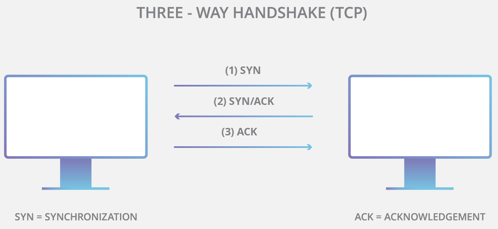
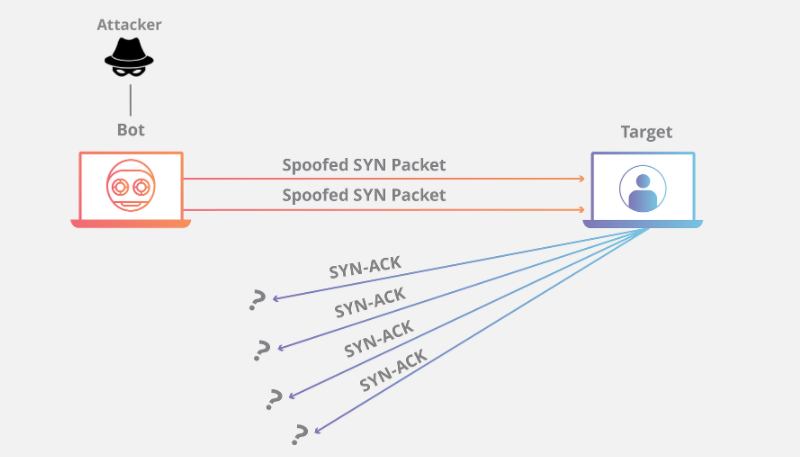

# SYN洪水攻击

SYN 洪水（半开连接攻击）是一种拒绝服务 (DDoS) 攻击，旨在耗尽可用服务器资源，致使服务器无法传输合法流量。通过重复发送初始连接请求 (SYN) 数据包，攻击者将可击垮目标服务器计算机上的所有可用端口，导致目标设备在响应合法流量时表现迟钝乃至全无响应。

## SYN洪水攻击如何工作

SYN 洪水攻击利用 TCP 连接的握手过程发动攻击。正常情况下，TCP 连接将完成三次握手以建立连接。

1. 首先，客户端向服务器发送 SYN 数据包以发起连接。
2. 接着，服务器通过 SYN/ACK 数据包对该初始数据包做出响应，以便确认通信。
3. 最后，客户端返回 ACK 数据包以确认接到服务器发出的数据包。完成这一系列数据包发送和接收操作后，TCP 连接将处于打开状态并且能够发送和接收数据。

为发起拒绝服务攻击，攻击者需利用这样一项事实：收到初始 SYN 数据包后，服务器将通过一个或多个 SYN/ACK 数据包做出回响，等待完成握手过程的最后一步。工作方式如下：

	1. 攻击者通常使用伪造的 IP 地址向目标服务器发送大量 SYN 数据包。
	2. 然后，服务器分别对每一项连接请求做出响应，并确保打开的端口做好接收响应的准备。
	3. 在服务器等待最后一个 ACK 数据包（永远不会到达）的过程中，攻击者将继续发送更多 SYN 数据包。每当有新的 SYN 数据包到达，服务器都会临时打开一个新的端口并在一段特定时间内保持连接；用遍所有可用端口后，服务器将无法正常运行。
	

	在网络中，如果服务器连接处于打开状态但另一端的机器连接未打开，则视为半开连接。在此类 DDoS 攻击中，目标服务器将使连接一直处于打开状态，静待各个连接超时，避免再次开放端口。因此，此类攻击可视为 “半开连接攻击”。

	## SYN攻击方式

	恶意用户可通过三种不同方式发起 SYN 洪水攻击：

		1. 直接攻击：不伪造 IP 地址的 SYN 洪水攻击称为直接攻击。在此类攻击中，攻击者完全不屏蔽其 IP 地址。由于攻击者使用具有真实 IP 地址的单一源设备发起攻击，因此很容易发现并清理攻击者。为使目标机器呈现半开状态，黑客将阻止个人机器对服务器的 SYN-ACK 数据包做出响应。为此，通常采用以下两种方式实现：部署防火墙规则，阻止除 SYN 数据包以外的各类传出数据包；或者，对传入的所有 SYN-ACK 数据包进行过滤，防止其到达恶意用户机器。实际上，这种方法很少使用（即便使用过也不多见），因为此类攻击相当容易缓解 – 只需阻止每个恶意系统的 IP 地址。哪怕攻击者使用僵尸网络（如 Mirai 僵尸网络），通常也不会刻意屏蔽受感染设备的 IP。
		2. 欺骗攻击：恶意用户还可以伪造其发送的各个 SYN 数据包的 IP 地址，以便阻止缓解措施并加大身份暴露难度。虽然数据包可能经过伪装，但还是可以通过这些数据包追根溯源。此类检测工作很难开展，但并非不可实现；特别是，如果 Internet 服务提供商 (ISP) 愿意提供帮助，则更容易实现。
		3. 分布式攻击（DDoS）：如果使用僵尸网络发起攻击，则追溯攻击源头的可能性很低。随着混淆级别的攀升，攻击者可能还会命令每台分布式设备伪造其发送数据包的 IP 地址。哪怕攻击者使用僵尸网络（如 Mirai 僵尸网络），通常也不会刻意屏蔽受感染设备的 IP。恶意用户可以通过 SYN 洪水攻击尝试在目标设备或服务中创建拒绝服务，其流量远低于其他 DDoS 攻击。SYN 攻击不属于容量耗尽攻击，其目的并非使目标周围的网络基础设施达到饱和，只需保证大于目标操作系统的可用积压工作即可。如果攻击者能够确定积压工作规模以及每个连接保持打开状态的时间长度（超出时间将进入超时状态），攻击者将可以找出禁用系统所需的确切参数，从而将创建拒绝服务所需的总流量降至最低。

	## 如何缓解SYN洪水攻击

	SYN 洪水漏洞早已为世人所知，而且开创了大量缓解方法。其中一些方法包括：

	### 扩展积压工作队列

	目标设备安装的每个操作系统都允许具有一定数量的半开连接。若要响应大量 SYN 数据包，一种方法是增加操作系统允许的最大半开连接数目。为成功扩展最大积压工作，系统必须额外预留内存资源以处理各类新请求。如果系统没有足够的内存，无法应对增加的积压工作队列规模，将对系统性能产生负面影响，但仍然好过拒绝服务。

	### 回收最先创建的 TCP 半开连接

	另一种缓解策略是在填充积压工作后覆盖最先创建的半开连接。这项策略要求完全建立合法连接的时间低于恶意 SYN 数据包填充积压工作的时间。当攻击量增加或积压工作规模小于实际需求时，这项特定的防御措施将不奏效。

	### SYN Cookie

	此策略要求服务器创建 Cookie。为避免在填充积压工作时断开连接，服务器使用 SYN-ACK 数据包响应每一项连接请求，而后从积压工作中删除 SYN 请求，同时从内存中删除请求，保证端口保持打开状态并做好重新建立连接的准备。如果连接是合法请求并且已将最后一个 ACK 数据包从客户端机器发回服务器，服务器将重建（存在一些限制）SYN 积压工作队列条目。虽然这项缓解措施势必会丢失一些 TCP 连接信息，但好过因此导致对合法用户发起拒绝服务攻击。
