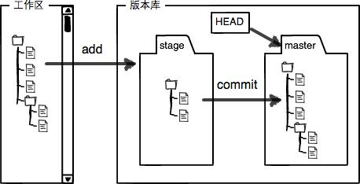

# Git工作区和暂存区

## Git工作区和暂存区

工作区（Working Directory） 就是你在电脑里能看到的目录。而版本库（Repository），工作区有一个隐藏目录 .git，这个不算工作区，而是 **[Git](https://haicoder.net/git/git-tutorial.html)** 的版本库。

Git 的版本库里存了很多东西，其中最重要的就是称为 stage（或者叫 index）的暂存区，还有 Git 为我们自动创建的第一个分支 master，以及指向 master 的一个指针叫 HEAD。

我们知道把文件往 Git 版本库里添加的时候，是分两步执行的：

1. 第一步是用 git add 把文件添加进去，实际上就是把文件修改添加到暂存区；
2. 第二步是用 git commit 提交更改，实际上就是把暂存区的所有内容提交到当前分支。

你可以简单理解为，需要提交的文件修改通通放到暂存区，然后，一次性提交暂存区的所有修改。
