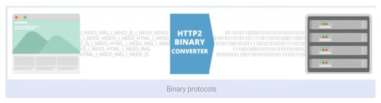
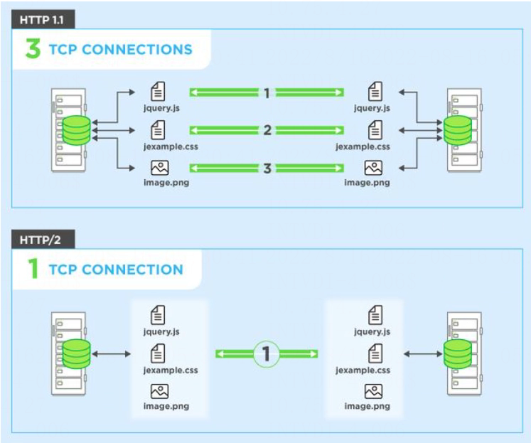
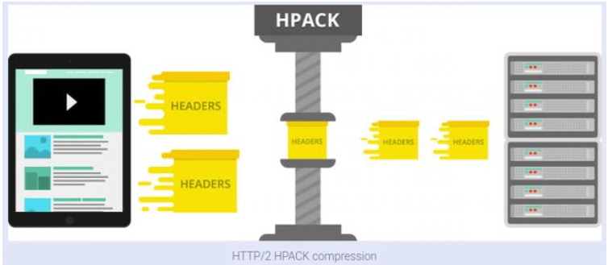
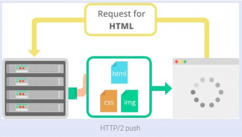

# HTTP1.0与HTTP2.0区别

## 什么是HTTP 2.0

HTTP/2（超文本传输协议第 2 版，最初命名为 HTTP 2.0），是 **[HTTP 协议](https://haicoder.net/http/http-tutorial.html)** 的的第二个主要版本，使用于万维网。HTTP/2 是 HTTP 协议自 1999 年 HTTP 1.1 发布后的首个更新，主要基于 SPDY 协议（是 Google 开发的基于 TCP 的应用层协议，用以最小化网络延迟，提升网络速度，优化用户的网络使用体验）。

## HTTP2.0与HTTP1.1区别

与 HTTP 1.1 相比，主要区别包括：

- HTTP/2 采用二进制格式而非文本格式。
- HTTP/2 是完全多路复用的，而非有序并阻塞的——只需一个连接即可实现并行。
- 使用报头压缩，HTTP/2 降低了开销。
- HTTP/2 让服务器可以将响应主动 “推送” 到客户端缓存中。

## 二进制协议

最新的 HTTP 版本在功能和属性（例如从文本协议转换为二进制协议）方面已经有了重大发展。 HTTP1.x 用于处理文本命令以完成请求-响应周期。 HTTP / 2 将使用二进制命令（分别为 1s 和 0s）执行相同的任务。 此属性减轻了框架的复杂性，并简化了由于包含文本和可选空格的命令而导致混淆的命令的实现。

使用 HTTP / 2 实现的浏览器会将相同的文本命令转换为二进制命令，然后再通过网络进行传输。

## 请求多路复用

HTTP/1.x 有个问题叫线端阻塞(head-of-line blocking), 它是指一个连接(connection)一次只提交一个请求的效率比较高, 多了就会变慢。 HTTP/1.1 试过用流水线(pipelining)来解决这个问题, 但是效果并不理想(数据量较大或者速度较慢的响应, 会阻碍排在他后面的请求)。

此外, 由于网络媒介(intermediary )和服务器不能很好的支持流水线, 导致部署起来困难重重。而多路传输(Multiplexing)能很好的解决这些问题, 因为它能同时处理多个消息的请求和响应; 甚至可以在传输过程中将一个消息跟另外一个掺杂在一起。所以客户端只需要一个连接就能加载一个页面。

这样可以减少额外的往返时间（RTT），使您的网站加载速度更快，而无需进行任何优化，并且不需要域分片。

## 标头压缩

HTTP / 2压缩大量冗余头帧。 它使用 HPACK 规范作为标头压缩的简单安全方法。 客户端和服务器都维护在先前的客户端-服务器请求中使用的标头列表。

HPACK 在将每个标头传输到服务器之前先压缩每个标头的单独值，然后服务器在先前传输的标头值列表中查找编码信息，以重建完整的标头信息。

## HTTP/2服务器推送

此功能使服务器可以向客户端发送其他未缓存的信息，但这些信息会在以后的请求中得到预期。 例如，如果客户端请求资源 X，并且可以理解资源 Y 被请求的文件引用，则服务器可以选择将 Y 与 X 一起推送，而不是等待适当的客户端请求。

