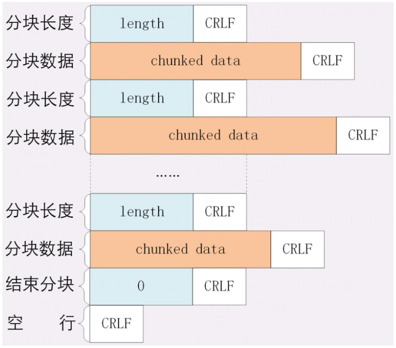

# HTTP协议之chunk编码(分块传输编码)

> GitHub 仓库源文件：[点击打开网页渲染版](https://github.com/ben2023niao/ben-ops-notes/blob/main/doc/md/202304141557-%E5%AE%89%E5%85%A8%E4%B8%8E%E5%A0%A1%E5%9E%92%E6%9C%BA%2B%E9%AB%98%E7%BA%A7%E5%AE%89%E5%85%A8%2B%E7%9F%A5%E8%AF%86%E7%AC%94%E8%AE%B0-HTTP%E5%8D%8F%E8%AE%AE%E4%B9%8Bchunk%E7%BC%96%E7%A0%81%28%E5%88%86%E5%9D%97%E4%BC%A0%E8%BE%93%E7%BC%96%E7%A0%81%29.md)

分块传输编码（Chunked transfer encoding）是超文本传输协议（HTTP）中的一种数据传输机制，允许 HTTP 由应用服务器发送给客户端应用（ 通常是网页浏览器）的数据可以分成多个部分。分块传输编码只在 HTTP 协议 1.1 版本（HTTP/1.1）中提供。

通常，HTTP 应答消息中发送的数据是整个发送的，Content-Length 消息头字段表示数据的长度。数据的长度很重要，因为客户端需要知道哪里是应答消息的结束，以及后续应答消息的开始。然而，使用分块传输编码，数据分解成一系列数据块，并以一个或多个块发送，这样服务器可以发送数据而不需要预先知道发送内容的总大小。通常数据块的大小是一致的，但也不总是这种情况。

## HTTP分块传输编码好处

HTTP 1.1 引入分块传输编码提供了以下几点好处：

1. HTTP 分块传输编码允许服务器为动态生成的内容维持 HTTP 持久连接。通常，持久链接需要服务器在开始发送消息体前发送 Content-Length 消息头字段，但是对于动态生成的内容来说，在内容创建完之前是不可知的。（动态内容，content-length 无法预知）
2. 分块传输编码允许服务器在最后发送消息头字段。对于那些头字段值在内容被生成之前无法知道的情形非常重要，例如消息的内容要使用散列进行签名，散列的结果通过 HTTP 消息头字段进行传输。没有分块传输编码时，服务器必须缓冲内容直到完成后计算头字段的值并在发送内容前发送这些头字段的值。（散列签名，需缓冲完成才能计算）
3. HTTP 服务器有时使用压缩 （gzip 或 deflate）以缩短传输花费的时间。分块传输编码可以用来分隔压缩对象的多个部分。在这种情况下，块不是分别压缩的，而是整个负载进行压缩，压缩的输出使用本文描述的方案进行分块传输。在压缩的情形中，分块编码有利于一边进行压缩一边发送数据，而不是先完成压缩过程以得知压缩后数据的大小。（gzip压缩，压缩与传输同时进行）

## HTTP分块传输详解

分块就是把数据分成一块一块的再发送出去，浏览器收到后再组装起来，这种 “化整为零” 的思路在 HTTP 协议里就是 “chunked” 分块传输编码，在响应报文里用头字段 “Transfer-Encoding: chunked” 来表示，意思是报文里的 body 部分不是一次性发过来的，而是分成了许多的块（chunk）逐个发送。

分块传输也可以用于 “流式数据”，例如由数据库动态生成的表单页面，这种情况下 body 数据的长度是未知的，无法在头字段 “Content-Length” 里给出确切的长度，所以也只能用 chunked 方式分块发送。

“Transfer-Encoding: chunked” 和 “Content-Length” 这两个字段是互斥的，也就是说响应报文里这两个字段不能同时出现，一个响应报文的传输要么是长度已知，要么是长度未知（chunked），这一点你一定要记住。

下面我们来看一下分块传输的编码规则，其实也很简单，同样采用了明文的方式，很类似响应头。

1.每个分块包含两个部分，长度头和数据块；

2.长度头是以 CRLF（回车换行，即\r\n）结尾的一行明文，用 16 进制数字表示长度；

3.数据块紧跟在长度头后，最后也用 CRLF 结尾，但数据不包含 CRLF；

4.最后用一个长度为 0 的块表示结束，即 “0\r\n\r\n”。

## 范围请求

有了分块传输编码，服务器就可以轻松地收发大文件了，但对于上 G 的超大文件，还有一些问题需要考虑。比如，你在看当下正热播的某穿越剧，想跳过片头，直接看正片，或者有段剧情很无聊，想拖动进度条快进几分钟，这实际上是想获取一个大文件其中的片段数据，而分块传输并没有这个能力。

“范围请求（range requests）的概念，允许客户端在请求头里使用专用字段来表示只获取文件的一部分。服务器会发送专用字段 Accept-Ranges: bytes” 明确告知客户端：“我是支持范围请求的”，范围请求不是 Web 服务器必备的功能，可以实现也可以不实现。

如果不支持的话该怎么办呢？服务器可以发送 “Accept-Ranges: none”，或者干脆不发送 “Accept-Ranges” 字段，这样客户端就认为服务器没有实现范围请求功能，只能老老实实地收发整块文件了。

客户端会发送 Range 请求字段，格式是 “bytes=x-y”，其中 x 和 Y 是以字节为单位的数据范围。Range 的格式也很灵活，起点 x 和终点 y 可以省略，能够很方便地表示正数或者倒数的范围。

假设文件是 100 个字节，那么：

- “0-” 表示从文档起点到文档终点，相当 于 “0-99”，即整个文件；
- “10-” 是从第 10 个字节开始到文档末尾，相当于 “10-99”；
- “-1” 是文档的最后一个字节，相当于 “99-99”；
- “-10” 是从文档末尾倒数 10 个字节，相当于 “90-99”。

例如客户端请求：

`GET /16-2 HTTP/1.1

Host: www.haicoder.net

Range: bytes=0-31`

服务端响应：

`HTTP/1.1 206 Partial Content

Content-Length: 32

Accept-Ranges: bytes

Content-Range: bytes 0-31/96`

服务端收到 Range 字段后，要做 4 件事：

1. 检查范围是否合法。
2. 范围合法的话，计算偏移量，读取文件的片段，返回状态码 “206 Partial Content”，和 200 的意思差不多，但表示 body 只是原数据的一部分。
3. 添加响应头字段 Content-Range，告诉片段的实际偏移量和资源的总大小。
4. 发送数据。
