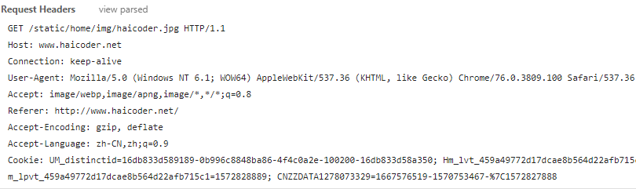
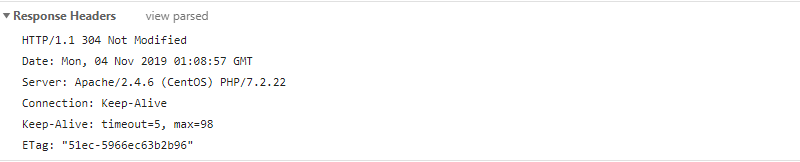

# HTTP请求与响应

## HTTP请求与响应教程

**[HTTP协议](https://haicoder.net/postman/http-synopsis.html)** 采用了请求/响应模型。

## HTTP请求

客户端发送一个 HTTP 请求到服务器的请求消息包括请求行、请求头、空行和请求数据几部分组成，如下图所示：

### 请求行

请求行，用来说明请求类型，要访问的资源以及所使用的HTTP版本。

GET 说明这次 HTTP 请求的类型为 GET，`/static/home/img/haicoder.jpg` 为要访问的资源，该行的最后一部分 `HTTP/1.1` 说明使用的是 HTTP1.1 版本。

### 请求头

从第二行起为请求头部，HOST 将指出请求的目的地。User-Agent，服务器端和客户端脚本都能访问它，它是浏览器类型检测逻辑的重要基础。该信息由你的浏览器来定义，并且在每个请求中自动发送。

### 空行

即使第四部分的请求数据为空，也必须有空行。

### 请求数据

这里的请求数据为空。

## HTTP响应

一般情况下，服务器接收并处理客户端发过来的请求后会返回一个 HTTP 的响应消息。HTTP 响应也由四个部分组成，分别是：状态行、消息报头、空行和响应正文，如下图所示：

### 状态行

状态行，由HTTP协议版本号， 状态码， 状态消息三部分组成。

第一行为状态行，`HTTP/1.1` 表明 HTTP 版本为 1.1 版本，状态码为 304，状态消息为 Not Modified。

### 消息报头

消息报头，用来说明客户端要使用的一些附加信息。

### 空行

空行，消息报头后面的空行是必须的。

### 响应正文

这是的响应正文为空。

## HTTP请求与响应总结

**HTTP协议** 采用了请求/响应模型。

HTTP请求由请求行、请求头、空行和请求数据几部分组成，HTTP响应由状态行、消息报头、空行和响应正文几部分组成。
