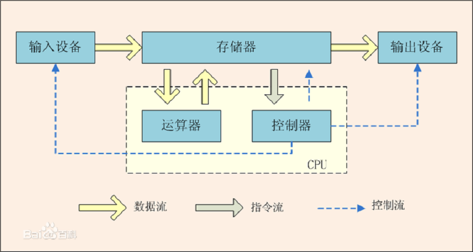

# IO密集型与CPU密集型

## IO密集型与CPU密集型教程

### 计算机结构回顾

首先回顾下计算机结构知识，如下图

运算器与控制器又被称为中央处理器，即 CPU(Center Process Unit)。存储器又可分为内存与外存。

CPU、存储器、输入(I)、输出(O)设备等接口设备均通过系统总线连接在一起。其实，系统总线(Bus)，就可以粗略地理解为总线就是主板好了。在总线上一般有两个独立的单元不常在计算机原理中提及到，就是南、北桥芯片。

北桥芯片，离 CPU 最近，一般都贴有散热片，也称为主桥芯片(Host Bridge)，一般来说，芯片组的命名就是以北桥芯片的名称来命名的。主要负责总线上的高速设备比如 AGP、PCI-e、内存等与 CPU 的数据高速交换。

南桥芯片，相对北桥芯片，离 CPU 较远，一般不会贴散热片。主要负责中低速外部设备比如 USB、PCI、IDE、Sata、网卡等，芯片中集成了中断控制器、DMA 控制器。

由此可见，负责给 CPU 提供数据的在总线上，还有两个管家，一个大内总管(北桥)，一个外掌柜(南桥)。

## IO密集型

网卡、硬盘都由南桥芯片控制，并属于中、低速设备，所以，在服务器上进行网络通讯、网络传输、磁盘读写均受南桥控制，此类即为 IO 操作。

IO 密集型服务/业务即是以网络请求压力大、磁盘读写频繁的操作类型，当进行这些 IO 密集型操作时，CPU 的负载相对较低(现代计算机均集成了对硬件访问控制的操作逻辑，使得 CPU 从这些操作中解放出来，提高核心资源的利用率)。

## CPU密集型

计算密集型，可以理解为在北桥芯片与 CPU 之间的通讯较高的服务/业务，往往这类操作常见的都是以计算为主的，而计算又是 CPU/GPU 的专长。

对于服务器，通过开发的服务或是业务，可以在项目之初就根据需求来对资源进行预先估算，大致属于 IO 密集型还是计算密集型的业务，并进行项目前期的资源预算等工作的开展，也包括前期的设计和后期的优化。

## 优化

项目立项过程中，根据需求对应的资源负载类型，提出对服务资源的需求配置。

- IO 密集型的需求，一般来说，如果是磁盘读写频繁，通过对磁盘进行升级，提高磁盘的响应速度和传输效率或通过负载技术，将文件读写分散到多台服务器中。如果是网络请求负载较高，可以通过负载均衡技术，水平扩展服务，提高负载能力。或使用代理缓存服务器，降低核心服务的负载压力。
- 计算密集型的需求，首先可以考虑使用计算能力更好的 CPU，然后考虑通过消息队列或其它降维算法，将计算分散的不同的计算结点，进行处理。

项目开发时，进行合理的规划和业务开发。

- 对于 IO 密集型的需求，在开发过程中，就要考虑尽可能减少 IO 开销，对磁盘读写频繁的业务，可以考虑通过内存缓存将热数据缓存起来，减少磁盘的请求。
- 对于计算密集型的需求，在开发过程中，需要注意计算算法的优化及结果重用，并尽可能进行降维处理，比如通过某种算法将原业务需求的计算分散成可拆分的逻辑，并分散计算进行结果求解，最后进行组合(很像现在大数据处理里的一些模式，可以参考)，或通过消息队列将大量的计算请求分发到其它的计算结点上去。

## 线程选型

CPU 密集型线程的作用是进行无阻塞的逻辑运算的线程。比如：RPG 游戏中的游戏逻辑服务器(也叫地图服务器)里面的主逻辑线程，这个主逻辑线程需要进行大量的无阻塞的逻辑处理。当被操作系统内核调度的时候，这个线程就在给定的 CPU 执行时间内进行无阻塞的操作。如果这个游戏逻辑服务器还创建更多的线程来进行逻辑操作的话，这样的行为是得不尝失的。因为，本进程的线程越多，而本进程获取的 CPU 执行时间又是固定的，导致了进程内每个线程的执行时间很短。所以，像游戏逻辑服务器中的线程应该属于 CPU 密集型线程。所以线程不宜过多。

而 IO 密集型线程是针对于 IO 操作比 CPU 计算操作占用更多的 CPU 时间来说的。比如：数据库服务器，这个服务器中的线程的职责就是进行阻塞的 IO 操作。当线程因为 IO 阻塞而进入阻塞状态后，该线程的调度被操作系统内核立即停止，不再占用 CPU 时间片段，而其他 IO 线程能立即被操作系统内核调度，等 IO 阻塞操作完成后，原来阻塞状态的线程重新变成就绪状态，而可以被操作系统调度。所以，像数据库服务器中的 IO 密集型线程来说，线程的数量就应该适量的多点。

### 线程选型说明

1. 待处理的数据离 CPU 越近，处理越快。
2. 启动线程数 = [ 任务执行时间 / ( 任务执行时间 - IO等待时间 ) ] x CPU内核数。
3. 最佳启动线程数和 CPU 内核数量成正比，和 IO 阻塞时间成反比。
4. 如果 CPU 计算密集型任务，那么线程数最多不超过 CPU 内核数，因为启动再多线程，CPU 也来不及调度； 相反如果是任务需要等待磁盘操作（即 IO 密集型），网络响应，那么多启动线程有助于提高任务并发度，提高系统吞吐能力，改善系统性能。
