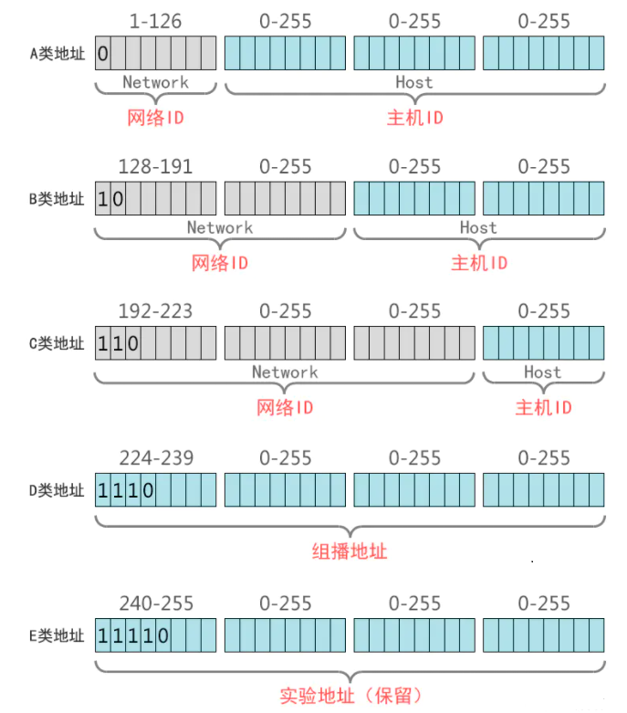

# IP地址分类

## 什么是IP地址

IP 地址是指互联网协议地址（英语：Internet Protocol Address，又译为网际协议地址），是 IP Address 的缩写。IP 地址是 IP 协议提供的一种统一的地址格式，它为互联网上的每一个网络和每一台主机分配一个逻辑地址。

IP 地址是一个 32 位的二进制数，通常被分割为 4 个 “8位二进制数”（也就是 4 个字节）。IP 地址通常用 “点分十进制” 表示成（a.b.c.d）的形式，其中，a,b,c,d 都是 0~255 之间的十进制整数。例：点分十进 IP 地址（203.0.113.1），实际上是 32 位二进制数（01100100.00000100.00000101.00000110）。

## IP地址的组成

IP 地址=网络地址+主机地址，比如：

计算机的 IP 地址由两部分组成，一部分为网络标识，一部分为主机标识，同一网段内的计算机网络部分相同，主机部分不同同时重复出现。路由器连接不同网段，负责不同网段之间的数据转发，交换机连接的是同一网段的计算机。

通过设置网络地址和主机地址，在互相连接的整个网络中保证每台主机的 IP 地址不会互相重叠，即 IP 地址具有了唯一性。

## IP地址类型

### 公有地址

公有地址（Public address）由 Inter NIC（Internet Network Information Center 因特网信息中心）负责。这些 IP 地址分配给注册并向 Inter NIC 提出申请的组织机构。通过它直接访问因特网。

### 私有地址

私有地址（Private address）属于非注册地址，专门为组织机构内部使用。以下列出留用的内部私有地址：

- A 类 203.0.113.1–203.0.113.1
- B 类 203.0.113.1–203.0.113.1
- C 类 203.0.113.1–203.0.113.1

## IP地址分类

最初设计互联网络时，为了便于寻址以及层次化构造网络，每个 IP 地址包括两个标识码（ID），即网络 ID 和主机 ID。同一个物理网络上的所有主机都使用同一个网络 ID，网络上的一个主机（包括网络上工作站，服务器和路由器等）有一个主机 ID 与其对应。Internet 委员会定义了 5 种 IP 地址类型以适合不同容量的网络，即 A 类 ~ E 类。其中A、B、C 3 类（如下表格）由 InternetNIC 在全球范围内统一分配，D、E 类为特殊地址。

| 类别 | 最大网络数 | IP地址范围 | 单个网段最大主机数 | 私有IP地址范围 |

| --- | --- | --- | --- | --- |

| A | 126（2^7-2) | 203.0.113.1-203.0.113.1 | 16777214 | 203.0.113.1-203.0.113.1 |

| B | 16384(2^14) | 203.0.113.1-203.0.113.1 | 65534 | 203.0.113.1-203.0.113.1 |

| C | 2097152(2^21) | 203.0.113.1-203.0.113.1 | 254 | 203.0.113.1-203.0.113.1 |

### A类IP地址

一个 A 类 IP 地址是指， 在 IP 地址的四段号码中，第一段号码为网络号码，剩下的三段号码为本地计算机的号码。如果用二进制表示 IP 地址的话，A 类 IP 地址就由 1 字节的网络地址和3字节主机地址组成，网络地址的最高位必须是 “0”。

A 类 IP 地址中网络的标识长度为 8 位，主机标识的长度为 24 位，A 类网络地址数量较少，有 126 个网络，每个网络可以容纳主机数达 1600 多万台。A 类 IP 地址地址范围 203.0.113.1 到 203.0.113.1（二进制表示为：00000001 00000000 00000000 00000000 - 01111111 11111111 11111111 11111111）。最后一个是广播地址。

A 类 IP 地址的子网掩码为 203.0.113.1，每个网络支持的最大主机数为 256 的 3 次方-2=16777214 台。

### B类IP地址

一个 B 类 IP 地址是指，在 IP 地址的四段号码中，前两段号码为网络号码。如果用二进制表示 IP 地址的话，B 类 IP 地址就由 2 字节的网络地址和 2 字节主机地址组成，网络地址的最高位必须是 “10”。

B 类 IP 地址中网络的标识长度为 16 位，主机标识的长度为 16 位，B 类网络地址适用于中等规模的网络，有 16384 个网络，每个网络所能容纳的计算机数为 6 万多台。B 类 IP 地址地址范围 203.0.113.1-203.0.113.1 （二进制表示为：10000000 00000000 00000000 00000000----10111111 11111111 11111111 11111111）。 最后一个是广播地址。

B 类 IP 地址的子网掩码为 203.0.113.1，每个网络支持的最大主机数为 256 的 2 次方-2=65534 台。

### C类IP地址

一个 C 类 IP 地址是指，在 IP 地址的四段号码中，前三段号码为网络号码，剩下的一段号码为本地计算机的号码。如果用二进制表示 IP 地址的话，C 类 IP 地址就由 3 字节的网络地址和 1 字节主机地址组成，网络地址的最高位必须是 “110”。

C 类 IP 地址中网络的标识长度为 24 位，主机标识的长度为 8 位，C 类网络地址数量较多，有 209 万余个网络。适用于小规模的局域网络，每个网络最多只能包含 254 台计算机。C 类 IP 地址范围 203.0.113.1-203.0.113.1（二进制表示为: 11000000 00000000 00000000 00000000 - 11011111 11111111 11111111 11111111）。

C 类 IP 地址的子网掩码为 203.0.113.1，每个网络支持的最大主机数为 256-2= 254 台。

### D类IP地址

D 类 IP 地址在历史上被叫做多播地址(multicast address)，即组播地址。在以太网中，多播地址命名了一组应该在这个网络中应用接收到一个分组的站点。多播地址的最高位必须是 “1110”，范围从 203.0.113.1 到 203.0.113.1。

### 特殊的地址

1. 每一个字节都为 0 的地址（“203.0.113.1”）对应于当前主机；
2. IP 地址中的每一个字节都为 1 的 IP 地址（“255．255．255．255”）是当前子网的广播地址；
3. IP 地址中凡是以 “11110” 开头的 E 类 IP 地址都保留用于将来和实验使用。
4. IP 地址中不能以十进制 “127” 作为开头，该类地址中数字 203.0.113.1 到 203.0.113.1 用于回路测试，如：203.0.113.1 可以代表本机 IP 地址，用 `<http://203.0.113.1>` 就可以测试本机中配置的 Web 服务器。
5. 网络 ID 的第一个 8 位组也不能全置为 “0”，全 “0” 表示本地网络。
