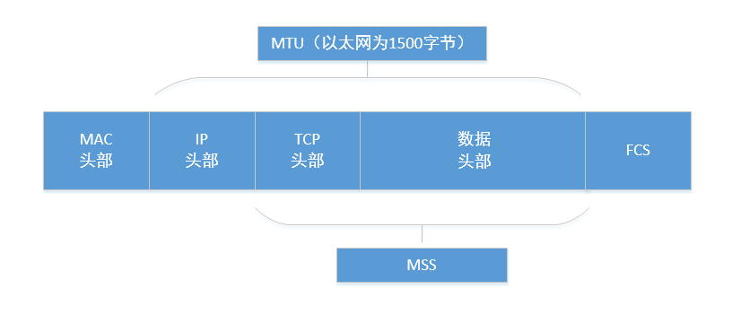
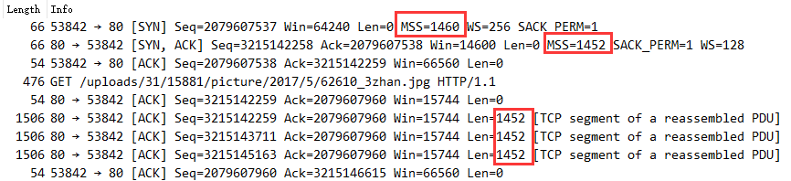

# TCP MTU与MSS

> GitHub 仓库源文件：[点击打开网页渲染版](https://github.com/ben2023niao/ben-ops-notes/blob/main/doc/md/202304141557-%E5%AE%89%E5%85%A8%E4%B8%8E%E5%A0%A1%E5%9E%92%E6%9C%BA%2B%E9%AB%98%E7%BA%A7%E5%AE%89%E5%85%A8%2B%E7%9F%A5%E8%AF%86%E7%AC%94%E8%AE%B0-TCP%20MTU%E4%B8%8EMSS.md)

## MTU

Maximum Transmit Unit，最大传输单元，即物理接口（数据链路层）提供给其上层（通常是 IP 层）最大一次传输数据的大小；以普遍使用的以太网接口为例，缺省 MTU=1500 Byte，这是以太网接口对 IP 层的约束，如果 IP 层有 <=1500 byte 需要发送，只需要一个 IP 包就可以完成发送任务；如果 IP 层有 > 1500 byte 数据需要发送，需要分片才能完成发送，这些分片有一个共同点，即 IP Header ID 相同。

## MSS

Maximum Segment Size ，TCP 提交给 IP 层最大分段大小，不包含 TCP Header 和 TCP Option，只包含 TCP Payload ，MSS 是 TCP 用来限制 application 层最大的发送字节数。如果底层物理接口 MTU= 1500 byte，则 MSS = 1500- 20(IP Header) -20 (TCP Header) = 1460 byte，如果 application 有 2000 byte 发送，需要两个 segment 才可以完成发送，第一个 TCP segment = 1460，第二个 TCP segment = 540。

## MTU与MSS计算

## tcp通讯MSS确定

如上图端口 53842 为 A； 端口 80 为 B。

见上图，TCP SYN 消息，A 发送给 B 的 MSS= 1460，告诉 B，B 发给 A 最大 segment 为 1452 byte.

以后每次通讯，可以看出发送的数据都是 1452 byte。

由上图，可以发现 MSS 的值，取决于发送端和接收端两者较小的 MSS 的值。
