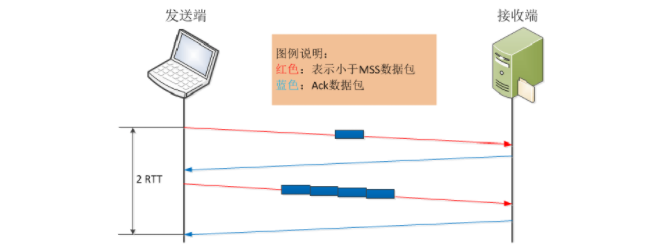
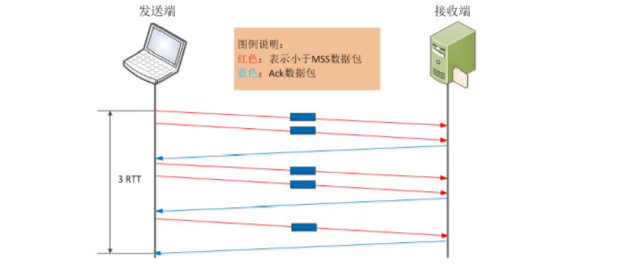
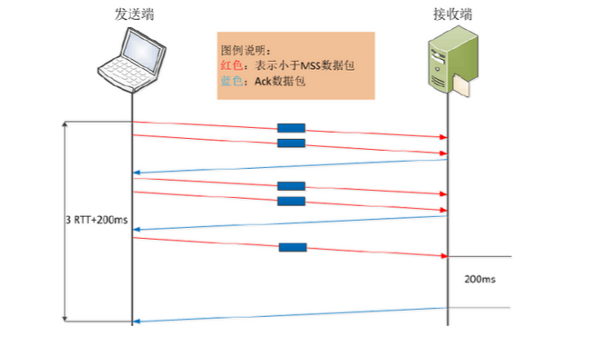
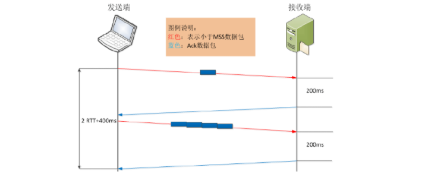
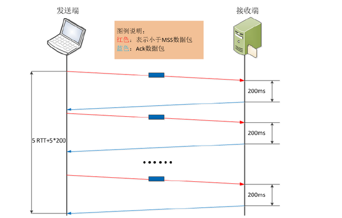

# TCP Nagle算法

> GitHub 仓库源文件：[点击打开网页渲染版](https://github.com/ben2023niao/ben-ops-notes/blob/main/doc/md/202304141557-%E5%AE%89%E5%85%A8%E4%B8%8E%E5%A0%A1%E5%9E%92%E6%9C%BA%2B%E9%AB%98%E7%BA%A7%E5%AE%89%E5%85%A8%2B%E7%9F%A5%E8%AF%86%E7%AC%94%E8%AE%B0-TCP%20Nagle%E7%AE%97%E6%B3%95.md)

TCP/IP 协议中，无论发送多少数据，总是要在数据前面加上协议头，同时，对方接收到数据，也需要发送 ACK 表示确认。为了尽可能的利用网络带宽，TCP 总是希望尽可能的发送足够大的数据。（一个连接会设置 MSS 参数，因此，TCP/IP 希望每次都能够以 MSS 尺寸的数据块来发送数据）。

Nagle 算法就是为了尽可能发送大块数据，避免网络中充斥着许多小数据块。（减少大量小包的发送）

Nagle 算法的基本定义是任意时刻，最多只能有一个未被确认的小段。所谓 “小段”，指的是小于 MSS 尺寸的数据块，所谓 “未被确认”，是指一个数据块发送出去后，没有收到对方发送的 ACK 确认该数据已收到。

## Nagle算法规则

Nagle 算法的规则（可参考 tcp_output.c 文件里 tcp_nagle_check 函数注释）：

1. 如果包长度达到 MSS，则允许发送；
2. 如果该包含有 FIN，则允许发送；
3. 设置了 TCP_NODELAY 选项，则允许发送；
4. 未设置 TCP_CORK 选项时，若所有发出去的小数据包（包长度小于 MSS）均被确认，则允许发送；
5. 上述条件都未满足，但发生了超时（一般为 200ms），则立即发送。

Nagle 算法只允许一个未被 ACK 的包存在于网络，它并不管包的大小，因此它事实上就是一个扩展的停-等协议（停止等待 ARQ 协议），只不过它是基于包停-等的，而不是基于字节停-等的。

Nagle 算法完全由 TCP 协议的 ACK 机制决定，这会带来一些问题，比如如果对端 ACK 回复很快的话，Nagle 事实上不会拼接太多的数据包，虽然避免了网络拥塞，网络总体的利用率依然很低。

## Nagle算法的应用场景

在 Nagle 算法的 Wiki 主页，有这么一段话：

`In general, since Nagle's algorithm is only a defense against careless applications, it will not benefit a carefully written application that takes proper care of buffering; the algorithm has either no effect, or negative effect on the application.`

可见编程模型对 “减少网络上小包数量” 的影响，言外之意，Nagle 算法是个有针对性的优化-针对交互式应用，不是放之四海而皆准的标准，要想有一个比较好的方案，别指望它了，还是应用程序自己搞定才是正解！要想 Nagle 算法真的能够减少网络上小包数量而又不引入明显延迟，对 TCP 数据的产生方式是有要求的，交互式应用是其初始针对的对象，Nagle 算法要求数据必须是 “乒乓型” 的，也就是说，数据流有明确的边界且一来一回，类似人机交互的那种，比如 telnet 这种远程终端登录程序，数据是人从键盘敲入的，边界基本上就是击键，一来一回就是输入回显和处理回显。

Nagle 算法在上面的场景中保证了下一个小包发送之前，所有发出的包已经得到了确认，再次我们看到，Nagle 算法并没有阻止发送小包，它只是阻止了发送大量的小包。

换句话说，所谓的 “乒乓型” 模式就是 “write-read-write-read” 模式-人机交互模式，但是对于 Wiki 中指出的 “write-write-read”(很多的 request/response 模式 C/S 服务就是这样的，比如 HTTP)-程序交互模式，Nagle 算法和延迟 ACK（延迟确认机制）拔河的恶果就会被放大。

Nagle 算法对于数据来自于 user input 的那种应用是有效的，但是对于数据 generated by applications using stream oriented protocols，Nagle 算法纯粹引入了延迟，这个观点我非常赞同，因为对于人而言，TCP 登录俄远程计算机就是一个处理机，人希望自己的操作马上展示结果，其模式就是 write-read-write-read 的，但是对于程序而言，其数据产生逻辑就不像人机交互那么固定，因此你就不能假定程序依照任何序列进行网络 IO，而 Nagle 算法是和数据 IO 的序列相关的。

实际上就算接收端没有启用延迟 ACK，Nagle 算法应用于 write-write-read 序列也是有问题的，作者的意思是，平白无故地引入了额外的延迟。

难道真的有这么复杂吗？作者没有提出如何靠编程把问题解决，但是 Nagle 算法的 Wiki 页面上提到了 ”尽量编写好的代码而不要依赖 TCP 内置的所谓的算法“ 来优化 TCP 的行为。

## TCP_NODELAY套接字选项

默认情况下，发送数据采用 Negle 算法。这样虽然提高了网络吞吐量，但是实时性却降低了，在一些交互性很强的应用程序来说是不允许的，使用 TCP_NODELAY 选项可以禁止 Negale 算法。

## 延迟确认机制（TCP delayed acknowledgment）

1989 RFC 1122 定义，全名 Delayed Acknowledgment，简称延迟 ACK，翻译为延迟确认。 与 Nagle 算法一样，延迟 ACK 的目的也是为了减少网络中传输大量的小报文数，但该报文数是针对 ACK 报文的。

一个来自发送端的报文到达接收端，TCP 会延迟 ACK 的发送，希望应用程序会对刚刚收到的数据进行应答，这样就可以用新数据将 ACK 捎带过去。

## 当Nagle算法遇到Delayed ACK

在一个有数据传输的 TCP 连接中，如果只有数据发送方启用 Nagle 算法，在其连续发送多个小报文时，Nagle 算法机制会减少网络中的小报文数量。这就意味着，同样传输相同大小的应用数据，在网络上的报文个数却不同。

举个例子，发送端需要连续发送 5 个写操作（应用程序将数据写入到缓冲池的动作）的小报文，首先发送第一个，由于 Nagle 算法的作用，在未收到第一个报文确认前，发送端在等待写操作的同时进行读操作，接收端并未启用延迟确认（视 TCP delay ACK 时间为 0），尽管刚收到该报文就发出确认，但由于网络延时的原因，在收集齐另外 4 个小报文后，发送方才收到了第一个报文的 ACK，则后面的 4 个报文会一起发送出去（大小未超过 MSS），接收端再次 ACK。

在上述发送 5 个小报文的过程中，只用了 4 个报文就实现了。但如果发送端未启用 Nagle 算法，完成整个过程则至少需要 8 个报文或 10 个报文才能实现，这里接收端未启用延迟确认，如下图所示。启用 Nagle 算法和未启用 Nagle 算法的场景中，从完成数据发送的时间来看，未启用 Nagle 算法的方式花费的时间会更长一些，如下图所示。这里基本看到了 Nagle 算法的好处了。

还是上述数据传输场景，发送端未启用 Nagle 算法，但接收端延迟确认默认时间为 200ms，来看看这时的情况。 RFC 1122 规定，Delayed ACK 对单个的小报文可以延长确认的时间，但不允许有两个连续的小报文不被确认。所以，当发送端连续发送两个报文后，接收端必须给予确认。这时的数据传输情况如下图，只有当第 5 个报文到达后，接收端由于延迟确认机制，会导致 200ms 的延时存在。

接下来看看，当 Nagle 算法遇到 Delayed ACK 时会是什么情况。按照常理推断，两种深思熟虑的功能设计，应该是 1+1>2 的效果。具体如何，还是请事实说话。

先继续看上面的假设场景，该场景要求发送端向接收端发送 5 个连续的写操作数据，但网络延时较大，同时发送端启用 Nagle 算法，接收端 Delayed ACK 默认为 200ms。

发送方先发出一个小报文，接收端收到后，由于延迟确认的机制，等待发送方的下一个报文到达。而发送方由于 Nagle 算法机制，在未接收到第一个报文的确认前，不会发送已读取到的报文。 在这种场景下，暂不考虑应用处理时间，完成整个数据传输所需时间为 2RTT+400ms，貌似情况不是特别糟糕。

如果上述其他条件不变，发送方应用写操作延时稍微变大，或发送端的应用操作延时稍大，我们再看看，完成这个操作的延时情况。

发送方先发出一个小报文，接收端收到后，由于延迟确认的机制，等待发送方的下一个报文到达。由于发送方应用数据写操作延时较大，在经过 RTT+200ms 后，读取到了下一个需要发送的内容，此时接收到了第一个报文的确认，而网络中未有没被确认的报文，发送方需要再将第二个小报文发送出去，以此类推，直到最后一个小报文被发送，且接收到该报文的确认，此时整个数据传输过程完成。

在这种情景下，完成整个数据传输所需时间则为 5RTT+5*200ms，明显增大了不少。如果相同情境下，有成千上万的小报文发送，则整体使用时间相当可观了。

在实际情况下，如果发送方程序做了一系列的写、写、读操作的现象，这样的操作都会触发 Nagle 和延迟 ACK 算法之间的交互作用，应该尽量避免。
