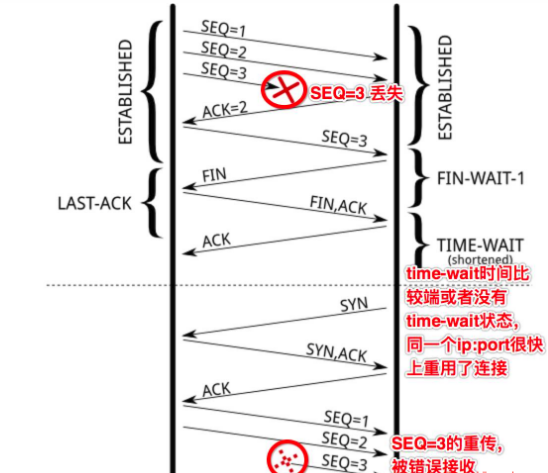
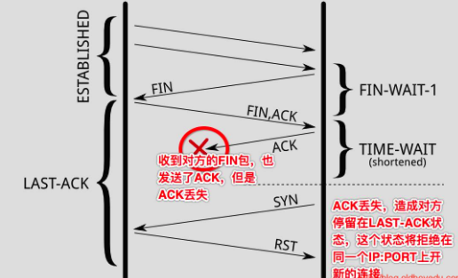
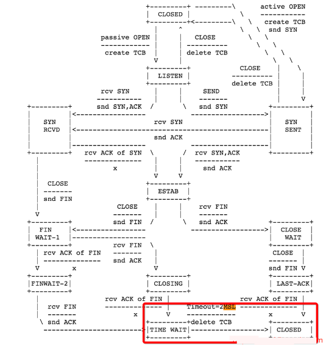
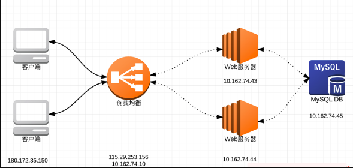

# TCP TIME_WAIT CLOSE_WAIT 状态

> GitHub 仓库源文件：[点击打开网页渲染版](https://github.com/ben2023niao/ben-ops-notes/blob/main/doc/md/202304141557-%E5%AE%89%E5%85%A8%E4%B8%8E%E5%A0%A1%E5%9E%92%E6%9C%BA%2B%E9%AB%98%E7%BA%A7%E5%AE%89%E5%85%A8%2B%E7%9F%A5%E8%AF%86%E7%AC%94%E8%AE%B0-TCP%20TIME_WAIT%20CLOSE_WAIT%20%E7%8A%B6%E6%80%81.md)

相信很多运维工程师遇到过这样一个情形：用户反馈网站访问巨慢，网络延迟等问题，然后就迫切地登录服务器，终端输入命令 "netstat -anp | grep TIME_WAIT | wc -l " 查看一下, 接着发现有几百几千甚至几万个 TIME_WAIT 连接数，顿时慌了。

通过 “netstat -anp | grep TIME_WAIT | wc -l” 命令查看数量，发现 TIME_WAIT 的连接数量很多！可能是因为服务器主动关闭连接导致 TIME_WAIT 产生了很多，发现系统存在大量 TIME_WAIT 状态的连接, 可以通过调整系统内核参数来解决，打开 sysctl.conf 文件，修改以下几个参数：

```
[root@web01 ~]# vim  /etc/sysctl.conf
net.ipv4.tcp_tw_reuse = 1
net.ipv4.tcp_tw_recycle = 1
net.ipv4.tcp_timestamps = 1
net.ipv4.tcp_syncookies = 1
net.ipv4.tcp_fin_timeout = 30
[root@web01 ~]# sysctl -p
```

接着被告知：开启 tw_recylce 和 tw_reuse 功能，一定需要 timestamps 的支持，而且这些配置一般不建议开启，但是对解决 TIME_WAIT 很多的问题，有很好的用处。果然，经过如上配置后, 过了几分钟，再查看 TIME_WAIT 的数量快速下降了不少，并且后面也没发现哪个用户说有问题了。

做到这里，相信大多数运维人员想当然地以为问题已经解决了，但是，要彻底理解并解决这个问题，可能就没这么简单，或者说，要想彻底搞清楚并解决这个问题还是有很长的路要走滴！

相关查看命令：

```
[root@web01 ~]# netstat -n | awk '/^tcp/ {++state[$NF]} END {for(key in state) print key,"\t",state[key]}'
LAST_ACK 1
SYN_RECV 14
ESTABLISHED 79
FIN_WAIT1 28
FIN_WAIT2 3
CLOSING 5
TIME_WAIT 1669
[root@web01 ~]# sysctl -a | grep time | grep wait
net.netfilter.nf_conntrack_tcp_timeout_fin_wait = 120
net.netfilter.nf_conntrack_tcp_timeout_close_wait = 60
net.netfilter.nf_conntrack_tcp_timeout_time_wait = 120
```

执行命令 “netstat -na” 查看到的相关 TCP 状态解释：

| 状态 | 描述 |

| --- | --- |

| LISTEN | 侦听来自远方的 TCP 端口的连接请求 |

| SYN-SENT | 在发送连接请求后等待匹配的连接请求 |

| SYN-RECEIVED | 在收到和发送一个连接请求后等待对方对连接请求的确认 |

| ESTABLISHED | 代表一个打开的连接 |

| FIN-WAIT-1 | 等待远程 TCP 连接中断请求, 或先前的连接中断请求的确认 |

| FIN-WAIT-2 | 从远程 TCP 等待连接中断请求 |

| CLOSE-WAIT | 等待从本地用户发来的连接中断请求 |

| CLOSING | 等待远程 TCP 对连接中断的确认 |

| LAST-ACK | 等待原来的发向远程TCP的连接中断请求的确认 |

| TIME-WAIT | 等待足够的时间以确保远程 TCP 接收到连接中断请求的确认 |

| CLOSE | 没有任何连接状态 |

## 什么是TIME-WAIT和CLOSE-WAIT

通常来说要想解决问题，就要先理解问题。有时遇到问题上网百度个解决方案临时修复了问题就以为问题已经不在了，其实问题不是真的不存在了，而是可能隐藏在更深的地方，只是我们没有发现，或者以现有自己的的知识水平无法发现而已。总所周知，由于 socket 是全双工的工作模式，一个 socket 的关闭，是需要四次握手来完成的：

1. 主动关闭连接的一方，调用 close()；协议层发送 FIN 包;
2. 被动关闭的一方收到 FIN 包后，协议层回复 ACK；然后被动关闭的一方，进入 CLOSE_WAIT 状态，主动关闭的一方等待对方关闭，则进入 FIN_WAIT_2 状态；此时，主动关闭的一方等待被动关闭一方的应用程序，调用 close 操作;
3. 被动关闭的一方在完成所有数据发送后，调用 close() 操作；此时，协议层发送 FIN 包给主动关闭的一方，等待对方的 ACK，被动关闭的一方进入 LAST_ACK 状态；
4. 主动关闭的一方收到 FIN 包，协议层回复 ACK；此时，主动关闭连接的一方，进入 TIME_WAIT 状态；而被动关闭的一方，进入 CLOSED 状态;
5. 等待 2MSL 时间，主动关闭的一方，结束 TIME_WAIT，进入 CLOSED 状态;

通过上面的一次 socket 关闭操作，可以得出以下几点：

1. 主动关闭连接的一方 – 也就是主动调用 socket 的 close 操作的一方，最终会进入 TIME_WAIT 状态;
2. 被动关闭连接的一方，有一个中间状态，即 CLOSE_WAIT，因为协议层在等待上层的应用程序，主动调用 close 操作后才主动关闭这条连接;
3. TIME_WAIT 会默认等待 2MSL 时间后，才最终进入 CLOSED 状态；
4. 在一个连接没有进入 CLOSED 状态之前，这个连接是不能被重用的！

所以说这里凭直觉看，TIME_WAIT 并不可怕，CLOSE_WAIT 才可怕，因为 CLOSE_WAIT 很多，表示说要么是你的应用程序写的有问题，没有合适的关闭 socket；要么是说，你的服务器 CPU 处理不过来（CPU 太忙）或者你的应用程序一直睡眠到其它地方(锁，或者文件 I/O 等等)，你的应用程序获得不到合适的调度时间，造成你的程序没法真正的执行 close 操作。

那么这里又出现两个问题：

1. 上面提到的连接重用，那连接到底是个什么概念？
2. 协议层为什么要设计一个 TIME_WAIT 状态？这个状态为什么默认等待 2MSL 时间才会进入 CLOSED

先解释清楚这两个问题后，接着再来看开头提到的 /etc/sysctl.conf 文件中那几个网络配置参数究竟有什么用，以及 TIME_WAIT 的后遗症问题。

## Socket连接

socket 其实就是一个五元组，包括：源IP, 源端口, 目的 IP, 目的端口, 类型(TCP or UDP) 。 这个五元组，即标识了一条可用的连接。需要注意是是，经常有很多人把一个 socket 定义成四元组，也就是源 IP:源端口+目的 IP:目的端口，这个定义是不正确的。

比如说，如果本地出口 IP 是 203.0.113.1，那么你的浏览器在连接某一个 Web 服务器，例如百度的时候，这条 socket 连接的四元组可能就是：[203.0.113.1:45678, tcp, 203.0.113.1:80] , 源 IP 为你的出口 IP 地址 203.0.113.1，源端口为随机端口 45678，目的 IP 为百度的某一个负载均衡服务器 IP 203.0.113.1，端口为 HTTP 标准的 80 端口。

如果这个时候，你再开一个浏览器，访问百度，将会产生一条新的连接：[203.0.113.1:43678, tcp, 203.0.113.1:80] , 这条新的连接的源端口为一个新的随机端口 43678。如此来看，如果你的本机需要压测百度，那么你最多可以创建多少个连接呢？

## TIME_WAIT有什么用

如果来做个类比的话，TIME_WAIT 的出现，对应的是你的程序里的异常处理，它的出现，就是为了解决网络的丢包和网络不稳定所带来的其他问题：

1. 防止前一个连接 【五元组，这里继续以 203.0.113.1:45678, tcp, 203.0.113.1:80 为例】 上延迟的数据包或者丢失重传的数据包，被后面复用的连接【前一个连接关闭后，此时你再次访问百度，新的连接可能还是由 203.0.113.1:45678, tcp, 203.0.113.1:80 这个五元组来表示，也就是源端口凑巧还是 45678】 错误的接收（异常：数据丢了，或者传输太慢了），参见下图：


	- SEQ=3 的数据包丢失，重传第一次，没有得到 ACK 确认
	- 如果没有 TIME_WAIT，或者 TIME_WAIT 时间非常短，那么关闭的连接 【203.0.113.1:45678, tcp, 203.0.113.1:80 的状态变为了 CLOSED，源端口可被再次利用】，马上被重用 【对110.88.92.104:80新建的连接，复用了之前的随机端口45678】，并连续发送 SEQ=1,2 的数据包;
	- 此时，前面的连接上的 SEQ=3 的数据包再次重传，同时，seq 的序号刚好也是 3（这个很重要，不然，SEQ 的序号对不上，就会 RST 掉），此时，前面一个连接上的数据被后面的一个连接错误的接收;
	1. 确保连接方能在时间范围内，关闭自己的连接。其实，也是因为丢包造成的，参见下图：
	
	- 主动关闭方关闭了连接，发送了 FIN；
	- 被动关闭方回复 ACK 同时也执行关闭动作，发送 FIN 包；此时，被动关闭的一方进入 LAST_ACK 状态;
	- 主动关闭的一方回去了 ACK，主动关闭一方进入 TIME_WAIT 状态；
	- 但是最后的 ACK 丢失，被动关闭的一方还继续停留在 LAST_ACK 状态;
	- 此时，如果没有 TIME_WAIT 的存在，或者说，停留在 TIME_WAIT 上的时间很短，则主动关闭的一方很快就进入了 CLOSED 状态，也即是说，如果此时新建一个连接，源随机端口如果被复用，在 connect 发送 SYN 包后，由于被动方仍认为这条连接 【五元组】 还在等待 ACK，但是却收到了 SYN，则被动方会回复 RST;
	- 造成主动创建连接的一方，由于收到了 RST，则连接无法成功;所以，这里看到了，TIME_WAIT 的存在是很重要的，如果强制忽略 TIME_WAIT，还是有很高的机率，造成数据粗乱，或者短暂性的连接失败。那么，为什么说 TIME_WAIT 状态会是持续 2MSL（2 倍的 max segment lifetime）呢？这个时间可以通过修改内核参数调整吗？第一，这个 2MSL，是 RFC 793 里定义的，参见 RFC 的截图标红的部分：


这个定义，更多的是一种保障（IP 数据包里的 TTL，即数据最多存活的跳数，真正反应的才是数据在网络上的存活时间），确保最后丢失了 ACK，被动关闭的一方再次重发 FIN 并等待回复的 ACK，一来一去两个来回。内核里，写死了这个 MSL 的时间为：30 秒（有读者提醒，RF 里建议的MSL其实是 2 分钟，但是很多实现都是 30 秒），所以 TIME_WAIT 的即为 1 分钟。所以，再次回想一下前面的问题，如果一条连接，即使在四次握手关闭了，由于 TIME_WAIT 的存在，这个连接，在 1 分钟之内，也无法再次被复用，那么，如果你用一台机器做压测的客户端，你一分钟能发送多少并发连接请求？如果这台是一个负载均衡服务器，一台负载均衡服务器，一分钟可以有多少个连接同时访问后端的服务器呢？

## TIME_WAIT很多

如果你通过 “ss -tan state time-wait | wc -l” 发现，系统中有很多 TIME_WAIT，看到时相信很多人都会紧张。多少算多呢？几百几千？如果是这个量级，其实真的没必要紧张。因为这个量级，因为 TIME_WAIT 所占用的内存很少很少；因为记录和寻找可用的 local port 所消耗的 CPU 也基本可以忽略。会占用内存吗？当然！任何你可以看到的数据，内核里都需要有相关的数据结构来保存这个数据啊。一条 Socket 处于 TIME_WAIT 状态，它也是一条“存在“的 socket，内核里也需要有保持它的数据：

```
#内核里有保存所有连接的一个 hash table，这个 hash table 里面既包含 TIME_WAIT 状态的连接，也包含其他状态的连接。主要用于有新的数据到来的时候，从这个 hash table 里快速找到这条连接。不同的内核对这个 hash table 的大小设置不同，你可以通过 dmesg 命令去找到你的内核设置的大小：
[root@web01 ~]# dmesg |grep --color "TCP established hash table"
TCP established hash table entries: 524288 (order: 11, 8388608 bytes)
#还有一个 hash table 用来保存所有的 bound ports，主要用于可以快速的找到一个可用的端口或者随机端口：
[root@web01 ~]# dmesg |grep --color "TCP bind hash table"
TCP bind hash table entries: 65536 (order: 8, 1048576 bytes)
```

由于内核需要保存这些数据，必然，会占用一定的内存。

那么会消耗 CPU 吗？当然！每次找到一个随机端口，还是需要遍历一遍 bound ports 的吧，这必然需要一些 CPU 时间。TIME_WAIT 很多，既占内存又消耗 CPU，这也是为什么很多人，看到 TIME_WAIT 很多，就蠢蠢欲动的想去干掉他们。其实，如果你再进一步去研究，1 万条 TIME_WAIT 的连接，也就多消耗 1M 左右的内存，对现代的很多服务器，已经不算什么了。至于 CPU，能减少它当然更好，但是不至于因为 1 万多个 hash item 就担忧。如果要真的想去调优，还是需要搞清楚调优方案以及调优参数背后的意义！

## TIME_WAIT调优

TIME_WAIT 调优，则必须理解的几个调优参数：

### net.ipv4.tcp_timestamps

RFC 1323 在 TCP Reliability 一节里，引入了 timestamp 的 TCP option，两个 4 字节的时间戳字段，其中第一个4字节字段用来保存发送该数据包的时间，第二个 4 字节字段用来保存最近一次接收对方发送到数据的时间。有了这两个时间字段，也就有了后续优化的余地。tcp_tw_reuse 和 tcp_tw_recycle 就依赖这些时间字段。

### net.ipv4.tcp_tw_reuse

从字面意思来看，这个参数是 reuse TIME_WAIT 状态的连接。时刻记住一条 socket 连接，就是那个五元组，出现 TIME_WAIT 状态的连接，一定出现在主动关闭连接的一方。所以，当主动关闭连接的一方，再次向对方发起连接请求的时候（例如，客户端关闭连接，客户端再次连接服务端，此时可以复用了；负载均衡服务器，主动关闭后端的连接，当有新的 HTTP 请求，负载均衡服务器再次连接后端服务器，此时也可以复用），可以复用 TIME_WAIT 状态的连接。

通过字面解释以及例子说明，可以看到，tcp_tw_reuse 应用的场景：某一方，需要不断的通过 “短连接“ 连接其他服务器，总是自己先关闭连接(TIME_WAIT 在自己这方)，关闭后又不断的重新连接对方。

那么，当连接被复用了之后，延迟或者重发的数据包到达，新的连接怎么判断，到达的数据是属于复用后的连接，还是复用前的连接呢？那就需要依赖前面提到的两个时间字段了。复用连接后，这条连接的时间被更新为当前的时间，当延迟的数据达到，延迟数据的时间是小于新连接的时间，所以，内核可以通过时间判断出，延迟的数据可以安全的丢弃掉了。

这个配置，依赖于连接双方，同时对 timestamps 的支持。同时，这个配置，仅仅影响 outbound 连接，即做为客户端的角色，连接服务端 [connect(dest_ip, dest_port)] 时复用 TIME_WAIT 的 socket。

### net.ipv4.tcp_tw_recycle

从字面意思来看，这个参数是销毁掉 TIME_WAIT。当开启了这个配置后，内核会快速的回收处于 TIME_WAIT 状态的 socket 连接。多快？不再是 2MSL，而是一个 RTO（retransmission timeout，数据包重传的 timeout 时间）的时间，这个时间根据 RTT 动态计算出来，但是远小于 2MSL。

有了这个配置，还是需要保障丢失重传或者延迟的数据包，不会被新的连接(注意，这里不再是复用了，而是之前处于 TIME_WAIT 状态的连接已经被 destroy 掉了，新的连接，刚好是和某一个被 destroy 掉的连接使用了相同的五元组而已)所错误的接收。在启用该配置，当一个 socket 连接进入 TIME_WAIT 状态后，内核里会记录包括该 socket 连接对应的五元组中的对方 IP 等在内的一些统计数据，当然也包括从该对方IP所接收到的最近的一次数据包时间。当有新的数据包到达，只要时间晚于内核记录的这个时间，数据包都会被统统的丢掉。

这个配置，依赖于连接双方对 timestamps 的支持。同时，这个配置，主要影响到了 inbound 的连接（对 outbound 的连接也有影响，但是不是复用），即做为服务端角色，客户端连进来，服务端主动关闭了连接，TIME_WAIT 状态的 socket 处于服务端，服务端快速的回收该状态的连接。

由此，如果客户端处于NAT的网络(多个客户端，同一个 IP 出口的网络环境)，如果配置了 tw_recycle，就可能在一个 RTO 的时间内，只能有一个客户端和自己连接成功(不同的客户端发包的时间不一致，造成服务端直接把数据包丢弃掉)。

下面通过案例和图示，来加深下理解:



	- 客户端 IP 地址为：203.0.113.1，我们可以认为是浏览器;
	- 负载均衡有两个 IP，外网 IP 地址为 203.0.113.1，内网地址为 203.0.113.1；外网地址监听 80 端口;
	- 负载均衡背后有两台 Web 服务器，一台 IP 地址为 203.0.113.1，监听 80 端口；另一台为 203.0.113.1，监听 80 端口;
	- Web 服务器会连接数据服务器，IP 地址为 203.0.113.1，监听 3306 端口;这种简单的架构下，我们来看看，在不同的情况下，上面谈论的 tw_reuse/tw_recycle 对网络连接的影响。先做个假定：

	- 客户端通过 HTTP/1.1 连接负载均衡，也就是说，HTTP 协议投 Connection 为 keep-alive，所以假定，客户端对负载均衡服务器的 socket 连接，客户端会断开连接，所以 TIME_WAIT 出现在客户端;
	- Web 服务器和 MySQL 服务器的连接，我们假定，Web 服务器上的程序在连接结束的时候，调用 close 操作关闭 socket 资源连接，所以，TIME_WAIT 出现在 Web 服务器端。那么，在这种假定下：

	- Web 服务器上，肯定可以配置开启的配置：tcp_tw_reuse；如果 Web 服务器有很多连向DB服务器的连接，可以保证 socket 连接的复用。
	- 那么，负载均衡服务器和 Web 服务器，谁先关闭连接，则决定了我们怎么配置 tcp_tw_reuse/tcp_tw_recycle 了。方案一：负载均衡服务器

首先关闭连接, 在这种情况下，因为负载均衡服务器对 Web 服务器的连接，TIME_WAIT 大都出现在负载均衡服务器上，所以:

```
在负载均衡服务器上的配置：

net.ipv4.tcp_tw_reuse = 1 //尽量复用连接
net.ipv4.tcp_tw_recycle = 0 //不能保证客户端不在NAT的网络啊
在 Web 服务器上的配置为：

net.ipv4.tcp_tw_reuse = 1 //这个配置主要影响的是Web服务器到DB服务器的连接复用
net.ipv4.tcp_tw_recycle： 设置成1和0都没有任何意义。想一想，在负载均衡和它的连接中，它是服务端，但是TIME_WAIT出现在负载均衡服务器上；
 它和DB的连接，它是客户端，recycle对它并没有什么影响，关键是reuse
```

方案二：Web服务器首先关闭来自负载均衡服务器的连接

在这种情况下，Web 服务器变成 TIME_WAIT 的重灾区。负载均衡对 Web 服务器的连接，由 Web 服务器首先关闭连接，TIME_WAIT 出现在 Web 服务器上；Web 服务器对 DB 服务器的连接，由 Web 服务器关闭连接，TIME_WAIT 也出现在它身上，此时:

```
负载均衡服务器上的配置：

net.ipv4.tcp_tw_reuse：0 或者 1 都行，都没有实际意义
net.ipv4.tcp_tw_recycle=0 //一定是关闭recycle
在 Web 服务器上的配置：

net.ipv4.tcp_tw_reuse = 1 //这个配置主要影响的是Web服务器到DB服务器的连接复用
net.ipv4.tcp_tw_recycle=1 //由于在负载均衡和Web服务器之间并没有NAT的网络，可以考虑开启recycle，加速由于负载均衡和Web服务器之间的连接造成的大量TIME_WAIT
```

问题1: 通常说的连接池可以复用连接，是不是意味着，需要等到上个连接 time wait 结束后才能再次使用？

所谓连接池复用，复用的一定是活跃的连接，所谓活跃，第一表明连接池里的连接都是 ESTABLISHED 的，第二，连接池做为上层应用，会有定时的心跳去保持连接的活跃性。既然连接都是活跃的，那就不存在有 TIME_WAIT 的概念了，在上篇里也有提到，TIME_WAIT 是在主动关闭连接的一方，在关闭连接后才进入的状态。既然已经关闭了，那么这条连接肯定已经不在连接池里面了，即被连接池释放了。

问题2: 作为负载均衡的机器随机端口使用完的情况下大量 time_wait，不调整上面文中说的那三个参数，有其他的更好的方案吗？

第一，随机端口使用完，你可以通过调整 /etc/sysctl.conf 下的 net.ipv4.ip_local_port_range 配置，至少修改成 net.ipv4.ip_local_port_range=1024 65535，保证你的负载均衡服务器至少可以使用 6 万个随机端口，也即可以有 6 万的反向代理到后端的连接，可以支持每秒 1000 的并发（想一想，因为 TIME_WAIT 状态会持续 1 分钟后消失，所以一分钟最多有 6 万，每秒 1000）；如果这么多端口都使用完了，也证明你应该加服务器了，或者，你的负载均衡服务器需要配置多个 IP 地址，或者，你的后端服务器需要监听更多的端口和配置更多的 IP（想一下 socket 的五元组）

第二，大量的 TIME_WAIT，多大量？如果是几千个，其实不用担心，因为这个内存和 CPU 的消耗有一些，但是是可以忽略的。

第三，如果真的量很大，上万上万的那种，可以考虑，让后端的服务器主动关闭连接，如果后端服务器没有外网的连接只有负载均衡服务器的连接（主要是没有 NAT 网络的连接），可以在后端服务器上配置 tw_recycle，然后同时，在负载均衡服务器上，配置 tw_reuse。
