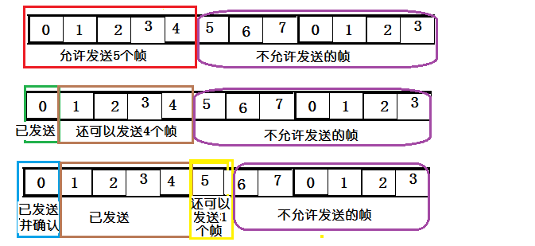
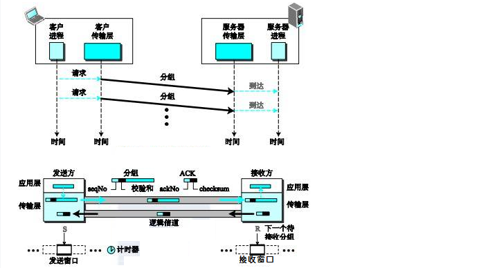
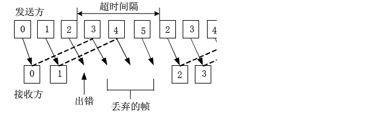
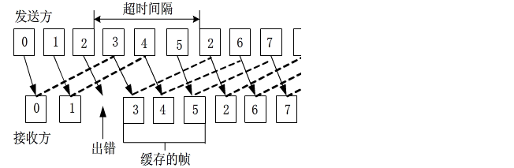

# TCP滑动窗口与回退N针协议

> GitHub 仓库源文件：[点击打开网页渲染版](https://github.com/ben2023niao/ben-ops-notes/blob/main/doc/md/202304141557-%E5%AE%89%E5%85%A8%E4%B8%8E%E5%A0%A1%E5%9E%92%E6%9C%BA%2B%E9%AB%98%E7%BA%A7%E5%AE%89%E5%85%A8%2B%E7%9F%A5%E8%AF%86%E7%AC%94%E8%AE%B0-TCP%E6%BB%91%E5%8A%A8%E7%AA%97%E5%8F%A3%E4%B8%8E%E5%9B%9E%E9%80%80N%E9%92%88%E5%8D%8F%E8%AE%AE.md)

## 滑动窗口协议

1. 发送端和接收端分别设定发送窗口和接收窗口。
2. 三次握手的时候，客户端把自己的缓冲区大小也就是窗口大小发送给服务器，服务器回应是也将窗口大小发送给客户端，服务器客户端都知道了彼此的窗口大小。
3. 比如主机A的发送窗口大小为 5，主机A可以向主机B发送 5 个单元，如果 B 缓冲区满了，A 就要等待 B 确认才能继续发送数据。
4. 如果缓冲区中有 1 个报文被进程读取，主机 B 就会回复 ACK 给主机 A，接收窗口向前滑动，报文中窗口大小为 1，就说明 A 还可以发送 1 个单元的数据，发送窗口向前滑动，之后等待主机 B 的确认报文。

只有接收窗口向前滑动并发送了确认时，发送窗口才能向前滑动。

## 停止等待ARQ协议（stop and wait）

当发送窗口和接收窗口都等于1时，就是停止等待协议。发送端给接收端发送数据，等待接收端确认回复 ACk，并停止发送新的数据包，开启计时器。数据包在计时器超时之前得到确认，那么计时器就会关闭，并发送下一个数据包。如果计时器超时，发送端就认为数据包丢失或被破坏，需要重新发送之前的数据包，说明数据包在得到确认之前，发送端需要存储数据包的副本。

停止等待协议是发出一个帧后得到确认才发下一个，降低了信道的利用率。

## 退后N帧协议

在发送完一个帧后，不用停下来等待确认，而是可以连续发送多个数据帧。收到确认帧时，任可发送数据，这样就减少了等待时间，整个通信的通吞吐量提高。

如果前一个帧在超时时间内未得到确认，就认为丢失或被破坏，需要重发出错帧及其后面的所有数据帧。这样有可能有把正确的数据帧重传一遍，降低了传送效率。

线路很差时，使用退后N帧的协议会浪费大量的带宽重传帧。

## 选择重传协议

NAK：非确认帧，当在一定时间内没有收到某个数据帧的 ACK 时，回复一个 NACK。 在发送过程中，如果一个数据帧计时器超时，就认为该帧丢失或者被破坏，接收端只把出错的的帧丢弃，其后面的数据帧保存在缓存中，并向发送端回复 NAK。发送端接收到 NAK 时，只发送出错的帧。

如果落在窗口的帧从未接受过，那么存储起来，等比它序列号小的所有帧都按次序交给网络层，那么此帧才提交给网络层。 接收端收到的数据包的顺序可能和发送的数据包顺序不一样。因此在数据包里必须含有顺序字符来帮助接受端来排序。

选择重传协议可以避免重复传送那些正确到达接收端的数据帧。但是接收端要设置具有相当容量的缓存空间，这在许多情况下是不够经济的。

---
