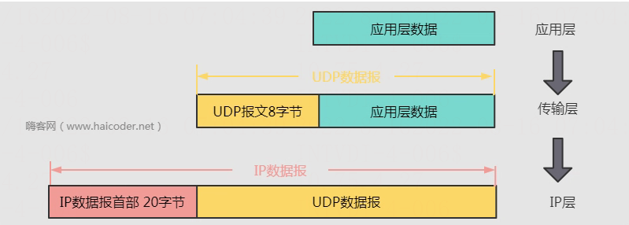

# UDP协议特点

> GitHub 仓库源文件：[点击打开网页渲染版](https://github.com/ben2023niao/ben-ops-notes/blob/main/doc/md/202304141557-%E5%AE%89%E5%85%A8%E4%B8%8E%E5%A0%A1%E5%9E%92%E6%9C%BA%2B%E9%AB%98%E7%BA%A7%E5%AE%89%E5%85%A8%2B%E7%9F%A5%E8%AF%86%E7%AC%94%E8%AE%B0-UDP%E5%8D%8F%E8%AE%AE%E7%89%B9%E7%82%B9.md)

UDP 协议全称是用户数据报协议，在网络中它与 TCP 协议一样用于处理数据包，是一种无连接的协议。在 OSI 模型中，在第四层——传输层，处于 IP 协议的上一层。UDP 有不提供数据包分组、组装和不能对数据包进行排序的缺点，也就是说，当报文发送之后，是无法得知其是否安全完整到达的。UDP 用来支持那些需要在计算机之间传输数据的网络应用。包括网络视频会议系统在内的众多的客户/服务器模式的网络应用都需要使用UDP协议。

用户数据报协议 UDP 只在 IP 得到数据报服务至上增加了很少一点的功能,这就是复用和分用的功能以及差错检测的功能。

## UDP的主要特点

1. UDP 是无连接的，即发送数据之前不需要建立连接，因此减少了开销和发送数据之前的时延。
2. UDP 使用尽最大努力交付，即不保证可靠交付，因此主机不需要维持复杂的连接状态表。
3. UDP 是面向报文的。发送方的 UDP 对应用程序交下来的报文，在添加首部后就向下交付 IP 层。UDP 对应用层交下来的报文，既不合并，也不拆分，而是保留这些报文的边界。因此，应用程序必须选择合适大小的报文。

	1. UDP 没有拥塞控制，因此网络出现的拥塞不会使源主机的发送速率降低。很多的实时应用（如 IP 电话、实时视频会议等）要去源主机以恒定的速率发送数据，并且允许在网络发生拥塞时丢失一些数据，但却不允许数据有太多的时延。UDP 正好符合这种要求。
	2. UDP 支持一对一、一对多、多对一和多对多的交互通信。
	3. UDP 的首部开销小，只有 8 个字节，比 TCP 的 20 个字节的首部要短。注意：

	1. 不使用拥塞控制功能的 UDP 有可能会引起网络产生严重的拥塞问题。
	2. 一些使用 UDP 的实时应用进程本身可以在不影响应用的实时性的前提下，增加一些提高可靠性的措施，如采用前向纠错或重传已丢失的报文。
