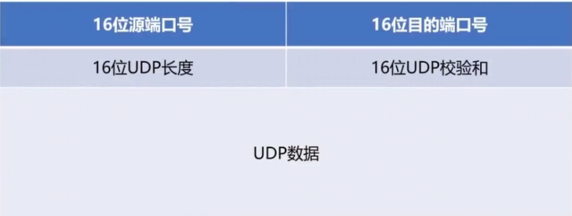

# UDP报文格式

> GitHub 仓库源文件：[点击打开网页渲染版](https://github.com/ben2023niao/ben-ops-notes/blob/main/doc/md/202304141557-%E5%AE%89%E5%85%A8%E4%B8%8E%E5%A0%A1%E5%9E%92%E6%9C%BA%2B%E9%AB%98%E7%BA%A7%E5%AE%89%E5%85%A8%2B%E7%9F%A5%E8%AF%86%E7%AC%94%E8%AE%B0-UDP%E6%8A%A5%E6%96%87%E6%A0%BC%E5%BC%8F.md)

UDP 报文的具体格式为：源端口( 2 字节) + 目的端口( 2 字节) + 长度( 2 字节) + 检验和( 2 字节) + 数据。

## UDP报文格式详解

UDP 报文格式图解如下：

具体解释如下：

- 源端口：这个字段占据 UDP 报文头的前 16 位，通常包含发送数据报的应用程序所使用的 UDP。
- 端口。接收端的应用程序利用这个字段的值作为发送响应的目的地址。这个字段是可选的，所以发送端的应用程序不一定会把自己的端口号写入该字段中。如果不写入端口号，则把这个字段设置为 0。这样，接收端的应用程序就不能发送响应了。
- 目的端口：接收端计算机上 UDP 软件使用的端口，占据 16 位。
- 长度：该字段占据 16 位，表示 UDP 数据报长度，包含 UDP 报文头和 UDP 数据长度。因为 UDP 报文头长度是 8 个字节，所以这个值最小为 8。
- 校验值：该字段占据 16 位，可以检验数据在传输过程中是否被损坏。
