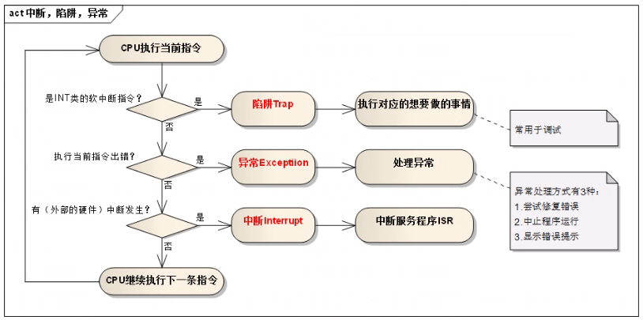
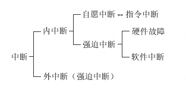

# 中断与异常

> GitHub 仓库源文件：[点击打开网页渲染版](https://github.com/ben2023niao/ben-ops-notes/blob/main/doc/md/202304141557-%E5%AE%89%E5%85%A8%E4%B8%8E%E5%A0%A1%E5%9E%92%E6%9C%BA%2B%E9%AB%98%E7%BA%A7%E5%AE%89%E5%85%A8%2B%E7%9F%A5%E8%AF%86%E7%AC%94%E8%AE%B0-%E4%B8%AD%E6%96%AD%E4%B8%8E%E5%BC%82%E5%B8%B8.md)

在操作系统中引入核心态和用户态这两种工作状态后，就需要考虑这两种状态之间如何切换。操作系统内核工作在核心态，而用户程序工作在用户态。但系统不允许用户程序实现核心态的功能，而它们又必须使用这些功能。因此，需要在核心态建立一些 “门”，实现从用户态进入核心态。

在实际操作系统中，CPU 运行上层程序时唯一能进入这些 “门” 的途径就是通过中断或异常。当中断或异常发生时，运行用户态的 CPU 会立即进入核心态，这是通过硬件实现的（例如，用一个特殊寄存器的一位来表示 CPU 所处的工作状态，0 表示核心态，1 表示用户态。若要进入核心态，只需将该位置 0 即可)。中断是操作系统中非常重要的一个概念，对一个运行在计算机上的实用操作系统而言，缺少了中断机制，将是不可想象的。

## 中断

中断(Interruption)，也称外中断，指来自 CPU 执行指令以外的事件的发生，如设备发出的 I/O 结束中断，表示设备输入/输出处理已经完成，希望处理机能够向设备发下一个输入 / 输出请求，同时让完成输入/输出后的程序继续运行。时钟中断，表示一个固定的时间片已到，让处理机处理计时、启动定时运行的任务等。这一类中断通常是与当前程序运行无关的事件，即它们与当前处理机运行的程序无关。

## 异常

异常(Exception)，也称内中断、例外或陷入(Trap)，指源自 CPU 执行指令内部的事件，如程序的非法操作码、 地址越界、算术溢出、虚存系统的缺页以及专门的陷入指令等引起的事件。对异常的处理一般要依赖于当前程序的运行现场，而且异常不能被屏蔽，一旦出现应立即处理。关于内中断和外中断的联系与区别如下图所示：

