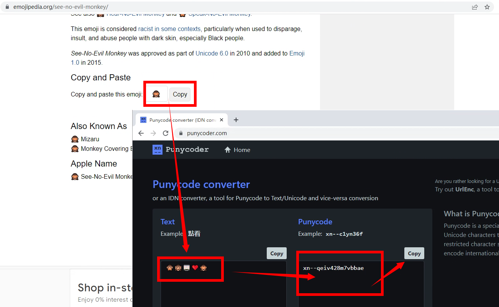
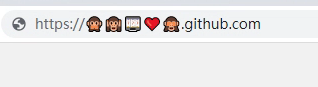
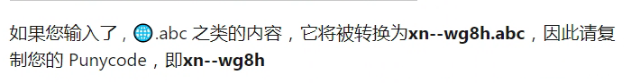

# 免费获得自己的表情域名

## https://xn--qeiv428m7vbbae.github.com第 1 步：选择表情

如果您使用的是没有表情符号键盘的台式机或移动设备，请不要担心，我为您提供了解决方案。
使用[https://emojipedia.org](https://emojipedia.org/)，他们列出了所有的表情符号，只需在搜索框中搜索您想要的表情符号。

如果您选择了您的域名，请继续下一步。

## • 第 2 步：转换为 Punycode

域名注册商不支持表情符号输入，因此您必须转换您选择的表情符号[Punycode](https://en.m.wikipedia.org/wiki/Punycode)，这是他们的拉丁语表示。

您可以使用<http://punycoder.com/>将表情符号转换为 Punycode。

[从emojipedia](https://emojipedia.org/)复制表情符号，或直接从键盘输入，然后单击**Convert To Punycode >>**按钮并从下面的框中复制输出。

### • [替代方式]

您也可以使用 Chrome 或其他网络浏览器来获取 Punycode，只需执行此操作即可。

在网络浏览器的地址栏中，输入您的表情符号然后**.abc** ，没有任何空格

> **.abc**不是强制性的，我只是举个例子，您可以使用任何其他 TLD，例如**.com**、**.xyz**等。

然后您的浏览器会自动将表情符号转换为 Punycode

## 第 3 步：注册域

由于我们想要免费的域，我们将使用[https://freenom.com](https://freenom.com/)，在那里注册并在搜索域框中粘贴我们的 Punycode 并按 Enter 如果您的域可用，它将在下面列出，如果不是，您必须选择另一个表情符号域并使用前面的步骤将其转换为 Punycode。

如果可以免费注册您的域，则不需要信用卡。然后使用域面板，您可以将域转发到您现有的网站或使用您全新的表情符号域设置一个全新的网站。

> 重要提示：由于 Freenom 是一个免费的域名注册商，所以不要期望太多。如果您想要一个专业的表情符号域，请选择**.ws**域，大多数拥有表情符号域的人都使用此 TLD。
