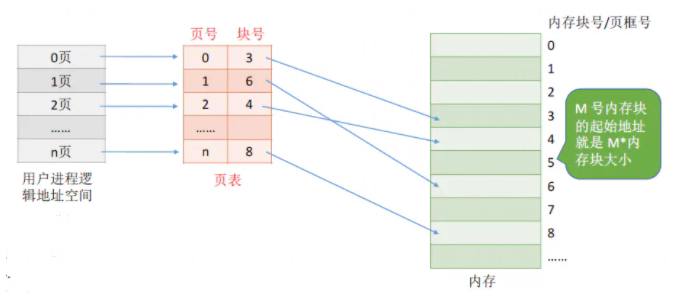
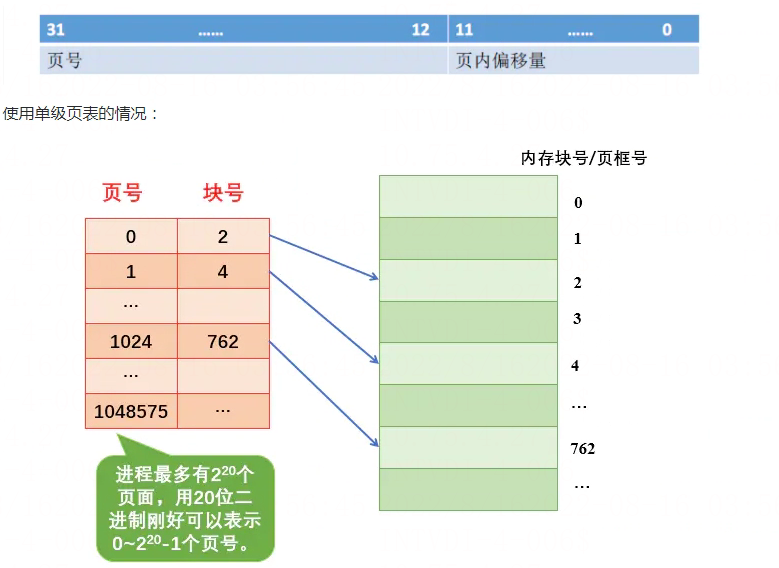
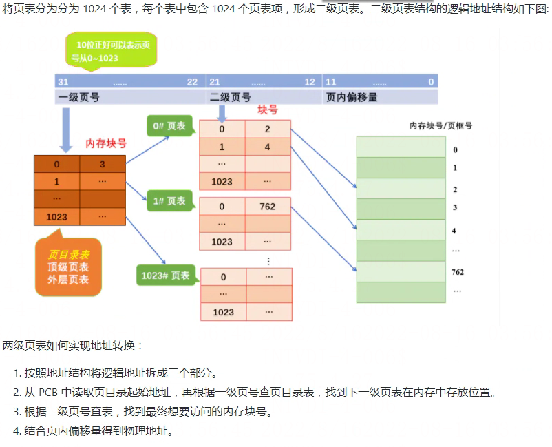
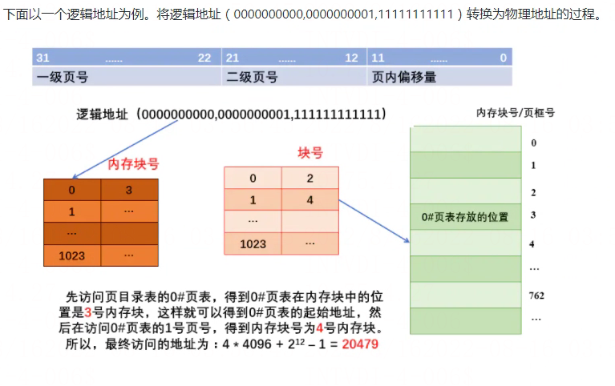
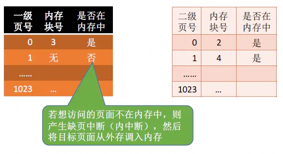

# 多级页表

## 单级页表存在的问题

假设某计算机系统按字节寻址，支持 32 位逻辑地址，采用分页存储管理，页面大小为 4KB，页表项长度为 4B。4KB = 212B，因此页内地址要用 12 位表示，剩余 20 位表示页号。

因此，该系统中用户进程最多有 220 页。相应的，一个进程的页表中，最多会有 220 个页表项，所以一个页表最大需要 220 * 4B = 222B。一个页框（内存块）大小为 4B，所以需要 222/212 = 210 个页框存储该页表。而页表的存储是需要连续存储的，因为根据页号查询页表的方法：K 号页对应的页表项的位置 = 页表起始地址 + K * 4B（页表项长度），所以这就要求页表的存储必须是连续的。

回想一下，当初为什么使用页表，就是要将进程划分为一个个页面可以不用连续的存放在内存中，但是此时页表就需要 1024 个连续的页框，似乎和当时的目标有点背道而驰了…

此外，根据局部性原理可知，很多时候，进程在一段时间内只需要访问某几个页面就可以正常运行了。因此也没有必要让整个页面都常驻内存。所以，单级页表存在以上两个问题。

## 两级页表

如何解决页表过大需要连续存储的问题呢？这个问题可以参考进程太大需要连续存储的答案。因为页表必须连续存放，所以可以将页表再分页。

解决方案：可以将长长的页表进行分组，使每个页面中刚好可以放下一个分组（如上面的例子中，页面的大小 4KB），每个页表项 4B，所以每个页面中可以存放 1K 个（1024）个页表项，因此每 1K 个连续的页表项为一组，每组刚好占一个页面，再讲各组离散的放在各个内存块中）。这样就需要为离散的页表再建立一张页表，称为页目录表，或外层页表，或顶层页表。

还是上面的例子，32 位的逻辑地址空间，页表项大小为 4B，页面大小 4KB，则页内地址占 12 位，单级页表结构逻辑结构图如下图所示：

## 虚拟存储技术

在解决了页必须连续存放的问题后，再看如何第二个问题：没有必要让整个页表常驻内存，因为进程一段时间内可能只需要访问某几个特定的页面。

解决方案：可以在需要访问页面时才把页面调入内存——虚拟存储技术（后面再说）。可以在页表中增加一个标示位，用于表示该页表是否已经调入内存。

## 几个问题

1. 若采用多级页表机制，则各级页表的大小不能超过一个页面。

举例说明，某系统按字节编址，采用 40 位逻辑地址，页面大小为 4KB，页表项大小为 4B，假设采用纯页式存储，则要采用（）级页表，页内偏移量为（）位？

页面大小 = 4KB，按字节编址，因此页内偏移量为 12 位。

页号 = 40 - 12 = 28位。

页面大小 = 4KB，页表项大小 = 4B，则每个页面可存放 1024 个页表项。因此各级页表最多包含 1024 个页表项，需要 10 个二进制位才能映射到 1024 个页表项，因此每级页表对应的页号应为 10 位二进制。共 28 位的页号至少要分为 3 级。

1. 两级页表的访问次数分析（假设没有页表）：

	1. 第一次访问：访问内存中的页目录表。
	2. 访问内存中的二级目录。
	3. 访问目标内存单元。

从上面可以看出，两级页表虽然解决了页表需要连续存储的问题，但是同时也增加了内存的访问次数。

## 使用二级页表的优势

1. 使用多级页表可以使得页表在内存中离散存储。多级页表实际上是增加了索引，有了索引就可以定位到具体的项。举个例子：比如虚拟地址空间大小为 4G，每个页大小依然为 4K，如果使用一级页表的话，共有 2^20 个页表项，如果每一个页表项占 4B，那么存放所有页表项需要 4M，为了能够随机访问，那么就需要连续 4M 的内存空间来存放所有的页表项。

随着虚拟地址空间的增大，存放页表所需要的连续空间也会增大，在操作系统内存紧张或者内存碎片较多时，这无疑会带来额外的开销。但是如果使用多级页表，我们可以使用一页来存放页目录项，页表项存放在内存中的其他位置，不用保证页目录项和页表项连续。
2. 使用多级页表可以节省页表内存。使用一级页表，需要连续的内存空间来存放所有的页表项。多级页表通过只为进程实际使用的那些虚拟地址内存区请求页表来减少内存使用量。举个例子：一个进程的虚拟地址空间是 4GB，假如进程只使用 4MB 内存空间。对于一级页表，我们需要 4M 空间来存放这 4GB 虚拟地址空间对应的页表，然后可以找到进程真正使用的 4M 内存空间。也就是说，虽然进程实际上只使用了 4MB 的内存空间，但是为了访问它们我们需要为所有的虚拟地址空间建立页表。

但是如果使用二级页表的话，一个页目录项可以定位 4M 内存空间，存放一个页目录项占 4K，还需要一页用于存放进程使用的 4M（4M=1024*4K，也就是用 1024 个页表项可以映射 4M 内存空间）内存空间对应的页表，总共需要 4K（页表）+4K（页目录）=8K 来存放进程使用的这 4M 内存空间对应页表和页目录项，这比使用一级页表节省了很多内存空间。

当然，在这种情况下，使用多级页表确实是可以节省内存的。但是，我们需要注意另一种情况，如果进程的虚拟地址空间是 4GB，而进程真正使用的内存也是 4GB，如果是使用一级页表，则只需要 4MB 连续的内存空间存放页表，我们就可以寻址这 4GB 内存空间。而如果使用的是二级页表的话，我们需要 4MB 内存存放页表，还需要 4KB 内存来存放页目录项，此时多级页表反倒是多占用了内存空间。注意在大多数情况都是进程的 4GB 虚拟地址空间都是没有使用的，实际使用的都是小于 4GB 的，所以我们说多级页表可以节省页表内存。

那么使用多级页表比使用以及页表有没有什么劣势呢？

当然是有的。比如：使用以及页表时，读取内存中一页内容需要 2 次访问内存，第一次是访问页表项，第二次是访问要读取的一页数据。但如果是使用二级页表的话，就需要 3 次访问内存了，第一次访问页目录项，第二次访问页表项，第三次访问要读取的一页数据。访存次数的增加也就意味着访问数据所花费的总时间增加。

## 总结

多级页表优势：

1. 可以离散存储页表。
2. 在某种意义上节省页表内存空间。

多级页表劣势：

1. 增加寻址次数，从而延长访存时间。
