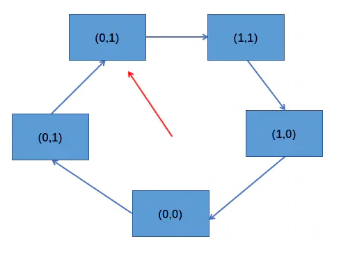
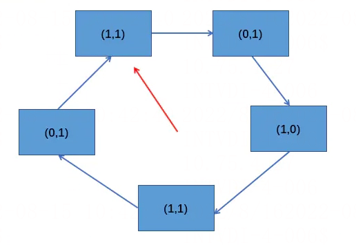
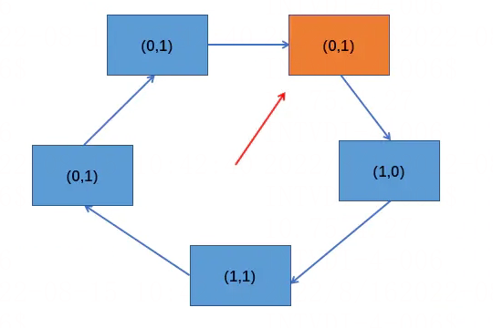
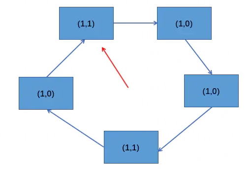
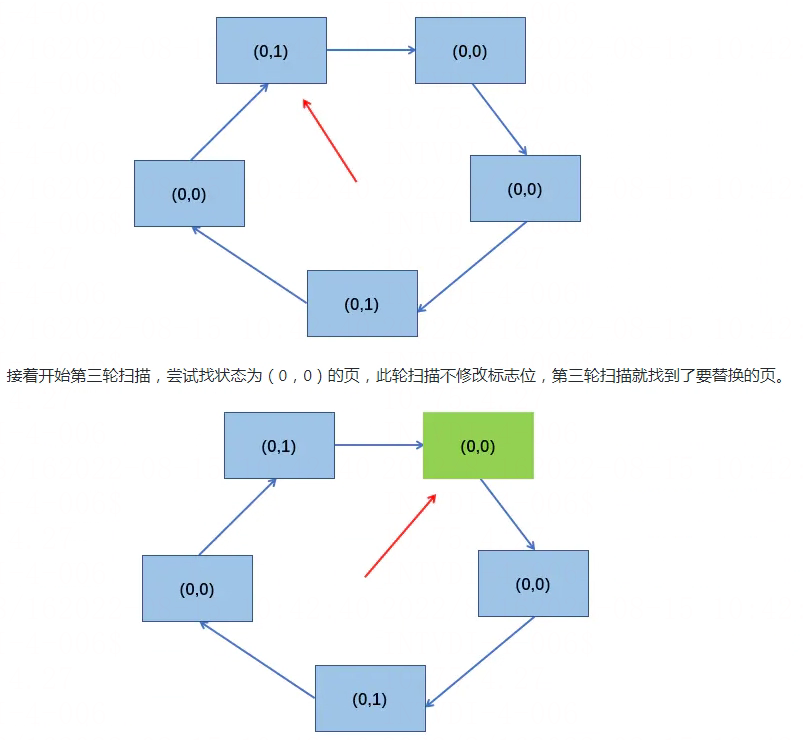
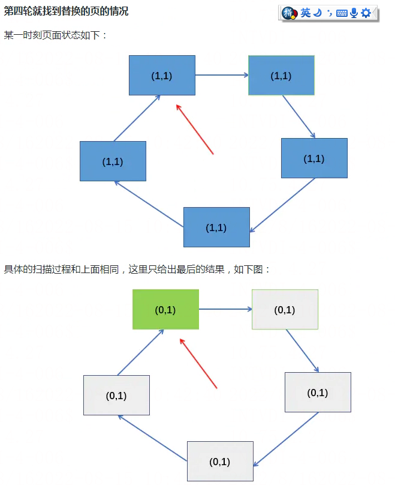
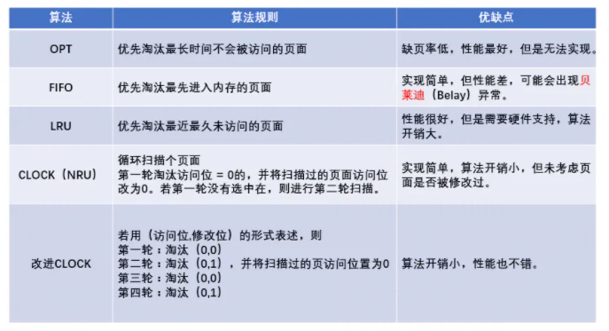

# 时钟置换算法(改进型)

> GitHub 仓库源文件：[点击打开网页渲染版](https://github.com/ben2023niao/ben-ops-notes/blob/main/doc/md/202304141557-%E5%AE%89%E5%85%A8%E4%B8%8E%E5%A0%A1%E5%9E%92%E6%9C%BA%2B%E9%AB%98%E7%BA%A7%E5%AE%89%E5%85%A8%2B%E7%9F%A5%E8%AF%86%E7%AC%94%E8%AE%B0-%E6%97%B6%E9%92%9F%E7%BD%AE%E6%8D%A2%E7%AE%97%E6%B3%95%28%E6%94%B9%E8%BF%9B%E5%9E%8B%29.md)

## 算法思想

简单的时钟置换算法仅考虑到了一个页面最近是否被访问过。事实上，如果淘汰的页面没有被修改过，就不需要执行 I/O 操作写回外存。只有淘汰的页面被修改过时，才需要写回外存。因此，除了考虑一个页面最近有没有被访问过之外，操作系统还需要考虑页面有没有被修改过。

改进型时钟置换算法的算法思想：在其他在条件相同时，应该优先淘汰没有被修改过的页面，从而来避免 I/O 操作。为了方便讨论，用（访问位，修改位）的形式表示各页面的状态。如（1,1）表示一个页面近期被访问过，且被修改过。

### 算法规则

将所有可能被置换的页面排成一个循环队列：

1. 第一轮：从当前位置开始扫描第一个（0,0）的页用于替换，本轮扫描不修改任何标志位。
2. 第二轮：若第一轮扫描失败，则重新扫描，查找第一个（0,1）的页用于替换。本轮将所有扫描的过的页访问位设为 0。
3. 第三轮：若第二轮扫描失败，则重新扫描，查找第一个（0,0）的页用于替换。本轮扫描不修改任何标志位。
4. 第四轮：若第三轮扫描失败，则重新扫描，查找第一个（0,1）的页用于替换。

由于第二轮已将所有的页的访问位都设为 0，因此第三轮、第四轮扫描一定会选中一个页，因此改进型 CLOCK 置换算法最多会进行四轮扫描。

**第一轮就找到替换的页的情况**

假设系统为进程分配了 5 个内存块，某时刻，各个页的状态如下图：

如果此时有新的页要进入内存，开始第一轮扫描就找到了要替换的页，即最下面的状态为（0,0）的页。

**第二轮就找到替换的页的情况**

某一时刻页面状态如下:

如果此时有新的页要进入内存，开始第一轮扫描就发现没有状态为（0，0）的页，第一轮扫描后不修改任何标志位。所以各个页状态和上图一样。

然后开始第二轮扫描，尝试找到状态为（0,1）的页，并将扫描过后的页的访问位设为 0，第二轮扫描找到了要替换的页。

**第三轮就找到替换的页的情况**

某一时刻页面状态如下:
****

第一轮扫描没有找到状态为（0,0）的页，且第一轮扫描不修改任何标志位，所以第一轮扫描后状态和上图一致。

然后开始第二轮扫描，尝试找状态为（0,1）的页，也没有找到，第二轮扫描需要将访问位设为 1，第二轮扫描后，状态为下图：

所以，改进型的 CLOCK 置换算法最多需要四轮扫描确定要置换的页。从上面的分析可以看出，改进型的 CLOCK 置换算法：

1. 第一优先级淘汰的是最近没有访问且没有修改的页面。
2. 第二优先级淘汰的是最近没有访问但修改的页面。
3. 第三优先级淘汰的是最近访问但没有修改的页面。
4. 第四优先级淘汰的是最近访问且修改的页面。

第三、四优先级为什么是访问过的？因为如果到了第三轮扫描，所有页的访问位都在第二轮扫描被设置为了 0，如果访问位不是0的话，也达到不了第三轮扫描，前两轮就会被淘汰。

所以到了第三轮，第四轮淘汰的页都是最近被访问过的。

## 总结

