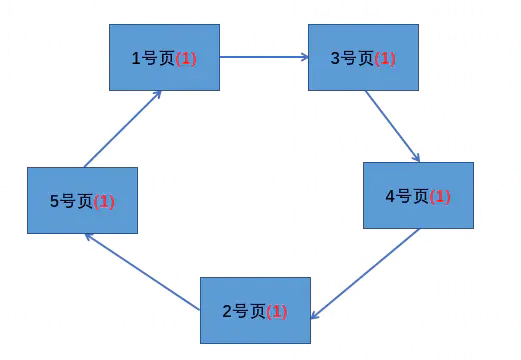
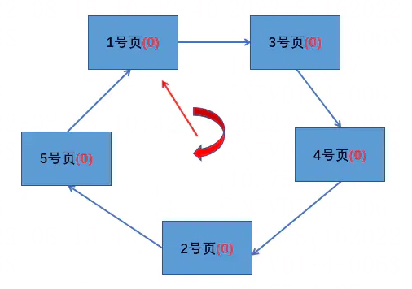
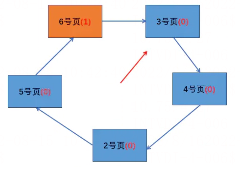
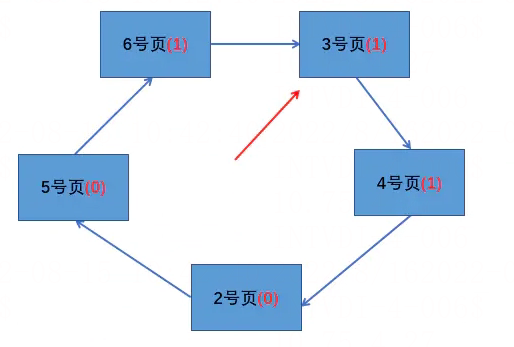
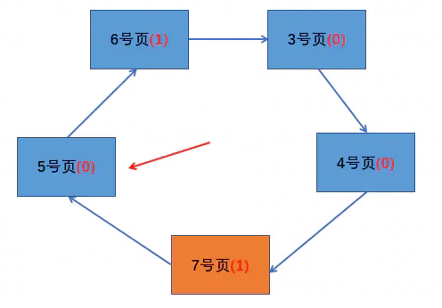

# 时钟置换算法

> GitHub 仓库源文件：[点击打开网页渲染版](https://github.com/ben2023niao/ben-ops-notes/blob/main/doc/md/202304141557-%E5%AE%89%E5%85%A8%E4%B8%8E%E5%A0%A1%E5%9E%92%E6%9C%BA%2B%E9%AB%98%E7%BA%A7%E5%AE%89%E5%85%A8%2B%E7%9F%A5%E8%AF%86%E7%AC%94%E8%AE%B0-%E6%97%B6%E9%92%9F%E7%BD%AE%E6%8D%A2%E7%AE%97%E6%B3%95.md)

## 算法思想

最佳置换算法性能最好，但无法实现。先进先出置换算法实现简单，但是算法性能差。最近最久未使用置换算法性能好，是最接近 OPT 算法性能的，但是实现起来需要专门的硬件支持，算法开销大。时钟置换算法是一种性能和开销均平衡的算法。又称 CLOCK 算法，或最近未用算法（NRU，Not Recently Used）。

简单 CLOCK 算法算法思想：为每个页面设置一个访问位，再将内存中的页面都通过链接指针链接成一个循环队列。当某个页被访问时，其访问位置 1。当需要淘汰一个页面时，只需检查页的访问位。如果是 0，就选择该页换出；如果是 1，暂不换出，将访问位改为 0，继续检查下一个页面，若第一轮扫描中所有的页面都是 1，则将这些页面的访问位一次置为 0 后，再进行第二轮扫描（第二轮扫描中一定会有访问位为 0 的页面，因此简单的 CLOCK 算法选择一个淘汰页面最多会经过两轮扫描）。

例如，假设某系统为某进程分配了五个内存块，并考虑有以下页面号引用串：1,3,4,2,5,6,3,4,7。刚开始访问前 5 个页面，由于都是刚刚被访问所以它们的访问位都是 1，在内存的页面如下图所示：

此时页面 6 需要进入内存，那么需要从中淘汰一个页面，于是从循环队列的队首（1 号页）开始扫描，尝试找到访问位为 0 的页面。经过一轮扫描发现所有的访问位都是 1，经过一轮扫描后，需要将所有的页面标志位设置为 0，如下图：

之后进行第二轮扫描，发现 1 号页的访问位为 0，所以换出 1 号页，同时指针指向下一页，如下图：

接下来是访问 3 号页和 4 号页，这两个页都在内存中，直接访问，并将访问位改为 1。在访问 3 号页和 4 号页时指针不需要动，指针只有在缺页置换时才移动下一页。如下图：

最后，访问 7 号页，此时从 3 号页开始扫描循环队列，扫描过程中将访问位为 1 的页的访问位改为 0，并找到第一个访问位为 0 的页，即 2 号页，将 2 号页置换为 7 号页，最后将指针指向 7 号页的下一页，即 5 号页。如下图：

这个算法指针在扫描的过程就像时钟一样转圈，才被称为时钟置换算法。
