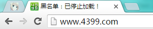

# 网站黑名单的油猴脚本

昨天搜索一个问题，点击了一个像模像样的答案，结果打开是一个游戏的官网。

被恶心到了，所以写了个user脚本，可以手动把网站添加到黑名单。

[安装此UserScript](https://greasyfork.org/zh-CN/scripts/25230)

如果想屏蔽某个域名的网站，需要手动去代码里添加其域名。

代码如下：

```
// ==UserScript==
// @name         网站黑名单
// @namespace    http://www.saber.love/?p=2683
// @version      0.1
// @description  通过域名来阻止一些网站打开
// @author       雪见仙尊
// @match        http://*/*
// @match        https://*/*
// @grant        none
// @run-at       document-start
// ==/UserScript==
/* jshint -W097 */
'use strict';

/*
使用方法：在数组myBlackList中以string类型添加要屏蔽的域名。
如果添加的域名是以*开头，则表示屏蔽该域名的所有页面，包括其所有二级域名。（如*.example1.com将会屏蔽example1.com域名的所有二级域名）
如果添加的域名不以*开头，则表示只屏蔽这个域名下的页面，不屏蔽该域名的其他二级域名。（如images.example2.com不会屏蔽www.example2.com等其他二级域名）
*/

let myBlackList = ['*.example1.com', 'images.example2.com'];

String.prototype.endWith = function(str) {
 var reg = new RegExp(str + "$");
 return reg.test(this);
}

function stopLoad() {
 window.stop();
 document.title = "黑名单：已停止加载！";
}

for (let i = 0, len = myBlackList.length; i < len; i++) {
 let pageHost = window.location.host;
 if (myBlackList[i][0] === '*') {
 let listHost = myBlackList[i].substring(1);
 if (pageHost.indexOf(listHost) > -1 && pageHost.endWith(listHost)) {
 stopLoad();
 break;
 }
 } else {
 if (pageHost === myBlackList[i]) {
 stopLoad();
 break;
 }
 }
}
```
