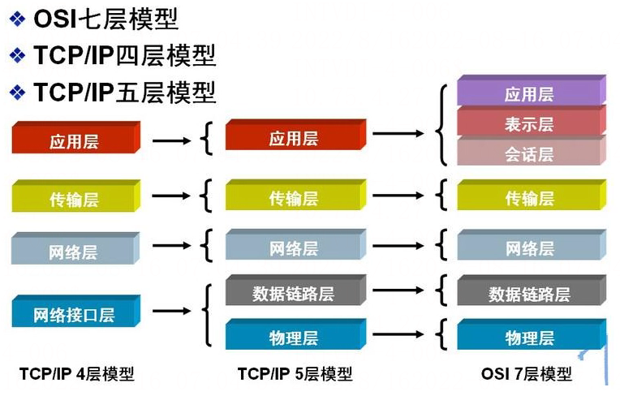

# 网络分层模型

## 网络分层模型

网络分层模型主要有两大类，一种是偏学术性的：**[OSI 七层网络模型](https://haicoder.net/http/http-osi.html)**；一种是偏应用性的：**[TCP/IP](https://haicoder.net/tcp/tcpip-tutorial.html)** 网络模型，其又分为 **[四层模型](https://haicoder.net/http/http-tcpip.html)** 和五层模型。

## OSI七层模型与TCP/IP四层模型区别

OSI 七层模型是学术界提出的，从层数上就知道它更把网络分的更加详实，从而也使得它的实现更加复杂，因此它的学术价值更大。

而 TCP/IP 网络模型是由计算机寡头提出并实现，并且属于开源产品，更能直接提供给用户使用。

## TCP/IP四层模型和五层模型区别

四层模型属于工业标准，是将 OSI 的有一些层被整合（应用层、表示层和会话层合并为应用层，数据链路层和物理层合并为网络接口层），或者功能分散到其他层去，因此在实际应用中更广泛。

五层模型只是在学习计算机网络原理是往往采用的折中办法，因为 OSI 七层模型层数过多，太详细了反倒不适合学习，四层模型过于简化，于是综合 OSI 和 TCP/IP 的优点而提出五层模型，这样既简洁又能将概念阐述清楚（总不能一会学习 OSI 一会又来学习 TCP/IP 四层模型吧）。

## 为什么要进行网络层次划分

为了简化网络设计的复杂性，通信协议采用分层的结构，各层协议之间既相互独立又相互高效的协调工作。对于复杂的通信协议，其结构应该是采用层次的。分层的协议可以带来很多便利：

1. 各层次之间是独立的。某一层并不需要知道它的下一层是如何实现的，而仅仅需要知道该层通过层间的接口所提供的服务。这样，整个问题的复杂程度就下降了。也就是说上一层的工作如何进行并不影响下一层的工作，这样我们在进行每一层的工作设计时只要保证接口不变可以随意调整层内的工作方式。
2. 灵活性好。当任何一层发生变化时，只要层间接口关系保持不变，则在这层以上或以下层均不受影响。当某一层出现技术革新或者某一层在工作中出现问题时不会连累到其它层的工作，排除问题时也只需要考虑这一层单独的问题即可。
3. 结构上可分割开。各层都可以采用最合适的技术来实现。技术的发展往往不对称的，层次化的划分有效避免了木桶效应，不会因为某一方面技术的不完善而影响整体的工作效率。
4. 易于实现和维护。这种结构使得实现和调试一个庞大又复杂的系统变得易于处理，因为整个的系统已经被分解为若干个相对独立的子系统。进行调试和维护时，可以对每一层进行单独的调试，避免了出现找不到、解决错问题的情况。
5. 能促进标准化工作。因为每一层的功能及其所提供的服务都已有了精确的说明。标准化的好处就是可以随意替换其中的某一层，对于使用和科研来说十分方便。

## 网络分层模型总结

网络分层模型主要有两大类，一种是偏学术性的：OSI 七层网络模型；一种是偏应用性的：TCP/IP 网络模型，其又分为四层模型和五层模型。
