# 进程调度算法

## 处理机调度

### 定义

调度研究的问题是：面对有限的资源，如何处理任务执行的先后顺序。对于处理机调度来说，这个资源就是有限的处理机，而任务就是多个进程。故处理机调度研究的问题是：面对有限的处理机，如何从就绪队列中按照一定的算法选择一个进程并将处理机分配给它运行，从而实现进程的并发执行。处理机调度共有三个层次，这三个层次也是一个作业从提交开始到完成所经历的三个阶段。

### 三个层次

**作业调度**

作业调度也即高级调度，这个阶段可以看作是准备阶段。主要任务是按照一定的规则从外存上处于后备队列的作业中挑选一个或多个作业，为其分配内存，建立 PCB（进程） 等，使它们具备竞争处理机的能力。

这个阶段进程的状态变化是：无 –> 创建态 –> 就绪态

**内存调度**

内存调度也即中级调度，这个阶段可以看作是优化阶段。主要任务是将暂时不能运行的进程对换到外存中，使它们挂起；而当挂起的进程具备运行条件时，它们会被重新对换回内存，得到激活。这个阶段的主要目的是提高内存利用率和系统吞吐量。

这个阶段进程的状态变化是： 静止就绪态 –> 活动就绪态，静止阻塞态 –> 活动阻塞态

**进程调度**

进程调度即低级调度，这个阶段让进程真正运行起来。主要任务是按照某种算法，从就绪队列中选取一个进程，分配处理机给它。进程调度是最基本、次数最频繁的阶段。

这个阶段进程的状态变化是： 就绪态 –> 活动态

## 进程调度

### 时机

进程调度的时机是什么呢？也就是说，什么时候会从就绪队列中选取一个进程，分配处理机给它呢？分为两种情况：当前进程主动放弃处理机 以及 当前进程被动放弃处理机。

- 当前进程主动放弃处理机：比如进程正常终止、运行过程中发生异常而终止、进程主动请求阻塞（如等待 I/O）
- 当前进程被动放弃处理机：比如进程的时间片用完、有更紧急的事需要处理（如 I/O 中断）、有更高优先级的进程进入就绪队列

### 方式

根据进程运行的过程中，处理机能否被其它进程抢占，将调度分为两种方式：

- **非抢占式：** “非抢占” 即 “不能抢占”。一旦把处理机分配给某个进程后，除非该进程终止或者主动要求进入阻塞态，否则会一直运行下去，不允许其它进程抢占自己占有的处理机。
- **抢占式：** 把处理机分配给某个进程 A 后，如果有一个更重要、更紧急的进程 B 需要用到处理机，那么进程 A 会立即暂停，把处理机交给进程 B。

### 补充

以下情况不会发生进程调度：

- 处理中断的时候：由于中断处理过程复杂，与硬件密切相关，很难做到在中断处理过程中进行进程切换。
- 进程在操作系统内核程序临界区的时候：注意是内核程序的临界区。普通临界区依然是有可能发生进程调度的。
- 进行原子操作的时候。

## 调度算法

### 评价指标

- CPU 利用率：忙碌的时间 / 总时间
- 系统吞吐量：完成作业量 / 总时间
- 周转时间：作业完成时间 - 作业提交时间 = 作业实际运行的时间 + 等待时间
- 平均周转时间： 各作业周转时间之和 / 作业数
- 带权周转时间：周转时间 / 作业实际运行的时间
- 平均带权周转时间：各作业带权周转时间之和 / 作业数
- 等待时间：进程或者作业处于等待处理机状态的时间之和，即 周转时间 - 作业实际运行的时间
	- 对于进程来说，等待时间指的是进程建立后等待被服务的时间之和（由于等待 I/O 完成的期间也属于被服务时间，所以这个时间不计入等待时间）
	- 对于作业来说，除了进程建立后的等待时间，还包括作业在外存后备队列中等待的时间

平均等待时间：各作业等待时间之和 / 作业数

响应时间：从用户提交请求到首次产生响应所用的时间

### 早期批处理系统的调度算法

**先来先服务调度算法（FCFS）**

FCFS 算法即 “先来先服务” 算法，类似于我们生活中的排队，谁先来，谁就先享受服务。对于作业调度，它指的是谁先到达后备队列，谁就先出队，进而先被执行；对于进程调度，它指的是谁先到达就绪队列，谁就先出队，进而先被执行。

看下面的例子：
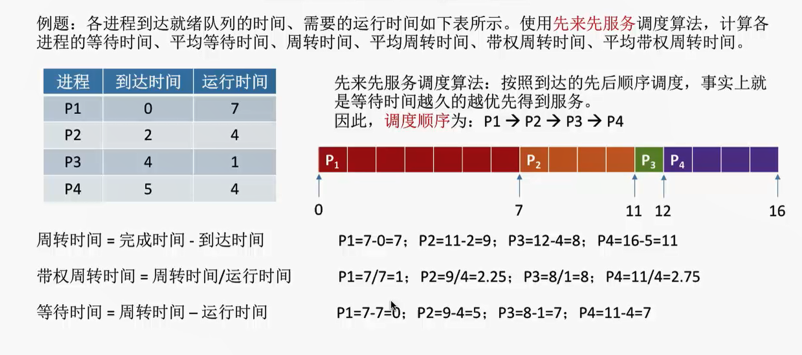

这个就是很自然的谁先到达，谁就先享受服务，所以顺序上就是从 P1 到 P4。注意这里的到达时间，就是前面说过的提交时间。这里不考虑等待 I/O 的情况，否则计算等待时间的时候还需要减去等待 I/O 的时间。

- FCFS 算法是非抢占式的算法，不存在某个进程在执行的时候被其它进程抢占处理机的情况。
- 它的优点是公平、算法实现简单，并且不会导致饥饿（不管等多久，所有进程最后都会运行，不存在某个进程永远得不到处理机的情况）
- 缺点是对长作业有利、对短作业不利 —— 对于长作业，如果它先到，那么它自然无需做过多的等待，而即使是后到，它等待短作业的时间也是不足挂齿的，所以长作业怎么都不亏；对于短作业，如果它先到，自然也无需做过多等待，但是如果它后到，那么它不得不花很长的时间去等待长作业完成，然而它自己运行所需的时间却是很短的，所以说这个算法对短作业不利。在这种情况下，短作业的带权周转时间会很大，也即周转时间远远大于实际运行时间，表示有大量时间用于等待。
- 有时候也说 FCFS 算法对 CPU 繁忙型作业有利，对 I/O 繁忙型作业不利。这是因为 CPU 繁忙型作业的特点是需要大量的 CPU 时间进行计算，而很少请求 I/O 操作，通常视作长作业。

**短作业优先（SJF）调度算法**

SJF 算法即 “短作业优先” 算法，前面的算法问题在于对短作业不利，所以 SJF 算法优先顾及短作业，让当前已到达并且运行时间最短的进程先执行。SJF 算法有非抢占式（默认）版本和抢占式版本，抢占式版本也叫做 SRTN 算法，即最短剩余时间优先算法。

先看非抢占式版本的例子：
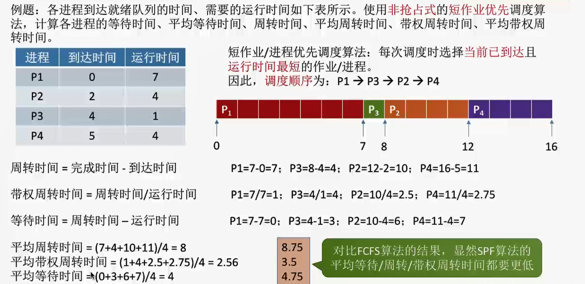

运行顺序的说明：

注意这里虽然 P1 不是运行时间最短的，但是它是 当前最先到达且运行时间最短 的进程，所以它首先运行，并且在运行过程中，P2，P3，P4 陆续到达就绪队列。在 P1 运行完之后就需要调度了，这时候，就绪队列中满足“当前已到达且运行时间最短”的进程是 P3，所以 P3 运行；P3 运行完之后继续调度其它进程，P2 和 P4 运行时间都一样，不过 P2 首先到达，所以 P2 运行，最后再轮到 P4 运行。

另外，由于这是非抢占式版本，所以除非进程终止或者其它原因，否则其它进程是无法与当前进程竞争处理机的。

接着看抢占式版本的例子：
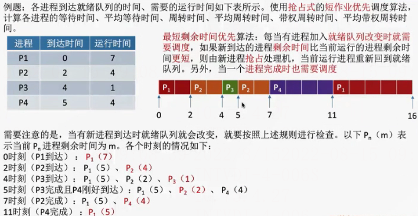

多了一个调度条件：

由于这是抢占式版本，所以存在着进程之间对于处理机的竞争。也就是说，除了进程正常终止会发生调度之外，每次有新进程进入就绪队列的时候，也可能发生调度。而具体谁会被调度并夺得处理机，则是比较新到达进程的剩余时间与正在运行进程的剩余时间，前者如果更短，那么它将夺得处理机。

下面是抢占式版本的相关指标计算：

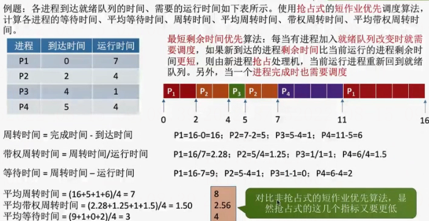

注意：

一般可以认为，SJF 算法的平均等待时间、平均周转时间都是最少的（相比于其它算法），但是更准确地说，其实它的抢占式版本，也即 SRTN 算法，各项指标要比 SJF 算法更低。

- SJF 算法的优点在于，它拥有 “最短的” 平均等待时间和平均周转时间
- 缺点在于，虽然这次顾及了短作业，但是没有顾及长作业，对长作业是不利的。因为一旦短作业源源不断进入，那么它们就会不断跑在长作业前面，导致长作业永远无法运行，产生“饥饿”甚至“饿死”现象。
- 另外一个缺点是，在实际实现中，要做到真正意义上的短作业优先，具有一定难度。

**HRRN 算法**

HRRN 算法即高响应比优先算法，它优先调度响应比高的进程。

响应比 = （ 等待时间+实际运行时间 ）/ 实际运行时间 = 等待时间 / 实际运行时间 + 1

可以说它同时综合了 FCFS 算法和 SJF 算法的优点。为什么优先调度响应比高的进程？因为当两个进程的等待时间一样时，响应比越高的进程，它的实际运行时间越短，这一点类似于 SJF 算法，优先顾及运行时间短的进程；而当两个进程的实际运行时间一样时，响应比越高的进程，它的等待时间越长，等待时间越长说明该进程越先到达，这一点类似于 FCFS 算法，优先顾及先到达的进程。

HRRN 是非抢占式的算法，因此只有当前运行进程正常放弃处理机的时候，才会计算哪个进程的响应比高，然后进行调度。

看下面的例子：
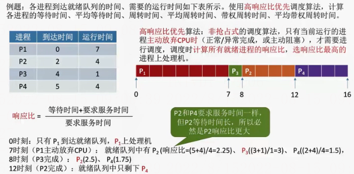

注意这里 “要求服务的时间” 就是实际需要运行的时间，等待时间则是从进程到达就绪队列的那一刻起，到发生进程调度这一段所花费的时间。

HRRN 算法的优点是综合考虑了等待时间和实际运行时间，而且也不会导致长作业饥饿的问题（因为长作业等待时间变长之后，它的响应比也会变高，增加了可以被调度的机会）。

### 总结

上面这几种算法主要关注对用户的公平性、平均周转时间、平均等待时间等评价系统整体性能的指标，但是不关心 “响应时间”，也并不区分任务的紧急程度，因此对于用户来说，交互性很糟糕。因此它们一般适合用于早期的批处理系统。下面介绍的算法则适合用于交互式系统。

## 交互式系统的调度算法

### RR算法

RR 算法即时间片轮转算法。像前面的算法的话，通常都是非抢占式的，也就是说，一个进程正常运行完，另一个进程才有机会被调度，整体呈现出 “顺序” 的特点；而 RR 算法的特点则在于 “公平分配”，按照进程到达就绪队列的顺序，轮流让每个进程执行一个相等长度的时间片，若在自己的时间片内没有执行完，则进程自动进入就绪队列队尾，并调度队头进程运行。整体呈现出“交替”的特点。因为进程即使没运行完也会发生调度，所以这是一个抢占式的算法。

看下面的例子：
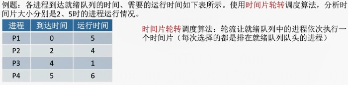

先来看时间片为 2 的情况：

**0 时刻：** 此时就绪队列为 P1(5)，P1 上处理机运行

**2 时刻：** P2 到达就绪队列队头，同时 P1 时间片用完，到达就绪队列队尾。此时就绪队列为 P2(4) —— P1(3)，P2 被调度，上处理机运行。

**4 时刻：** P3 到达就绪队列队尾，同时 P2 时间片用完，进入就绪队列，紧挨在 P3 后面。此时就绪队列为 P1(3) —— P3(1) ——P2(2)，P1 被调度，上处理机运行。

**5 时刻：** P4 到达就绪队列队尾，P1 时间片还没用完，仍然在运行。此时就绪队列为 P3(1) —— P2(2)——P4(6)

**6 时刻：** P1 时间片用完，进入就绪队列队尾，此时就绪队列为 P3(1) —— P2(2) —— P4(6) —— P1(1)。P3 被调度，上处理机运行。

**7 时刻：** 虽然 P3 有 2 个单位的时间片可用，但是它实际上只需要用到一个单位，所以 7 时刻的时候它正常运行完，轮到 P2 被调度。此时就绪队列为 P4(6) —— P1(1)。

**9 时刻：** P2 时间片用完，同时也正常运行结束。P4 被调度，上处理机运行。此时就绪队列为 P1(1)。

**11 时刻：** P4 时间片用完，到达就绪队列队尾。此时就绪队列为 P1(1) —— P4(4)。P1 被调度，上处理机运行。

**12 时刻：** 在 12 时刻的时候，P1 就已经运行结束。此时再次调度 P4 上处理机运行

**14 时刻：** P4 时间片用完，由于就绪队列中没有其它进程可供调度，所以让 P4 接着运行一个时间片

**16 时刻：** P4 正常运行结束。

整个过程如下图所示：
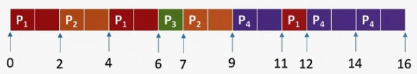

再来看时间片为 5 的情况：

**0 时刻：** 此时就绪队列为 P1(5)，P1 上处理机运行

**2 时刻：** P2 到达就绪队列队头，P1 仍在运行

**4 时刻：** P3 到达就绪队列队尾，P1 仍在运行

**5 时刻：** P4 到达就绪队列队尾。P1 正常运行结束，时间片刚好用完。此时就绪队列是 P2(4)——P3(1)——P4(6)，所以 P2 被调度上处理机

**9 时刻：** 尽管时间片没有用完，但是 P2 正常运行结束，所以 P3 会被调度上处理机

**10 时刻：** P3 正常运行结束，同样调度 P4

**15 时刻：** P4 时间片用完，但是就绪队列没有可供调度的进程，所以 P4 还得继续运行

**16 时刻：** P4 正常运行结束

整个过程如下图所示：
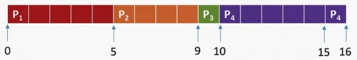

这里会发现，效果和使用 FCFS 算法是差不多的。实际上，如果时间片太大，那么 RR 算法会退化成 FCFS 算法，而且会增加进程响应时间，所以时间片应该设置得小一点；另一方面，时间片也不能设置得太小，否则进程切换会过于频繁，导致更多的时间用于切换而不是有效执行进程。

总的来说，RR 算法的优点是公平、响应快，适用于分时操作系统；缺点则是进程切换频率相比其他算法会高一点，因此有一定的开销。另外它不区分任务的紧急程度，再紧急的任务，如果某个运行进程的时间片还没用完，这个任务也不会被调度。

RR 算法不会导致饥饿，因为时间片一到自然就会切换到其它进程，不存在某个进程永远无法被调度的情况。

### 优先级算法

优先级算法在某种程度上和 HRRN 算法很像，两者可以联系起来进行理解。前面我们所讲的算法都无法区分进程紧急程度，而优先级算法弥补了这个问题。它会给每个进程一个优先级，调度时会选择当前已到达并且优先级最高的进程。和 HRRN 算法一样，它也有非抢占式和抢占式两个版本。

先看非抢占式版本：
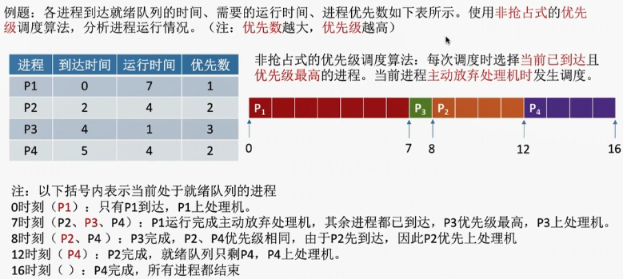

这里和 HRRN 算法是很像的，进程会正常运行，直到结束之后才发生调度，在调度的时候会选择队列中优先级最高的进程。

再看抢占式版本：
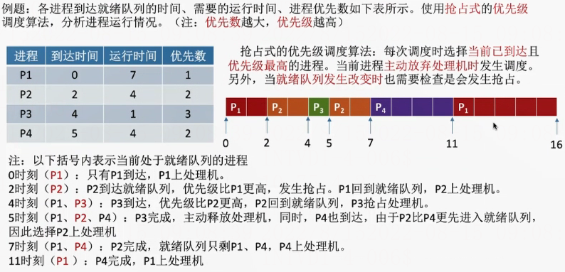

这里同样和 HRRN 算法很像。除了正常运行结束会发生调度之外，每次就绪队列有新的进程到达时还会做一次检查，如果新到达进程优先级高于正在运行进程的优先级，那么新到达进程会抢占处理机。

PS：在优先级算法中，就绪队列可能不止有一个，可以按照不同优先级分成很多种队列。另外还要注意，有的地方规定优先数越小，优先级越高，具体看题目要求。

静态优先级和动态优先级：

优先级还包括静态优先级和动态优先级。上面所讲的属于静态优先级，指的是进程的优先级在它创建的时候就确定了，此后一直不会改变；动态优先级则相对灵活很多，它会根据具体情况动态调整进程的优先级。

- 对于静态优先级，一般认为系统进程优先级要高于用户进程优先级；前台进程优先级高于后台进程优先级；I/O 型进程优先级会比较高。
- 于动态优先级，会尽量遵循公平的原则。也就是说，如果某个进程实在等得太久，那么不妨提高它的优先级，让他有机会被调度；反之，如果某个进程占用处理机时间过长，那么就要考虑降低它的优先级，不要让他一直“霸占”处理机了。另外，之前说过 I/O 型进程的优先级会很高，所以如果某个进程频繁进行 I/O 操作，也可以考虑提高它的优先级。

总的来说，优先级算法的优点在于区分了各个进程的紧急程度，比较紧急重要的进程会优先得到处理，因此它适用于实时操作系统。另外，由于动态优先级的存在，使得它对进程的调度相对灵活很多。缺点则是，如果源源不断进来了一些高优先级的进程，那么优先级相对较低的进程可能一直无法执行，进而导致饥饿现象的发生。这点和 HRRN 算法也是很像的。（其实也可以把 HRRN 算法看作优先级算法的一种特殊情况，将响应比作为优先级评判的标准）

### 多级反馈队列算法

多级反馈队列算法是对其他调度算法的折中权衡，它的分析过程会复杂很多。下面我们先给定多级反馈队列算法的几个规则，再结合图片文字理一理具体的过程。

- 有多个级别的就绪队列，各级队列优先级从高到低，时间片从小到大
- 每次有新进程到达，都会首先进入第一级队列，并按 FCFS 算法被分配时间片。如果时间片用完了而进程还没执行完，那么该进程将被送到下一级队列队尾。如果当前已经是最后一级，则重新放回当前队列队尾
- 当且仅当上层级别的队列为空时，下一级队列的进程才有机会被调度
- 关于抢占：如果某个进程运行的时候，比它所在队列级别更高的队列中有新进程到达，则那个新进程会抢占处理机，而当前正在运行的进程会被送到当前队列队尾

下面我们结合图片来进行理解。

在 0 时刻，P1 首先到达第一级就绪队列
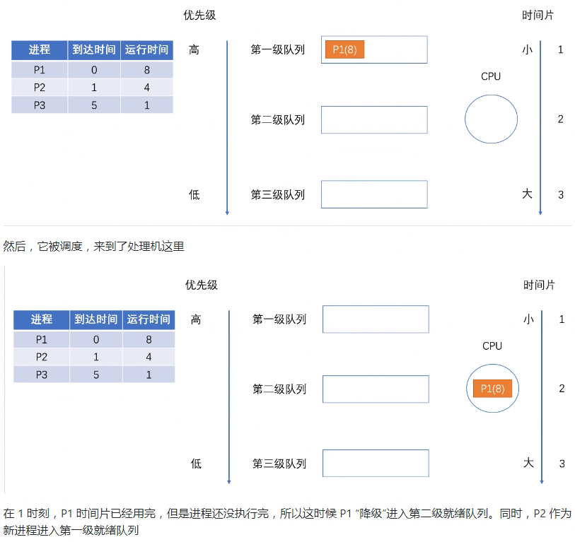
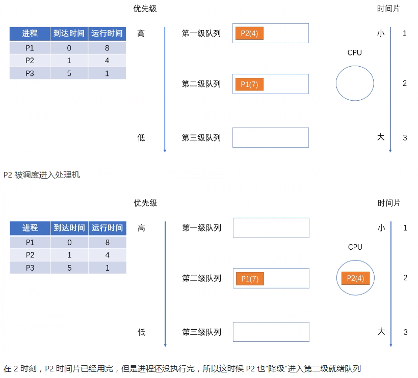
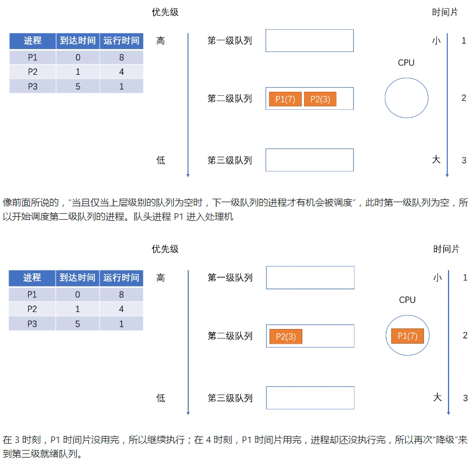

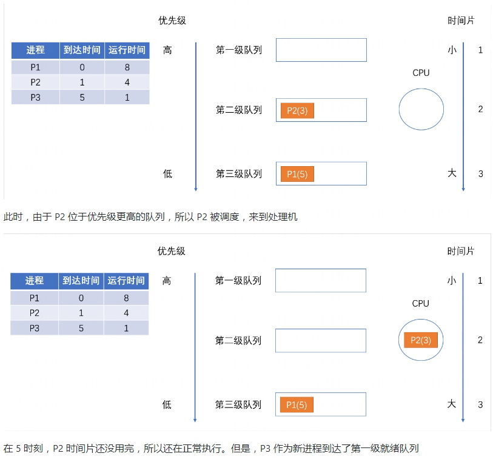

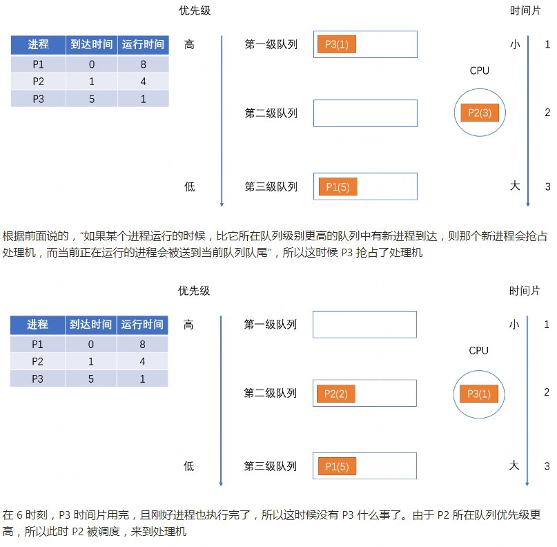
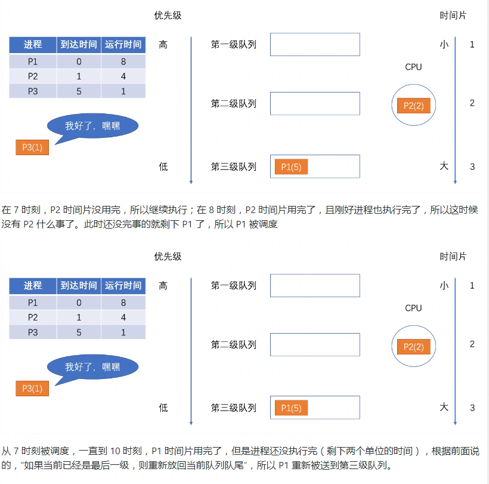
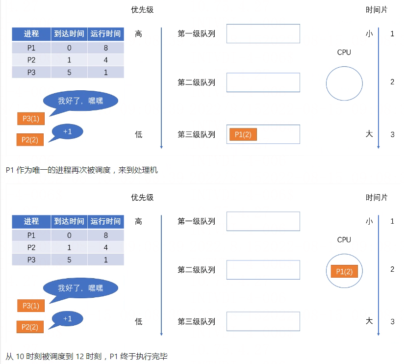

最后再做一下总结：

- 优点：

	- 对各类型进程相对公平（FCFS 的优点）：谁先进来，谁就会处于高级队列，优先得到服务
	- 每个新到达的进程都可以很快就得到响应（RR 的优点）：新到达的进程首先在高级队列，可以很快得到响应
	- 短进程只用较少的时间就可完成（SPF 的优点）：不需要经历过多的队列
	- 可灵活地调整对各类进程的偏好程度，比如 CPU 密集型进程、I/O 密集型进程（拓展：可以将因 I/O 而阻塞的进程重新放回原队列，这样 I/O 型进程就可以保持较高优先级）
	- 对各类型用户友好。

	对于终端型用户来说，他们提交的大多属于较小的交互型作业，系统只要能使这些作业在第一队列所规定的时间片内完成，便可使终端型作业用户都感到满意；对短批处理作业用户来说，只需在第一队列中执行一个时间片，或至多在第二和第三队列中各执行一个时间片即可完成；对长批处理作业用户来说，只要让作业依次在第 1, 2，…. n 个队列中运行，然后再按轮转方式运行，用户不必担心其作业长期得不到处理。
- 缺点：可能会导致饥饿。若有源源不断的短进程到达第一队列，那么这些进程会持续被调度，使得下面一级的那些进程一直得不到调度，导致饥饿现象的发生。

### 总结

比起早期的批处理操作系统来说，由于计算机造价大幅降低，因此之后出现的交互式操作系统（包括
分时操作系统、实时操作系统等）更注重系统的响应时间、公平性、平衡性等指标。而以上这三种算法恰好也
能较好地满足交互式系统的需求。因此这三种算法适合用于交互式系统。( 比如 UNIX 使用的就是多级反馈
队列调度算法）

## 总结

### 先来先服务（FCFS）调度算法

处于就绪态的进程按先后顺序链入到就绪队列中，而FCFS调度算法按就绪进程进入就绪队列的先后次序选择当前最先进入就绪队列的进程来执行，直到此进程阻塞或结束，才进行下一次的进程选择调度。

FCFS调度算法采用的是不可抢占的调度方式，一旦一个进程占有处理机，就一直运行下去，直到该进程完成其工作，或因等待某一事件而不能继续执行时，才释放处理机。

操作系统如果采用这种进程调度方式，则一个运行时间长且正在运行的进程会使很多晚到的且运行时间短的进程的等待时间过长。

### 短作业优先（SJF）调度算法

其实目前作业的提法越来越少，我们姑且把 “作业” 用 “进程” 来替换，改称为短进程优先调度算法，此算法选择就绪队列中确切（或估计）运行时间最短的进程进入执行。

它既可采用可抢占调度方式，也可采用不可抢占调度方式。可抢占的短进程优先调度算法通常也叫做最短剩余时间优先（Shortest Remaining Time First，SRTF）调度算法。短进程优先调度算法能有效地缩短进程的平均周转时间，提高系统的吞吐量，但不利于长进程的运行。

而且如果进程的运行时间是 “估计” 出来的话，会导致由于估计的运行时间不一定准确，而不能实际做到短作业优先。

### 时间片轮转（RR）调度算法

RR 调度算法与 FCFS 调度算法在选择进程上类似，但在调度的时机选择上不同。RR调度算法定义了一个的时间单元，称为时间片（或时间量）。一个时间片通常在1～100 ms之间。

当正在运行的进程用完了时间片后，即使此进程还要运行，操作系统也不让它继续运行，而是从就绪队列依次选择下一个处于就绪态的进程执行，而被剥夺CPU使用的进程返回到就绪队列的末尾，等待再次被调度。

时间片的大小可调整，如果时间片大到让一个进程足以完成其全部工作，这种算法就退化为FCFS调度算法；若时间片设置得很小，那么处理机在进程之间的进程上下文切换工作过于频繁，使得真正用于运行用户程序的时间减少。

时间片可以静态设置好，也可根据系统当前负载状况和运行情况动态调整，时间片大小的动态调整需要考虑就绪态进程个数、进程上下文切换开销、系统吞吐量、系统响应时间等多方面因素。

### 高响应比优先（Highest Response Ratio First，HRRF）调度算法

HRRF 调度算法是介于先来先服务算法与最短进程优先算法之间的一种折中算法。先来先服务算法只考虑进程的等待时间而忽视了进程的执行时间，而最短进程优先调度算法只考虑用户估计的进程的执行时间而忽视了就绪进程的等待时间。

HRRF调度算法二者兼顾，既考虑进程等待时间，又考虑进程的执行时间，为此定义了响应比（Rp）这个指标：

Rp=（等待时间+预计执行时间）/执行时间=响应时间/执行时间

上个表达式假设等待时间与预计执行时间之和等于响应时间。HRRF调度算法将选择Rp最大值的进程执行，这样既照顾了短进程又不使长进程的等待时间过长，改进了调度性能。

但HRRF调度算法需要每次计算各各个进程的响应比Rp，这会带来较大的时间开销（特别是在就绪进程个数多的情况下）。

### 多级反馈队列（Multi-Level Feedback Queue）调度算法

在采用多级反馈队列调度算法的执行逻辑流程如下：

1. 设置多个就绪队列，并为各个队列赋予不同的优先级。第一个队列的优先级最高，第二队次之，其余队列优先级依次降低。仅当第1～i-1个队列均为空时，操作系统调度器才会调度第i个队列中的进程运行。赋予各个队列中进程执行时间片的大小也各不相同。在优先级越高的队列中，每个进程的执行时间片就越小或越大（Linux-2.4内核就是采用这种方式）。
2. 当一个就绪进程需要链入就绪队列时，操作系统首先将它放入第一队列的末尾，按FCFS的原则排队等待调度。若轮到该进程执行且在一个时间片结束时尚未完成，则操作系统调度器便将该进程转入第二队列的末尾，再同样按先来先服务原则等待调度执行。如此下去，当一个长进程从第一队列降到最后一个队列后，在最后一个队列中，可使用FCFS或RR调度算法来运行处于此队列中的进程。
3. 如果处理机正在第i（i>1）队列中为某进程服务时，又有新进程进入第k（k<i）的队列，则新进程将抢占正在运行进程的处理机，即由调度程序把正在执行进程放回第i队列末尾，重新将处理机分配给处于第k队列的新进程。

从MLFQ调度算法可以看出长进程无法长期占用处理机，且系统的响应时间会缩短，吞吐量也不错（前提是没有频繁的短进程）。所以MLFQ调度算法是一种合适不同类型应用特征的综合进程调度算法。

### 最高优先级优先调度算法

进程的优先级用于表示进程的重要性及运行的优先性。一个进程的优先级可分为两种：静态优先级和动态优先级。静态优先级是在创建进程时确定的。一旦确定后，在整个进程运行期间不再改变。

静态优先级一般由用户依据包括进程的类型、进程所使用的资源、进程的估计运行时间等因素来设置。一般而言，若进程需要的资源越多、估计运行的时间越长，则进程的优先级越低；反之，对于I/O bounded的进程可以把优先级设置得高。

动态优先级是指在进程运行过程中，根据进程执行情况的变化来调整优先级。动态优先级一般根据进程占有CPU时间的长短、进程等待CPU时间的长短等因素确定。

占有处理机的时间越长，则优先级越低，等待时间越长，优先级越高。那么进程调度器将根据静态优先级和动态优先级的总和现在优先级最高的就绪进程执行。

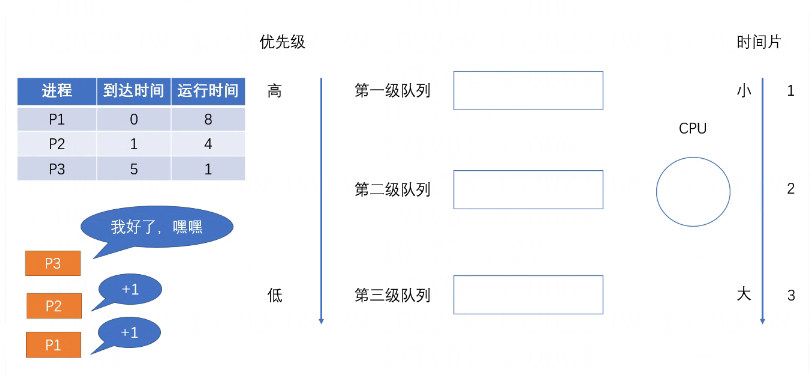
