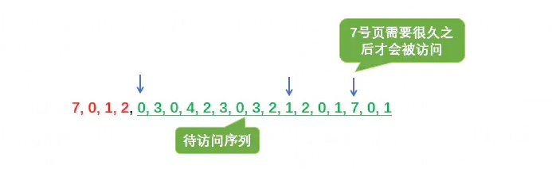
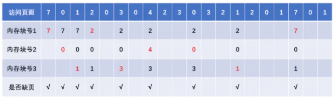
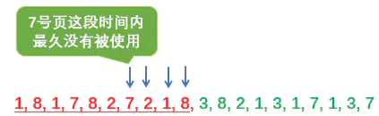
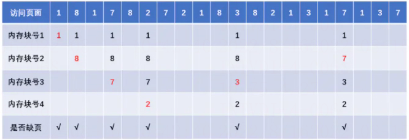

# 页面置换算法

> GitHub 仓库源文件：[点击打开网页渲染版](https://github.com/ben2023niao/ben-ops-notes/blob/main/doc/md/202304141557-%E5%AE%89%E5%85%A8%E4%B8%8E%E5%A0%A1%E5%9E%92%E6%9C%BA%2B%E9%AB%98%E7%BA%A7%E5%AE%89%E5%85%A8%2B%E7%9F%A5%E8%AF%86%E7%AC%94%E8%AE%B0-%E9%A1%B5%E9%9D%A2%E7%BD%AE%E6%8D%A2%E7%AE%97%E6%B3%95.md)

操作系统中的页面置换算法主要包括最佳置换算法（OPT，Optimal）、先进先出置换算法（FIFO）、最近最久未使用置换算法（LRU，Least Recently Used）、时钟置换算法和改进型的时钟置换算法。

## 最佳置换算法（OPT，Optimal）

### 算法思想

每次选择淘汰的页面将是以后永不使用，或者在最长时间内不再被访问的页面，这样可以保证最低的缺页率。

### 举例说明

假设系统为进程分配了三个内存块，并考虑到有以下页面号引用串（会依次访问这些页面）：7,0,1,2,0,3,0,4,2,3,0,3,2,1,2,0,1,7,0,1。

1. 第一个访问的是 7 号页，内存中没有此页，由缺页中断机构将 7 号页调入内存。此时有三个可用的内存块，不需要置换。即第一次(7) ：7
2. 同理，第二个访问的是 0 号页，和第一次一样，第三次访问的是 1 号页，同样 1 号页也会被调入内存，1 号内被调入内存后，此时分配给该进程内存空间已占满。

	- 第二次(0)：7 0
	- 第三次(1)：7 0 1
3. 第四个访问的页是 2 号页，此时内存已经用完，需要将一个页调出内存，根据最佳置换算法，淘汰一个以后永不使用或最长时间不使用的，此时内存中的页有 7、0、1，查看待访问页号序列中这三个页号的先后位置，下图可以看到，0 号页和 1 号页在不久又会被访问到，而 7 号页需要被访问的时间最久。所以该算法会淘汰 7 号页。

`第一次(7) ：7
第二次(0)：7 0
第三次(1)：7 0 1
第四次(2)：0 1 2`

按照此算法依次执行，最后的结果如下：

`第一次(7) ：7
第二次(0)：7 0
第三次(1)：7 0 1
第四次(2)：0 1 2
第五次(0)：0 1 2（命中）
第六次(3) ：0 3 1
第七次(0) ：0 3 1（命中）
第八次(4) ：3 2 4
第九次(2) ：3 2 4（命中）
第十次(3) ：3 2 4（命中）
第十一次(0) ：3 2 0
第十二次(3) ：3 2 0（命中）
.....`

结果图：

整个过程缺页中断发生了 9 次，页面置换发生了 6 次。缺页率 = 9 / 20 = 45%。

注：缺页时未必发生页面置换，若还有可用的空闲内存空间就不用进行页面置换。

最佳置换算法可以保证最低的缺页率，但是实际上，只有进程执行的过程中才能知道接下来会访问到的是哪个页面。操作系统无法提前预判页面的访问序列。因此，最佳置换算法是无法实现的。

## 先进先出置换算法（FIFO）

### 算法思想

每次选择淘汰的页面是最早进入内存的页面。

### 举例说明

该算法很简单，每次淘汰最在内存中待时间最久的各个，下面分别给出系统为进程分为配三个内存块和四个内存块的执行情况图。访问序列为 3,2,1,0,3,2,4,3,2,1,0,4。

分配三个内存块的情况：

`第一次(3) ：3
第二次(2) ：3 2
第三次(1) ：3 2 1
第四次(0) ：2 1 0
第五次(3) ：1 0 3
第六次(2) ：0 3 2
第七次(4) ：3 2 4
第八次(3) ：3 2 4（命中）
第九次(2) ：3 2 4（命中）
第十次(1) ：2 4 1
第十一次(0) ：4 1 0
第十二次(4) ：4 1 0（命中）`

分配三个内存块时，缺页次数：9 次。

分配四个内存块的情况：

`第一次(3) ：3
第二次(2) ：3 2
第三次(1) ：3 2 1
第四次(0) ：3 2 1 0
第五次(3) ：3 2 1 0（命中）
第六次(2) ：3 2 1 0 （命中）
第七次(4) ：2 1 0 4
第八次(3) ：1 0 4 3
第九次(2) ：0 4 3 2
第十次(1) ：4 3 2 1
第十一次(0) ：3 2 1 0
第十二次(4) ：2 1 0 4`

分配四个内存块时，缺页次数：10 次。当为进程分配的物理块数增大时，缺页次数不减反增的异常现象称为贝莱迪（Belay）异常。

只有 FIFO 算法会产生 Belay 异常。另外，FIFO 算法虽然实现简单，但是该算法与进程实际运行时的规律不适应。因为先进入的页面也有可能最经常被访问。因此，算法性能差。

## 最近最久未使用置换算法（LRU）

### 算法思想

每次淘汰的页面是最近最久未使用的页面。

### 实现方法

赋予每个页面对应的页表项中，用访问字段记录该页面自上次被访问以来所经历的时间 t。当需要淘汰一个页面时，选择现有页面中 t 最大的页面，即最近最久未使用。

### 举例说明

加入某系统为某进程分配了四个内存块，并考虑到有以下页面号引用串：1,8,1,7,8,2,7,2,1,8,3,8,2,1,3,1,7,1,3,7

这里先直接给出答案：

`第一次(1) ：1
第二次(8) ：1 8
第三次(1) ：8 1 （命中）（由于1号页又被访问过了，所以放到最后）
第四次(7) ：8 1 7
第五次(8) ：1 7 8（命中）
第六次(2) ：1 7 8 2
第七次(7) ：1 8 2 7（命中）
第八次(2) ：1 8 7 2（命中）
第九次(1) ：8 7 2 1（命中）
第十次(8) ：7 2 1 8（命中）
第十一次(3) ：2 1 8 3
第十二次(8) ：2 1 3 8（命中）
第十三次(2) ：1 3 8 2（命中）
第十四次(1) ：3 8 2 1（命中）
第十五次(3) ：8 2 1 3（命中）
第十六次(1) ：8 2 3 1（命中）
第十七次(7) ：2 3 1 7
....`

这里前 10 次都 1、8、7、2 这四个页，四个内存块号正好可以满足，当第 11 次要访问的 3 号页进入内存时，需要从 1、8、7、2 这四个页淘汰一个页，按照该算法，从页号为3的开始，从右往左一次找到这 4 个页第一次出现的地方，在最左边的就是最近最少使用的页。

如下图所示，所以该算法最终淘汰的是 7 号页。同时直接从第十次的访问结果 7 2 1 8 也可以直接看出，7 号页在最前面，是最久没有被访问过的，所以淘汰应该是 7 号页。

结果图

