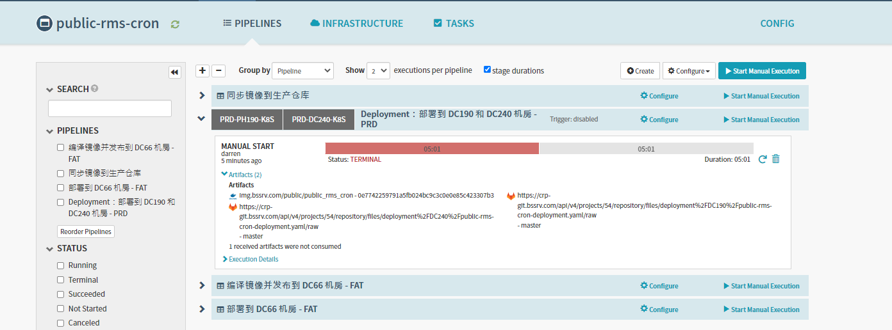
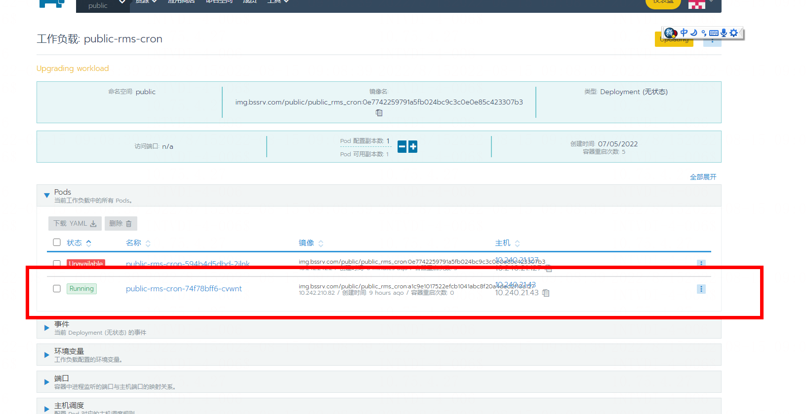
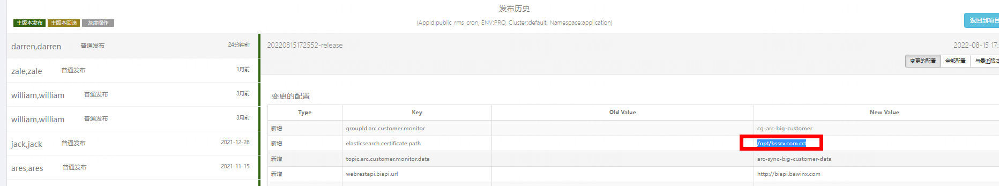
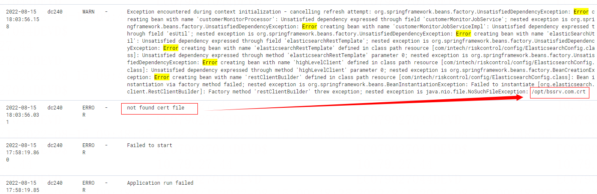
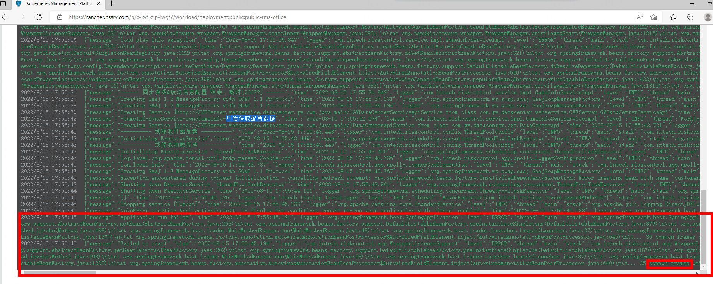

# 8/15 大客監控升級狀況處理

反馈人  升级手兼实习值班(hsDarren)

问题描述
常规k8s模块升级异常
public-arc-service 异常
public-rms-office 异常
public_rms_cron 异常

原因
新增的ES配置没有上传对应的证书导致连接异常

处理方法
1 让升级手回滚
2 让基础平台那边上传对应证书

3 重新让升级手发布恢复正常
public-arc-service 正常
public-rms-office 正常
public_rms_cron 正常
