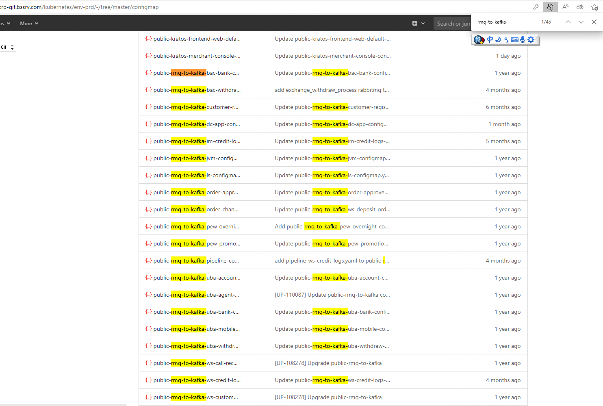
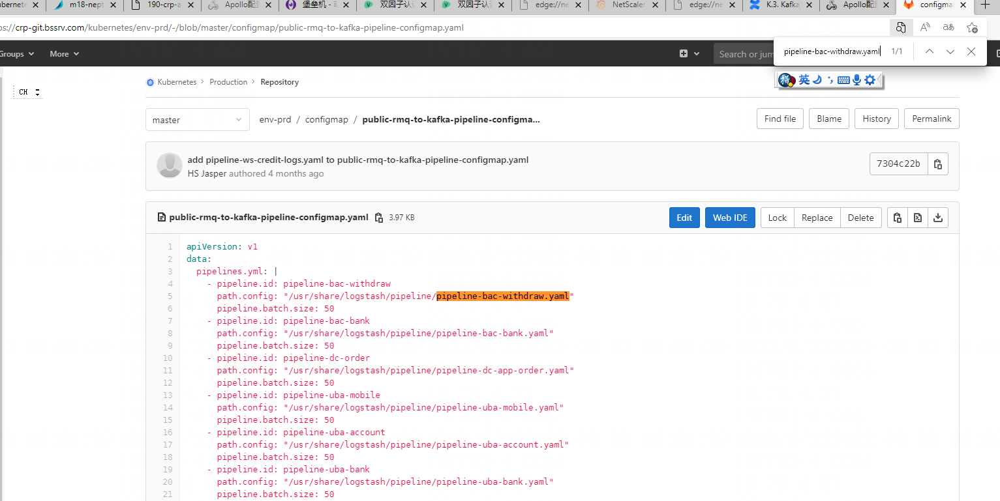
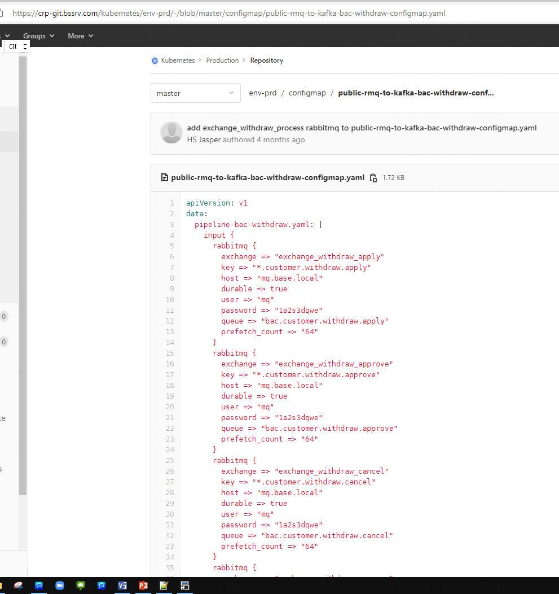
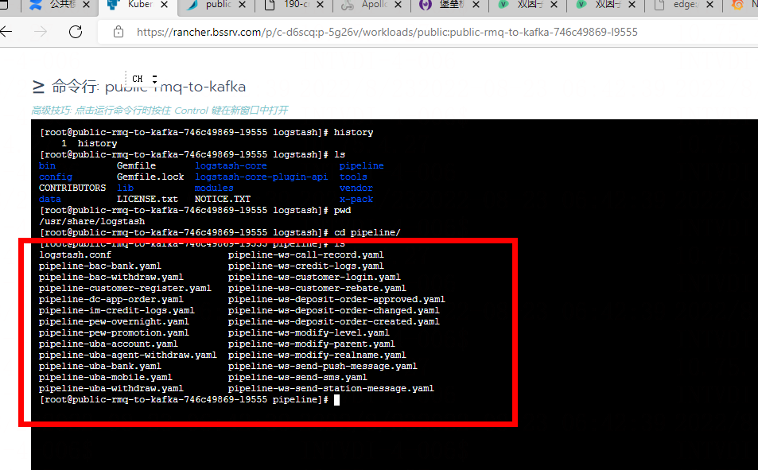
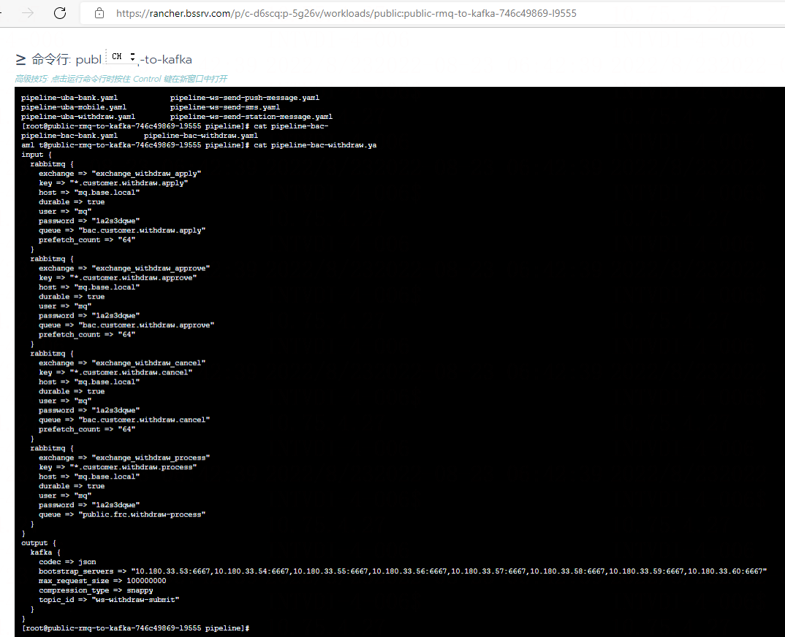
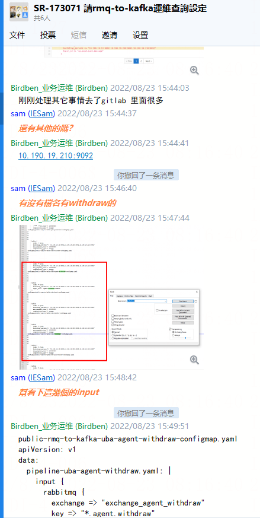
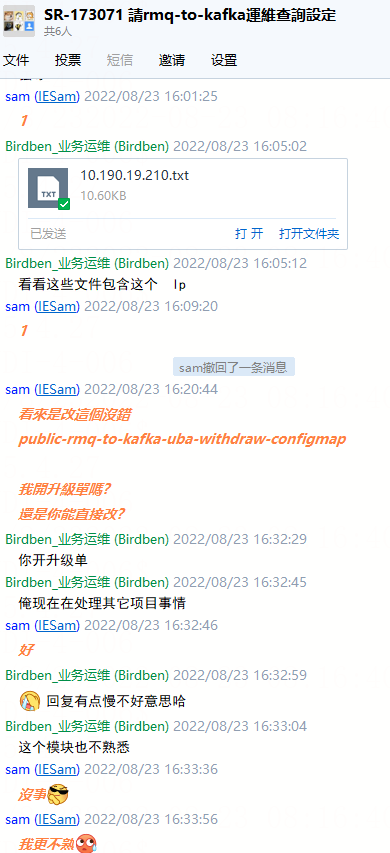

# rmq-to-kafka配置文件查询

> GitHub 仓库源文件：[点击打开网页渲染版](https://github.com/ben2023niao/ben-ops-notes/blob/main/doc/md/202304141557-%E6%95%85%E9%9A%9C%E6%8E%92%E6%9F%A5%2B%E9%97%AE%E9%A2%98%E6%8E%92%E6%9F%A5%2BKubernetes%2B%E7%9F%A5%E8%AF%86%E7%AC%94%E8%AE%B0-rmq-to-kafka%E9%85%8D%E7%BD%AE%E6%96%87%E4%BB%B6%E6%9F%A5%E8%AF%A2.md)

反馈人  hsWilliam

问题描述
203.0.113.1 這台沒收到withdraw.process

原因
找配置 查设定
特殊点 配置没完全接入apollo

处理方法
1 先巡检网络通不
2 进gitlab 先找到 yaml 配置看configmap的路径

3 进k8s容器被比对配置是否有改动

4 在github找出所有包含 203.0.113.1 关键字的配置整理后发开发

5 开发找到原因然后申请发布单升级解决

