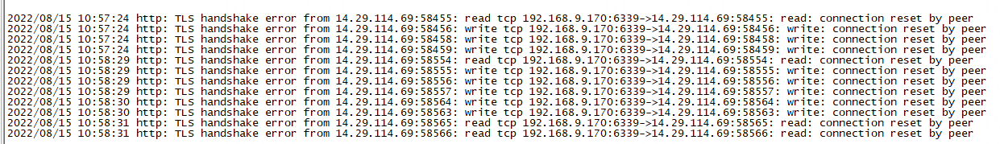

# health接口异常排查

> GitHub 仓库源文件：[点击打开网页渲染版](https://github.com/ben2023niao/ben-ops-notes/blob/main/doc/md/202304141557-%E6%95%85%E9%9A%9C%E6%8E%92%E6%9F%A5%2B%E9%97%AE%E9%A2%98%E6%8E%92%E6%9F%A5%2B%E7%9B%91%E6%8E%A7%E5%91%8A%E8%AD%A6%2B%E7%9F%A5%E8%AF%86%E7%AC%94%E8%AE%B0-health%E6%8E%A5%E5%8F%A3%E5%BC%82%E5%B8%B8%E6%8E%92%E6%9F%A5.md)

反馈人  vinco

问题描述
health接口访问报错

原因
1 增大服务器文件描述符大小                                                    (处理后问题还在)
2 域名没续费导致域名的 解析出问题                                        (处理后问题还在)
3 续费后SSL证书问题导致 TLS 加密过程失败从而报读写的错  (处理后问题还在)
4 最终问题是用的阿里云三方 SLB 负载均衡故障                      (处理后问题解决)

处理过程
调大文件描述符
及时续费域名监控域名到期
及时更换SSL证书
协商阿里云更好正常 SLB 负载均衡
