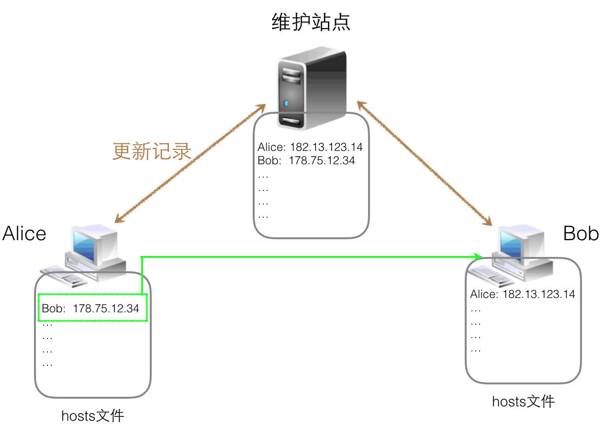
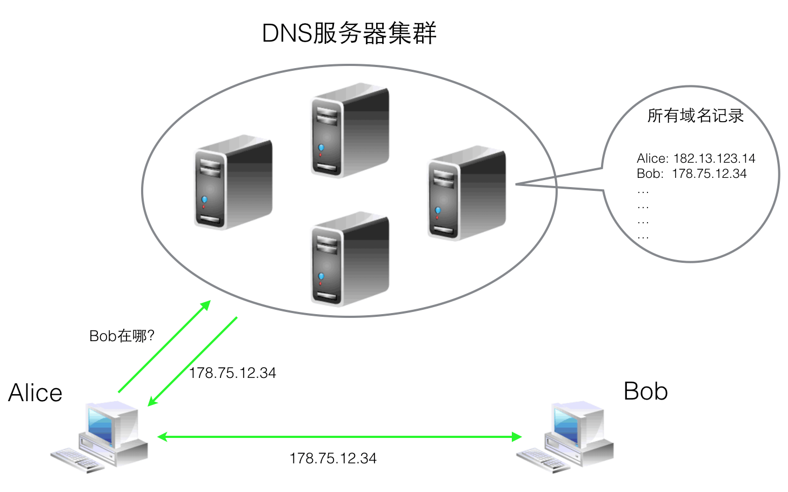
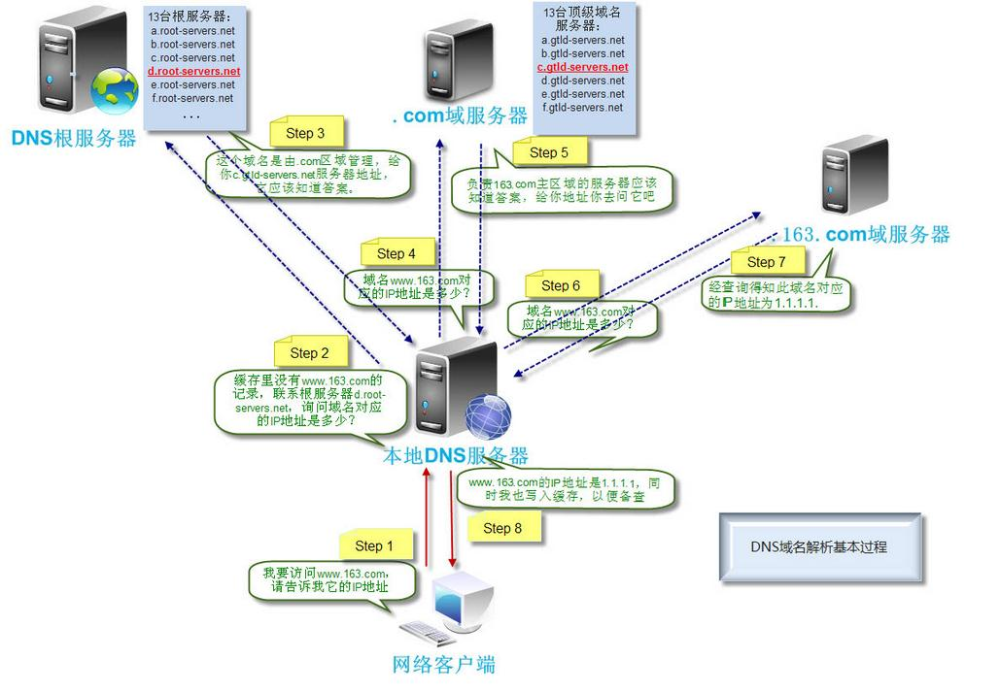

# DNS实战一 DNS快速入门及原理详解

> GitHub 仓库源文件：[点击打开网页渲染版](https://github.com/ben2023niao/ben-ops-notes/blob/main/doc/md/202304141557-%E7%BD%91%E7%BB%9C%E5%B7%A5%E7%A8%8B%2BDNS%2BWindows%2BMySQL-DNS%E5%AE%9E%E6%88%98%E4%B8%80%20DNS%E5%BF%AB%E9%80%9F%E5%85%A5%E9%97%A8%E5%8F%8A%E5%8E%9F%E7%90%86%E8%AF%A6%E8%A7%A3.md)

## 1. DNS概述

> 网域名称系统（英文：Domain Name System，缩写：DNS）是互联网的一项服务。它作为将域名和IP地址相互映射的一个分布式数据库，能够使人更方便地访问互联网。在日常生活中人们习惯记忆域名，但机器间互相只认IP地址，域名与IP地址之间是多对一的关系，一个ip地址不一定只对应一个域名，且一个域名只可以对应一个ip地址，它们之间的转换工作称为域名解析，域名解析需要由专门的域名解析服务器来完成，整个过程是自动进行的。

---

### 2. DNS理论基础

> 当你的网站制作完成后上传到你的虚拟主机时，你可以直接在浏览器中输入IP地址浏览你的网站，也可以输入域名查询你的网站，虽然得出的内容是一样的但是调用的过程不一样，输入IP地址是直接从主机上调用内容，输入域名是通过域名解析服务器指向对应的主机的IP地址，再从主机调用网站的内容。

- 早期的hosts映射

每台计算机保存一个hosts文件，每台计算机保存一个hosts文件，里面列出所有计算机名字和对应的IP地址，然后定期从一个维护此文件的站点更新里面的记录。当我们访问某个计算机名字时，先在hosts文件找到对应的IP，然后就可以建立连接。

早期的ARPANET就是这样做的，但是随着网络规模的扩大，这种方法渐渐吃不消了。主要有以下三个原因：
- hosts文件变得非常大；
- 主机名字会冲突；
- 集中的维护站点会不堪重负（需要给几百万机器提供hosts文件，想想就可怕）。
- 
- 域名系统

为了解决上面的问题，1983年Paul Mockapetris提出了域名系统（DNS, Domain Name System)，这是一种层次的、基于域的命名方案，并且用一个分布式数据库系统加以实现。当我们需要访问一个域名（其实就是前面说的计算机的名字）时，应用程序会向DNS服务器发起一个DNS请求，DNS服务器返回该域名对应的IP地址。通过下面三种手段解决了上面的问题：

这样访问一个域名的过程可以简化为下图：
- 用户计算机上并没有存储所有的名字到IP的映射，这样避免了hosts文件过于庞大（现在各操作系统中hosts文件默认都是空的）。
- 规定了域名的命名规则，保证主机名字不会重复。
- DNS服务器不再是单一的一台机器，而是一个层次的、合理组织的服务器集群。
- 
- ## 3. DNS域名解析过程

> 看完下面的文章还不懂的去撞墙，哈哈！

	- [3.1 从理论到实践，全方位认识DNS（理论篇）](https://www.cloudxns.net/Support/detail/id/737.html)
	- [3.2 DNS原理总结及其解析过程详解](http://blog.csdn.net/yipiankongbai/article/details/25031461)
	- [3.3 一张图看懂DNS域名解析全过程](http://www.maixj.net/ict/dns-chaxun-9208)
	- [3.4 DNS解析过程详解](http://blog.csdn.net/crazw/article/details/8986504)
- 
- ## 4. DNS的分类

**主DNS服务器**：存储着原始资料的DNS服务器。

**从DNS服务器**：和主DNS服务器建立信任关系后，使用自动更新方式从主DNS服务器同步数据的DNS服务器，也称辅助DNS服务器。

**缓存服务器**：不负责本地解析，采用递归方式转发客户机查询请求，并返回结果给客户机的DNS服务器。同时缓存查询回来的结果，也叫递归服务器。

**转发器**：这台DNS发现非本机负责的查询请求时，不再向根域发起请求，而是直接转发给指定的一台或多台服务器。自身并不缓存查询结果。

***主DNS服务器和从DNS服务器类似于Mysql主从的关系，所有的写入操作都在主DNS上做，而从DNS服务器建立信任关系后可以实时更新。一般主DNS只作管理用，而从DNS提供解析服务。也可以在从DNS服务器上加一层缓存，减轻压力。***

### 5. DNS记录类型

```
搭建网站：
要将域名指向主机服务商提供的IP地址，请选择「A记录」；要将域名指向主机服务商提供的另一个域名，请选择「CNAME记录」。
建立邮箱：
需要设置「MX记录」，根据邮箱服务商提供的MX记录填写。
A记录：（IPV4主机地址）
将域名指向一个IPv4地址（例如：203.0.113.1），需要增加A记录
CNAME记录：（正式名称，定义别名记录）
如果将域名指向一个域名，实现与被指向域名相同的访问效果，需要增加CNAME记录
MX记录：（域的邮件交换器，要跟着一个优先级值，越小越高）
建立电子邮箱服务，将指向邮件服务器地址，需要设置MX记录
NS记录：（域的授权名称服务器）
域名解析服务器记录，如果要将子域名指定某个域名服务器来解析，需要设置NS记录
TXT记录：
可任意填写（可为空），通常用做SPF记录（反垃圾邮件）使用
AAAA记录：（IPV6主机地址）
将主机名（或域名）指向一个IPv6地址（例如：ff03:0:0:0:0:0:0:c1），需要添加AAAA记录
PTR记录：
解析IP的指针，反向记录，把IP解析成域名，原理和A记录一样，如（xx.1.128.192.）从后往前看。
SRV记录：
记录了哪台计算机提供了哪个服务。格式为：服务的名字.协议的类型（例如：_example-server._tcp）
301跳转：从一个地址301重定向到另一个地址。注:仅已备案域名可使用。
302跳转：从一个地址302重定向到另一个地址。注:仅已备案域名可使用。
显性URL：
将域名指向一个http（s)协议地址，访问域名时，自动跳转至目标地址（例如：将www.net.cn显性转发到www.hichina.com后，访问www.net.cn时，地址栏显示的地址为：www.hichina.com）。
隐性URL：
与显性URL类似，但隐性转发会隐藏真实的目标地址（例如：将www.net.cn隐性转发到www.hichina.com后，访问www.net.cn时，地址栏显示的地址仍然为：www.net.cn）。
当然在国内，域名得备案才能用！
```

---

### 6. DNS命名规范

```
1. 26个英文字母
2. “0,1,2,3,4,5,6,7,8,9”十个数字
3. “-” (英文中的连词号)
4. 最多63字节长度
```

	- 不按照DNS命名规范，会有很多预想不到的错误和坑。如果域名不规范而又难以修改，可以在master-view文件上配置check-names ignore;等以后标准流程规范化后修改。

### 7. dig、nslookup、host介绍

- ```
安装dnsutils

Ubuntu:

## sudo apt-get install dnsutils

Debian:

## apt-get update

## apt-get install dnsutils

Fedora / Centos:

## yum install bind-utils

Host命令是大多数系统、软件库调用的解析命令，比如php中。Host功能虽然简单，但它是最准确的。

anzhihe@test1:~$ host baidu.com
baidu.com has address 203.0.113.1
baidu.com has address 203.0.113.1
baidu.com has address 203.0.113.1
baidu.com has address 203.0.113.1
baidu.com mail is handled by 20 jpmx.baidu.com.
baidu.com mail is handled by 20 mx50.baidu.com.
baidu.com mail is handled by 20 mx1.baidu.com.
baidu.com mail is handled by 10 mx.n.shifen.com.
Nslookup能够反映出是哪个dnsserver返回的结果，但是没有MX记录。

anzhihe@test1:~$ nslookup baidu.com
Server: 203.0.113.1
Address: 203.0.113.1#53

Non-authoritative answer:
Name: baidu.com
Address: 203.0.113.1
Name: baidu.com
Address: 203.0.113.1
Name: baidu.com
Address: 203.0.113.1
Name: baidu.com
Address: 203.0.113.1
Dig返回整个解析过程的详细路径，类似traceroute，生产中常用。

anzhihe@test1:~$ dig baidu.com

; <<>> DiG 9.10.3-P4-Ubuntu <<>> baidu.com
;; global options: +cmd
;; Got answer:
;; ->>HEADER<<- opcode: QUERY, status: NOERROR, id: 21190
;; flags: qr rd ra; QUERY: 1, ANSWER: 4, AUTHORITY: 0, ADDITIONAL: 1
;; OPT PSEUDOSECTION:
; EDNS: version: 0, flags:; udp: 4096
;; QUESTION SECTION:
;baidu.com. IN A

;; ANSWER SECTION:
baidu.com. 74 IN A 203.0.113.1
baidu.com. 74 IN A 203.0.113.1
baidu.com. 74 IN A 203.0.113.1
baidu.com. 74 IN A 203.0.113.1

;; Query time: 77 msec
;; SERVER: 203.0.113.1#53(203.0.113.1)
;; WHEN: Thu Mar 16 11:28:31 CST 2017
;; MSG SIZE rcvd: 102

```
	- Windows中查看DNS信息

	调出cmd窗口，在窗口处输入命令ipconfig /displaydns 来进行查看系统内的dns缓存。

	执行命令ipconfig /flushdns 命令来进行清空dns缓存。参考：

	- [1 从理论到实践，全方位认识DNS（理论篇）](https://www.cloudxns.net/Support/detail/id/737.html)
	- [2 DNS原理总结及其解析过程详解](http://blog.csdn.net/yipiankongbai/article/details/25031461)
	- [3 一张图看懂DNS域名解析全过程](http://www.maixj.net/ict/dns-chaxun-9208)
	- [4 DNS解析过程详解](http://blog.csdn.net/crazw/article/details/8986504)
```
