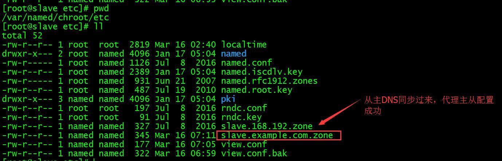

# DNS实战三 DNS主从部署

## 1. 部署从dns服务器

- yum安装bind9

```bash
yum install bind-utils bind bind-devel bind-chroot -y
```

- 编辑/etc/named.conf（与master一样）
- 编辑/etc/rndc.key
- 编辑/etc/rndc.conf
- 编辑/var/named/chroot/etc/view.conf (与master有些不一样啦)
- **var/named/chroot/etc/view.conf** 展开源码

```
[root@slave etc]# cat /var/named/chroot/etc/view.conf
view "SlaveView" {
 zone "example.com" { #zone与master一样
 type slave; #类型 从DNS
 masters {203.0.113.1; }; #master服务器，可以配置多个，用;号分隔
 file "slave.example.com.zone";
 };
};
```

- **#更改master的view.conf， 通知从DNS变更** 展开源码

```
[root@master ~]# vim /var/named/chroot/etc/view.conf
view "View" {
 zone "example.com" {
 type master;
 file "example.com.zone";
 allow-transfer {
 203.0.113.1;
 };
 notify yes;
 also-notify {
 203.0.113.1;
 };
};
};
[root@master ~]# rndc reload
WARNING: key file (/etc/rndc.key) exists, but using default configuration file (/etc/rndc.conf)
server reload successful
```

- **#启动从dns** 展开源码

```
[root@slave etc]# cd /var && chown -R named.named named/
[root@slave var]# /etc/init.d/named start
Starting named: [ OK ]
[root@slave var]# chkconfig named on
[root@slave etc]# cat slave.example.com.zone
$ORIGIN .
$TTL 3600 ; 1 hour
example.com IN SOA op.example.com. dns.example.com. (
 2000 ; serial
 900 ; refresh (15 minutes)
 600 ; retry (10 minutes)
 86400 ; expire (1 day)
 3600 ; minimum (1 hour)
 )
 NS op.example.com.
$ORIGIN example.com.
a A 203.0.113.1
op A 203.0.113.1
```

- 
- ## 2. 添加A、CNAME、MX、PTR记录

	- 添加A记录（serial每次要增加，否则slave不会检测到变化不会同步）
- 展开源码

```
[root@master etc]# vim /var/named/chroot/etc/example.com.zone
$ORIGIN .
$TTL 3600 ; 1 hour
example.com IN SOA op.example.com. dns.example.com. (
 2001 ; serial
 900 ; refresh (15 minutes)
 600 ; retry (10 minutes)
 86400 ; expire (1 day)
 3600 ; minimum (1 hour)
 )
 NS op.example.com.
$ORIGIN example.com.
chegva A 203.0.113.1
op A 203.0.113.1

a A 203.0.113.1
a A 203.0.113.1
[root@master etc]# rndc reload
WARNING: key file (/etc/rndc.key) exists, but using default configuration file (/etc/rndc.conf)
server reload successful
```

**#查看slave zone文件是否同步** 展开源码

```
[root@slave etc]# cat slave.example.com.zone
$ORIGIN .
$TTL 3600 ; 1 hour
example.com IN SOA op.example.com. dns.example.com. (
 2001 ; serial
 900 ; refresh (15 minutes)
 600 ; retry (10 minutes)
 86400 ; expire (1 day)
 3600 ; minimum (1 hour)
 )
 NS op.example.com.
$ORIGIN example.com.
a A 203.0.113.1
 A 203.0.113.1 #bind的一种写法，表示这条解析是继承上条的a
chegva A 203.0.113.1
op A 203.0.113.1
```

- **添加CNAME记录** 展开源码

```
[root@master etc]# vim /var/named/chroot/etc/example.com.zone
$ORIGIN .
$TTL 3600 ; 1 hour
example.com IN SOA op.example.com. dns.example.com. (
 2002 ; serial
 900 ; refresh (15 minutes)
 600 ; retry (10 minutes)
 86400 ; expire (1 day)
 3600 ; minimum (1 hour)
 )
 NS op.example.com.
$ORIGIN example.com.
chegva A 203.0.113.1
op A 203.0.113.1

a A 203.0.113.1
a A 203.0.113.1
cname CNAME a.example.com.
#前面是a因为要保证a.example.com能被解析，后边一定有个.表示代表的是域名，正常解析只是把这个点忽略了，记得serial数要增加，保存退出reload
[root@master etc]# rndc reload
WARNING: key file (/etc/rndc.key) exists, but using default configuration file (/etc/rndc.conf)
server reload successful

#在slave中可以看到，有条cname记录
[root@slave etc]# cat slave.example.com.zone
$ORIGIN .
$TTL 3600 ; 1 hour
example.com IN SOA op.example.com. dns.example.com. (
 2002 ; serial
 900 ; refresh (15 minutes)
 600 ; retry (10 minutes)
 86400 ; expire (1 day)
 3600 ; minimum (1 hour)
 )
 NS op.example.com.
$ORIGIN example.com.
a A 203.0.113.1
 A 203.0.113.1
chegva A 203.0.113.1
cname CNAME a #CNAME记录
op A 203.0.113.1
```

**A记录、CNAME记录结果检测** 展开源码

```
[root@slave etc]# dig @203.0.113.1 cname.example.com
; <<>> DiG 9.8.2rc1-RedHat-9.8.2-0.47.rc1.el6_8.4 <<>> @203.0.113.1 cname.example.com
; (1 server found)
;; global options: +cmd
;; Got answer:
;; ->>HEADER<<- opcode: QUERY, status: NOERROR, id: 56615
;; flags: qr aa rd ra; QUERY: 1, ANSWER: 3, AUTHORITY: 1, ADDITIONAL: 1
;; QUESTION SECTION:
;cname.example.com.     IN  A
;; ANSWER SECTION:
cname.example.com.  3600    IN  CNAME   a.example.com.  #首先解析cname.example.com得到a.example然后解析a.example.com的A记录拿到两个IP
a.example.com.      3600    IN  A   203.0.113.1
a.example.com.      3600    IN  A   203.0.113.1
;; AUTHORITY SECTION:
example.com.        3600    IN  NS  op.example.com.
;; ADDITIONAL SECTION:
op.example.com.     3600    IN  A   203.0.113.1
;; Query time: 0 msec
;; SERVER: 203.0.113.1#53(203.0.113.1)
;; WHEN: Thu Mar 16 07:43:21 2017
;; MSG SIZE  rcvd: 116
[root@slave etc]# dig @203.0.113.1 cname.example.com      #再用slave来解析，正常情况下与主dns解析应该是一样的
; <<>> DiG 9.8.2rc1-RedHat-9.8.2-0.47.rc1.el6_8.4 <<>> @203.0.113.1 cname.example.com
; (1 server found)
;; global options: +cmd
;; Got answer:
;; ->>HEADER<<- opcode: QUERY, status: NOERROR, id: 39519
;; flags: qr aa rd ra; QUERY: 1, ANSWER: 3, AUTHORITY: 1, ADDITIONAL: 1
;; QUESTION SECTION:
;cname.example.com. IN A

;; ANSWER SECTION:
cname.example.com. 3600 IN CNAME a.example.com.
a.example.com. 3600 IN A 203.0.113.1
a.example.com. 3600 IN A 203.0.113.1

;; AUTHORITY SECTION:
example.com. 3600 IN NS op.example.com.

;; ADDITIONAL SECTION:
op.example.com. 3600 IN A 203.0.113.1

;; Query time: 30 msec
;; SERVER: 203.0.113.1#53(203.0.113.1)
;; WHEN: Thu Mar 16 07:45:55 2017
;; MSG SIZE rcvd: 116
```

- **添加MX记录** 展开源码

```
[root@master etc]# egrep  "^mx|serial$" /var/named/chroot/etc/example.com.zone  #添加mx记录
2003 ; serial
mx MX 5 203.0.113.1 #5是优先级，越小越高
[root@master etc]# rndc reload
#用host查看解析结果，dig看不到
[root@master etc]# host mx.example.com 203.0.113.1
Using domain server:
Name: 203.0.113.1
Address: 203.0.113.1#53
Aliases:

mx.example.com mail is handled by 5 203.0.113.1.example.com.
[root@master etc]# host mx.example.com 203.0.113.1
Using domain server:
Name: 203.0.113.1
Address: 203.0.113.1#53
Aliases:

mx.example.com mail is handled by 5 203.0.113.1.example.com.
```

- **PTR记录（反向解析多用于IP地址标识主机特征）** 展开源码

```
[root@master etc]# vim /var/named/chroot/etc/view.conf
[root@master etc]# vim view.conf
view "View" {
 zone "example.com" {
 type master;
 file "example.com.zone";
 allow-transfer {
 203.0.113.1;
 };
 notify yes;
 also-notify {
 203.0.113.1;
 };
};
 zone "168.192.in-addr.arpa" { #前边的数字表示是192.168这个zone的反向解析，in-addr.arpa是反向解析的申明
 type master;
 file "168.192.zone";
 allow-transfer {
 203.0.113.1;
 };
 notify yes;
 also-notify {
 203.0.113.1;
 };
};
};
```

- **编辑master节点/var/named/chroot/etc/168.192.zone** 展开源码

```
[root@master etc]# vim /var/named/chroot/etc/168.192.zone
$TTL 3600 ; 1 hour
@ IN SOA op.example.com. dns.example.com. (
 2004 ; serial
 900 ; refresh (15 minutes)
 600 ; retry (10 minutes)
 86400 ; expire (1 day)
 3600 ; minimum (1 hour)
 )
 NS op.example.com.
102.122 IN PTR a.example.com.
[root@master etc]# chown named.named 168.192.zone
[root@master etc]# rndc reload
```

- **编辑slave下的view.conf文件，添加反向解析的zone** 展开源码

```
view "SlaveView" {
zone "example.com" {
 type slave;
 masters {203.0.113.1; };
 file "slave.example.com.zone";
};
zone "168.192.in-addr.arpa" {
 type slave;
 masters {203.0.113.1; };
 file "slave.168.192.zone";
};
};
[root@slave etc]#  rndc reload
[root@slave etc]# ll    #可以看到salve.168.192.zone已同步过来
total 52
-rw-r--r-- 1 root root 2819 Mar 16 02:40 localtime
drwxr-x--- 2 root named 4096 Jan 17 05:04 named
-rw-r----- 1 root named 1126 Jul 8 2016 named.conf
-rw-r--r-- 1 root named 2389 Jan 17 05:04 named.iscdlv.key
-rw-r----- 1 root named 931 Jun 21 2007 named.rfc1912.zones
-rw-r--r-- 1 root named 487 Jul 19 2010 named.root.key
drwxr-x--- 3 named named 4096 Jan 17 05:04 pki
-rw-r--r-- 1 root root 197 Jul 8 2016 rndc.conf
-rw-r--r-- 1 root root 91 Jul 8 2016 rndc.key
-rw-r--r-- 1 named named 327 Mar 16 08:23 slave.168.192.zone
-rw-r--r-- 1 named named 408 Mar 16 08:12 slave.example.com.zone
-rw-r--r-- 1 named named 330 Mar 16 08:20 view.conf
-rw-r--r-- 1 named named 322 Mar 16 06:59 view.conf.bak
```

- **检测反向解析**

```
[root@slave etc]# host 203.0.113.1 203.0.113.1
Using domain server:
Name: 203.0.113.1
Address: 203.0.113.1#53
Aliases:
#可以看到主从dns都能通过IP 192.168.122.102地址解析到域名
203.0.113.1.in-addr.arpa domain name pointer a.example.com.
[root@slave etc]# host 203.0.113.1 203.0.113.1
Using domain server:
Name: 203.0.113.1
Address: 203.0.113.1#53
Aliases:
203.0.113.1.in-addr.arpa domain name pointer a.example.com
```
