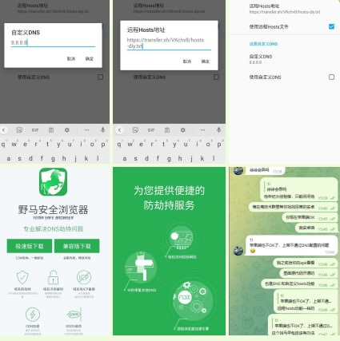

# 早期方案 - 隔离测试浏览器

> 原文：[早期方案 - 隔离测试浏览器](https://ji-shu-jian-li.gitbook.io/ben_bird/zao-qi-fang-an-bo-cai-zhuan-yong-liu-lan-qi.html)

> 来源：GitBook 网页 HTML｜页面时间：2024-09-19 15:56｜日期依据：GitBook 页面更新时间

参考 <示例地址> 项目

实现的没root权限远程设置手机hosts

[示例地址)

难点是苹果高系统下客户端有不兼容
