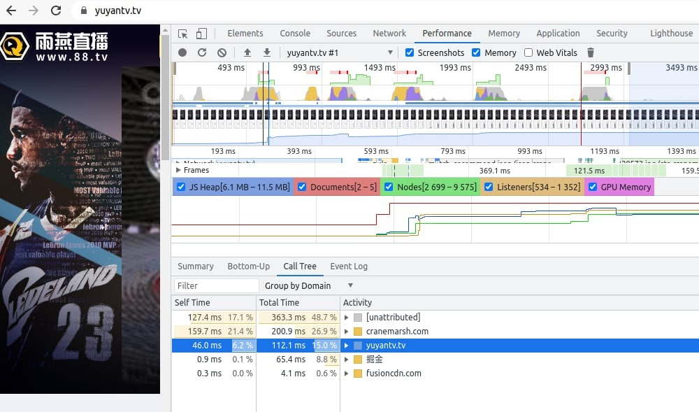
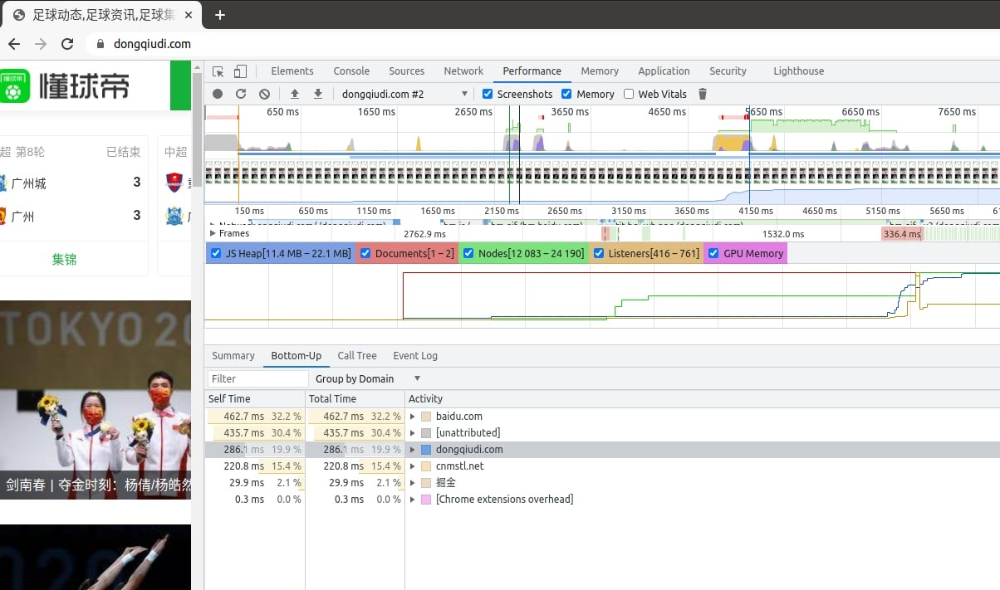
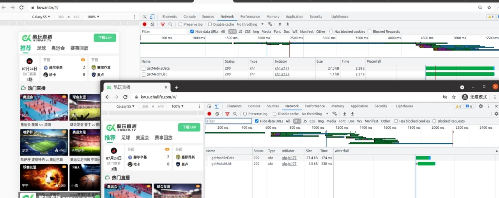

# 直播方案 - 域名同时跑多家cdn节点，并调度最好的节点服务

> 原文：[直播方案 - 域名同时跑多家cdn节点，并调度最好的节点服务](https://ji-shu-jian-li.gitbook.io/ben_bird/zhi-bo-fang-an-yu-ming-tong-shi-pao-duo-jia-cdn-jie-dian-bing-diao-du-zui-hao-de-jie-dian-fu-wu.html)

> 来源：GitBook 网页 HTML｜页面时间：2024-09-19 15:57｜日期依据：GitBook 页面更新时间

**直播方案 - 域名同时跑多家cdn节点，并调度最好的节点服务**

雨燕直播 聚合cdn加速效果
前端 js 6-11 M 大小
加载渲染时间 112 ms

懂球帝 聚合cdn加速效果
前端 js 11-22 M 大小
加载渲染时间 286 ms

酷玩直播 聚合cdn加速效果
https://kuwan.tv/
优化前线路访问
2.28 秒
https://kw.suchulife.com/
聚合cdn线路访问|
230 毫秒

涉及到vue的懒加载，首页静态化，本地化全部外部js css 样式库，打包体积压缩，和seo方面，安卓报毒解决，苹果签名渠道，广告投放等
