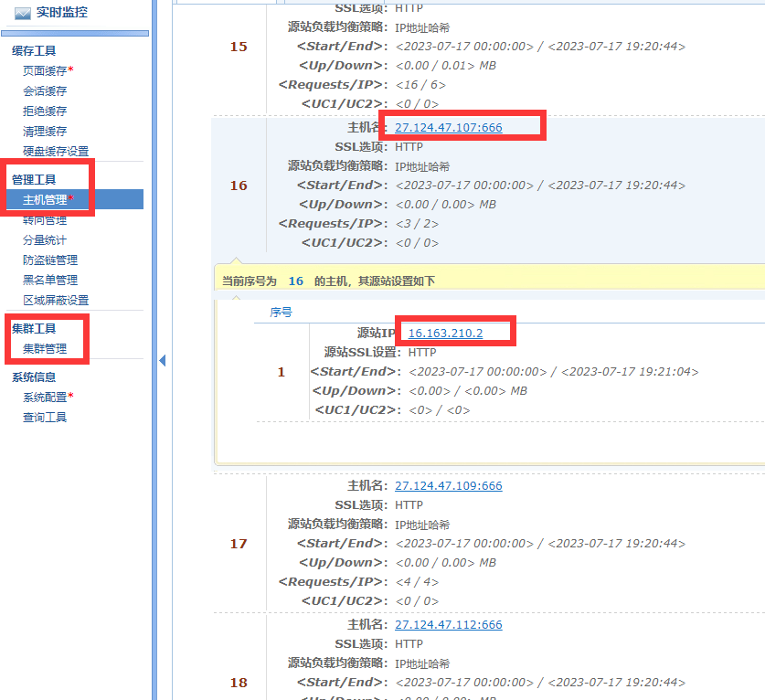
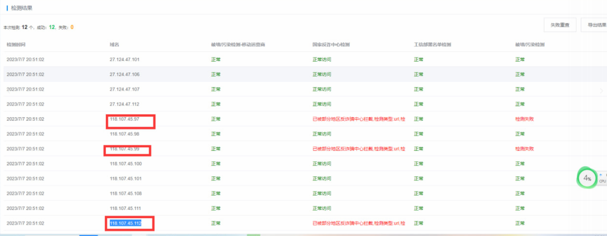

# AG尊龙凯时全面优化 https://z6.com

> GitHub 仓库源文件：[点击打开网页渲染版](https://github.com/ben2023niao/ben-ops-notes/blob/main/doc/md/202409191557-%E5%AE%89%E5%85%A8%E7%AB%9E%E8%B5%9B%E5%A4%8D%E7%9B%98%2B%E8%87%AA%E5%8A%A8%E5%8C%96%2BCDN-%E6%9F%90%E4%B8%9A%E5%8A%A1%E5%B9%B3%E5%8F%B0%E5%85%A8%E9%9D%A2%E4%BC%98%E5%8C%96%20https%EF%BC%9A-%E7%9B%AE%E6%A0%87%E7%A4%BA%E4%BE%8B.md)

> 原文：[AG尊龙凯时全面优化 https://z6.com](https://ji-shu-jian-li.gitbook.io/ben_bird/ag-zun-long-kai-shi-quan-mian-you-hua-httpsz6.com.html)

> 来源：GitBook 网页 HTML｜页面时间：2024-09-19 15:57｜日期依据：GitBook 页面更新时间

**AG尊龙凯时全面优化** [**https://z6.com**](https://z6.com/)

**自建cdn + 批量干净ip节点 + 自研int技术 + 签名加密技术**

**自建cdn**

**批量干净ip节点**

异常的cdn节点会自动化丢弃，然后补进新的干净ip
