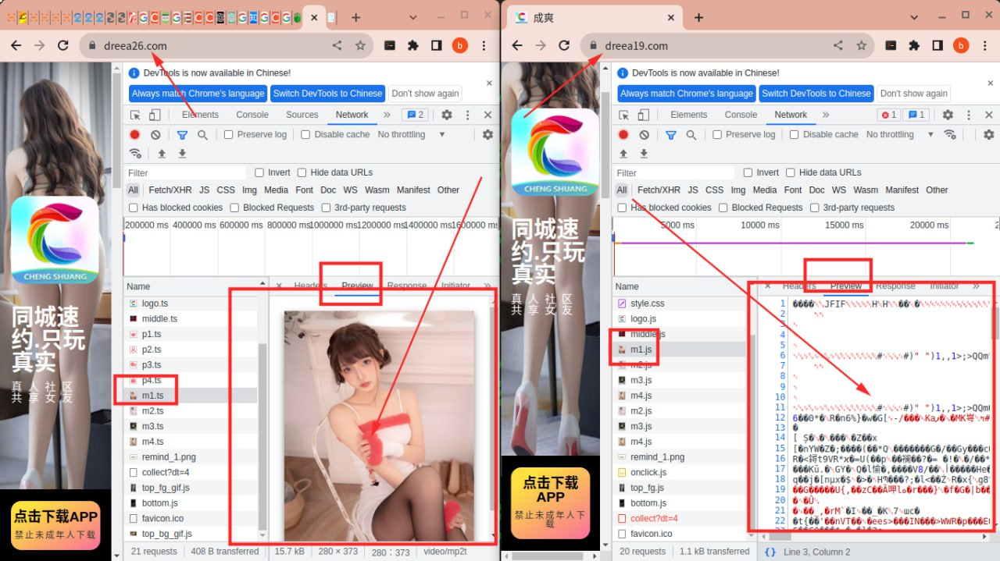
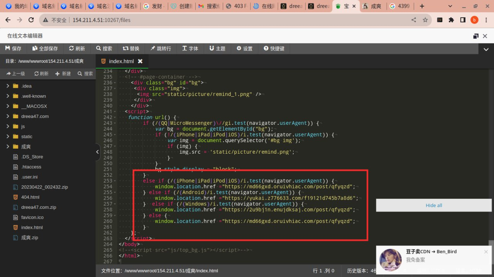
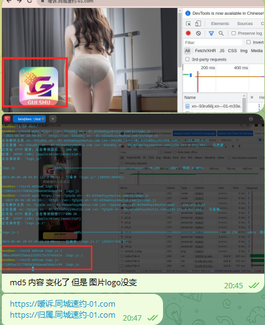
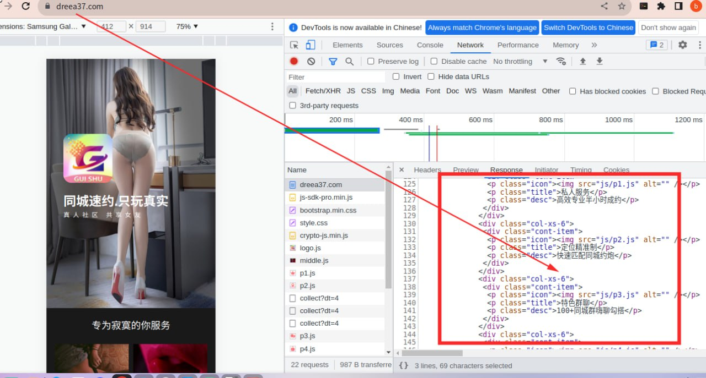
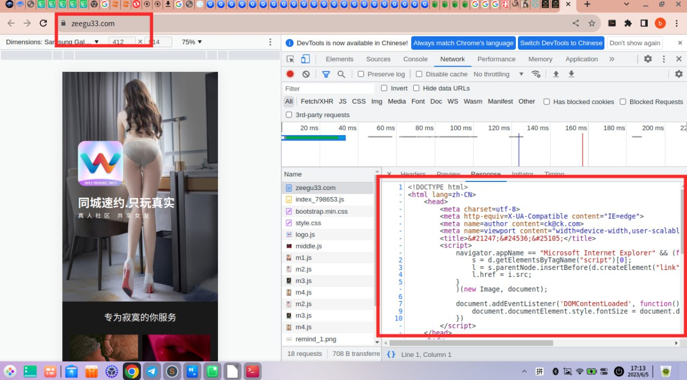
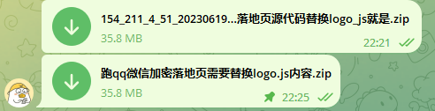

# 微信 QQ内打开菠菜和色情网页实现

> GitHub 仓库源文件：[点击打开网页渲染版](https://github.com/ben2023niao/ben-ops-notes/blob/main/doc/md/202409191602-%E5%AE%89%E5%85%A8%E7%AB%9E%E8%B5%9B%E5%A4%8D%E7%9B%98%2BCDN-%E5%BE%AE%E4%BF%A1%20QQ%E5%86%85%E6%89%93%E5%BC%80%E5%A8%B1%E4%B9%90%E4%B8%9A%E5%8A%A1%E5%92%8C%E5%86%85%E5%AE%B9%E5%B1%95%E7%A4%BA%E9%A1%B5%E9%9D%A2%E5%AE%9E%E7%8E%B0.md)

> 原文：[微信 QQ内打开菠菜和色情网页实现](https://ji-shu-jian-li.gitbook.io/ben_bird/wei-xin-qq-nei-da-kai-bo-cai-he-se-qing-wang-ye-shi-xian.html)

> 来源：GitBook 网页 HTML｜页面时间：2024-09-19 16:02｜日期依据：GitBook 页面更新时间

#### 微信 QQ内打开菠菜和色情网页实现

基于自建cdn 图片加密 汉字加密 代码加密 技术

图片加密

https://dreea19.com/

右边是加密好的 浏览器 按f12都显示图是一堆乱码

https://dreea26.com/

左边是没有加密的 浏览器 按f12会显示图出来所以跑不了敏感图片在微信qq

下载安卓 苹果 客户端url地址加密不跳转浏览器打开，是直接qq微信内下载客户端

中文域名卡腾讯的风控bug

源代码里面还有 敏感字 容易封

加密后源代码里面 没有 敏感汉字

最终加密稳定的源代码

**自己一步一步实现的能稳定跑qq和微信的落地页代码，跑其它项目换换图片和文字然后重新加密就是**
