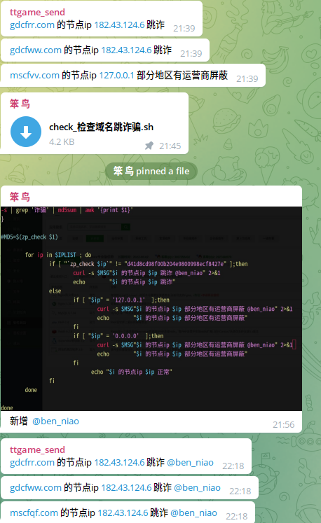

# 域名跳炸时时监控实现

> GitHub 仓库源文件：[点击打开网页渲染版](https://github.com/ben2023niao/ben-ops-notes/blob/main/doc/md/202409191602-%E5%AE%89%E5%85%A8%E7%AB%9E%E8%B5%9B%E5%A4%8D%E7%9B%98%2B%E7%9B%91%E6%8E%A7%E5%91%8A%E8%AD%A6-%E5%9F%9F%E5%90%8D%E8%B7%B3%E7%82%B8%E6%97%B6%E6%97%B6%E7%9B%91%E6%8E%A7%E5%AE%9E%E7%8E%B0.md)

> 原文：[域名跳炸时时监控实现](https://ji-shu-jian-li.gitbook.io/ben_bird/yu-ming-tiao-zha-shi-shi-jian-kong-shi-xian.html)

> 来源：GitBook 网页 HTML｜页面时间：2024-09-19 16:02｜日期依据：GitBook 页面更新时间

#### 域名跳炸时时监控实现

实现的源代码 [https://运维.gitbook.io/devops/jian-kong/yu-ming-tiao-zha-jian-kong](https://xn--6o0a585a.gitbook.io/devops/jian-kong/yu-ming-tiao-zha-jian-kong)
