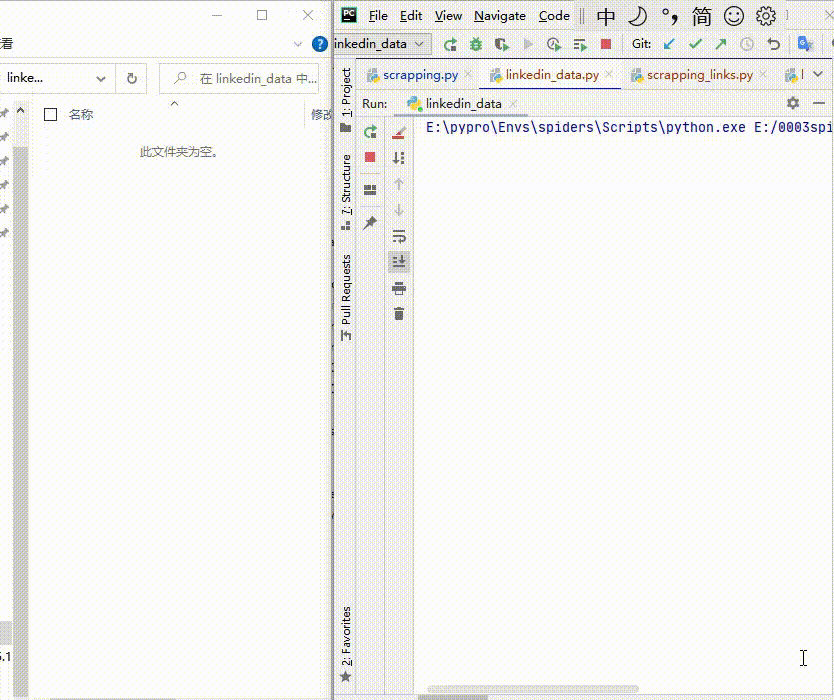

# 领英爬取印度活跃用户电话号码

> GitHub 仓库源文件：[点击打开网页渲染版](https://github.com/ben2023niao/ben-ops-notes/blob/main/doc/md/202409191612-%E5%AE%89%E5%85%A8%E7%AB%9E%E8%B5%9B%E5%A4%8D%E7%9B%98%2B%E5%B7%A5%E7%A8%8B%E7%AC%94%E8%AE%B0-%E9%A2%86%E8%8B%B1%E5%85%AC%E5%BC%80%E6%95%B0%E6%8D%AE%E9%87%87%E9%9B%86%E5%8D%B0%E5%BA%A6%E6%B4%BB%E8%B7%83%E7%94%A8%E6%88%B7%E6%B5%8B%E8%AF%95%E8%81%94%E7%B3%BB%E6%95%B0%E6%8D%AE.md)

> 原文：[领英爬取印度活跃用户电话号码](https://ji-shu-jian-li.gitbook.io/ben_bird/ling-ying-pa-qu-yin-du-huo-yue-yong-hu-dian-hua-hao-ma.html)

> 来源：GitBook 网页 HTML｜页面时间：2024-09-19 16:12｜日期依据：GitBook 页面更新时间

领英爬取印度活跃用户电话号码

难点是领英的封账号js脚本的加密破解
