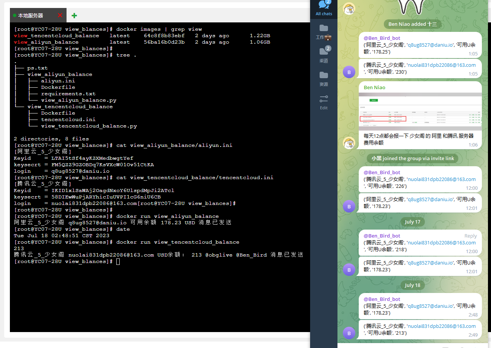
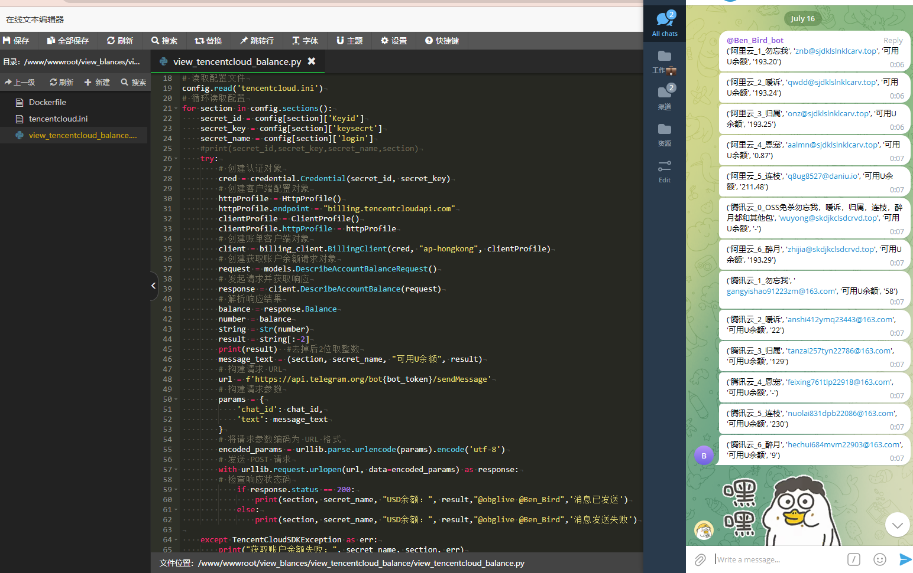

# 自写一套阿里腾讯额度报警系统 (已封装成docker镜像)

> 原文：[自写一套阿里腾讯额度报警系统 (已封装成docker镜像)](https://ji-shu-jian-li.gitbook.io/ben_bird/zi-xie-yi-taoali-teng-xunedu-bao-jing-xi-tong-yi-feng-zhuang-cheng-docker-jing-xiang.html)

> 来源：GitBook 网页 HTML｜页面时间：2024-09-19 16:17｜日期依据：GitBook 页面更新时间

**自写一套阿里腾讯额度报警系统 (已封装成docker镜像)**

封装成docker

核心逻辑代码
