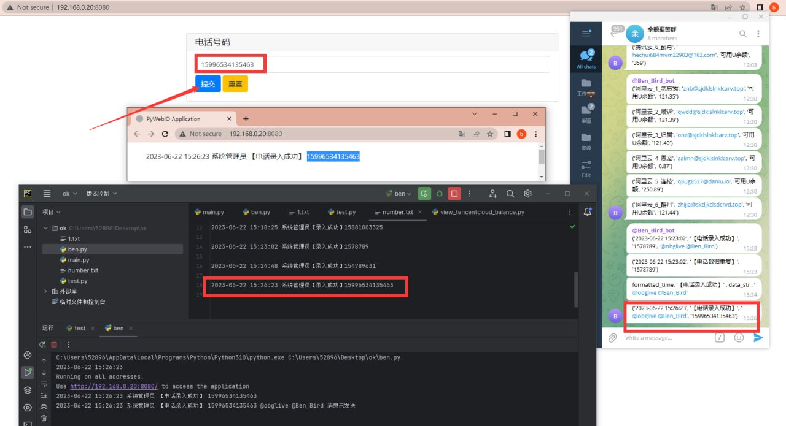
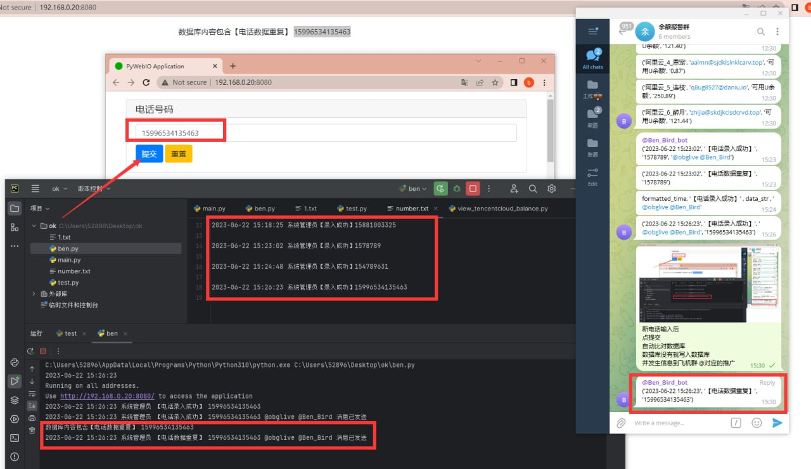
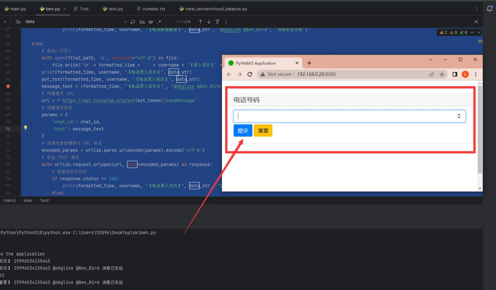
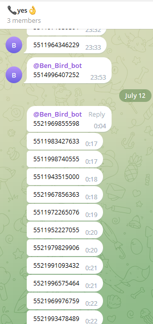

# 自写一套电话号码处理系统 (已封装成docker镜像)

> 原文：[自写一套电话号码处理系统 (已封装成docker镜像)](https://ji-shu-jian-li.gitbook.io/ben_bird/zi-xie-yi-tao-dian-hua-hao-ma-chu-li-xi-tong-yi-feng-zhuang-cheng-docker-jing-xiang.html)

> 来源：GitBook 网页 HTML｜页面时间：2024-09-19 16:17｜日期依据：GitBook 页面更新时间

**自写一套电话号码处理系统 (已封装成docker镜像)**

新电话输入后
点提交
自动比对数据库
数据库没有就写入数据库
并发生信息到飞机群 @对应的推广

输入的电话数据库里面有
就不再写入数据库
并发现信息到飞机群
（可另外一个专门的重复号码飞机群）

后端电话处理逻辑 和 前端展示

运行效果
