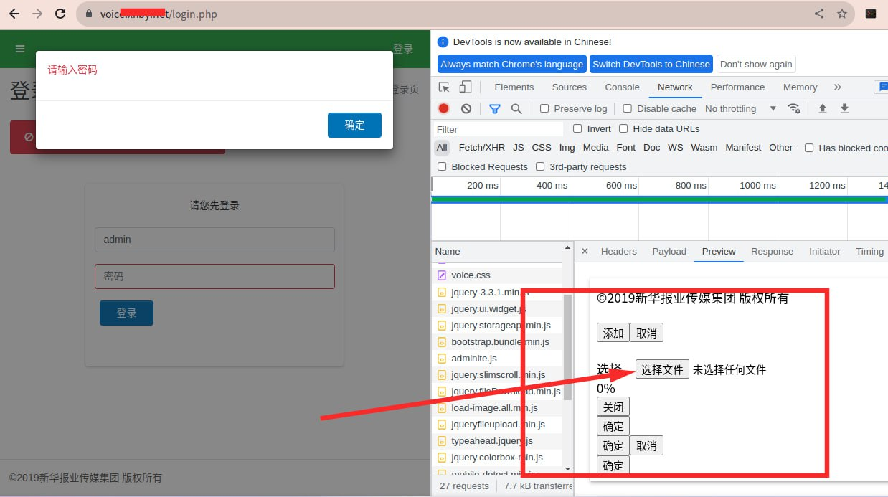
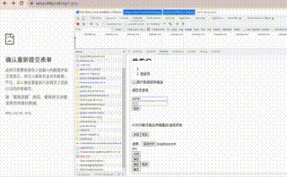

# 某媒体平台后台命令执行风险验证 https：//某媒体平台

> 原文：[某媒体平台后台命令执行风险验证 https：//某媒体平台](https://ji-shu-jian-li.gitbook.io/ben_bird/xin-hua-bao-ye-hou-tai-getshell-httpsxhby.net.html)

> 来源：GitBook 网页 HTML｜页面时间：2024-09-19 16:21｜日期依据：GitBook 页面更新时间

**某媒体平台后台命令执行风险验证** [**示例地址)

漏洞位置
zmedit.某媒体平台
服务器ip
203.0.113.1

上传漏洞代码位置
示例地址

上传函数
API_UPLOAD_ACTION: "upload"
IMAGE_FOLDER: "phpimages/",
SESSION_ID: "c_itasAa6Oswi5-W8ycHj0R5Pt8-wBuMb2JIJx1N3tQ.",
UPLOAD_URL: "api/index.php",
UPLOAD_TYPE: "POST",

[Telegram 原帖](示例地址)

