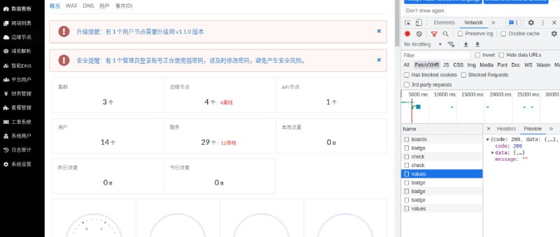

# 拿下某大型cdn后台

> 原文：[拿下某大型cdn后台](https://ji-shu-jian-li.gitbook.io/ben_bird/na-xia-mou-da-xing-cdn-hou-tai.html)

> 来源：GitBook 网页 HTML｜页面时间：2024-09-19 16:25｜日期依据：GitBook 页面更新时间

[Telegram 原帖](https://t.me/HackerNiao/220913)

