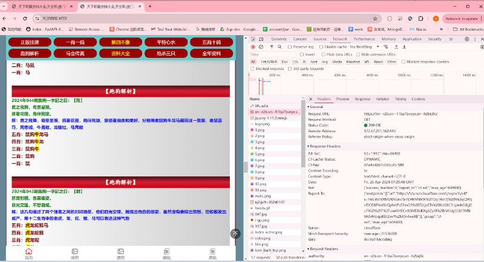

# 新的访问策略验证域名思路

> 原文：[新的访问策略验证域名思路](https://ji-shu-jian-li.gitbook.io/ben_bird/xin-de-fang-feng-yu-ming-si-lu.html)

> 来源：GitBook 网页 HTML｜页面时间：2024-09-19 16:31｜日期依据：GitBook 页面更新时间

原理：利用国家最新小语种地区的的域名注册字符国内域名访问策略验证系统无法录入所以无法访问策略验证

[Telegram 原帖](示例地址)

