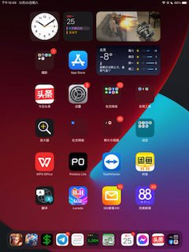
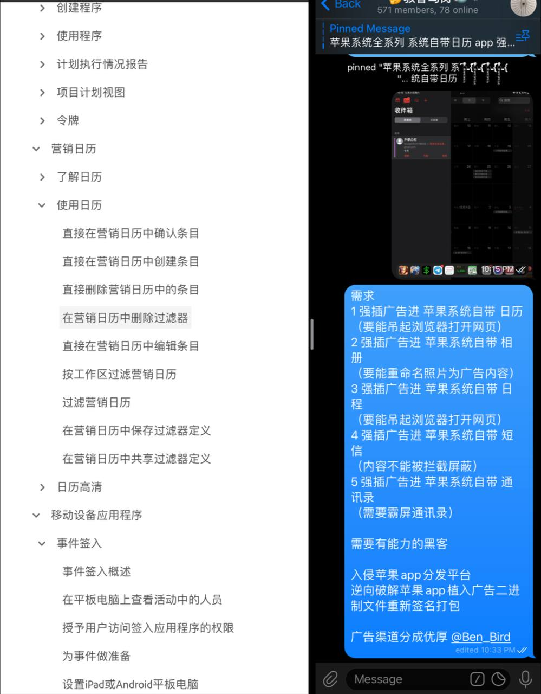
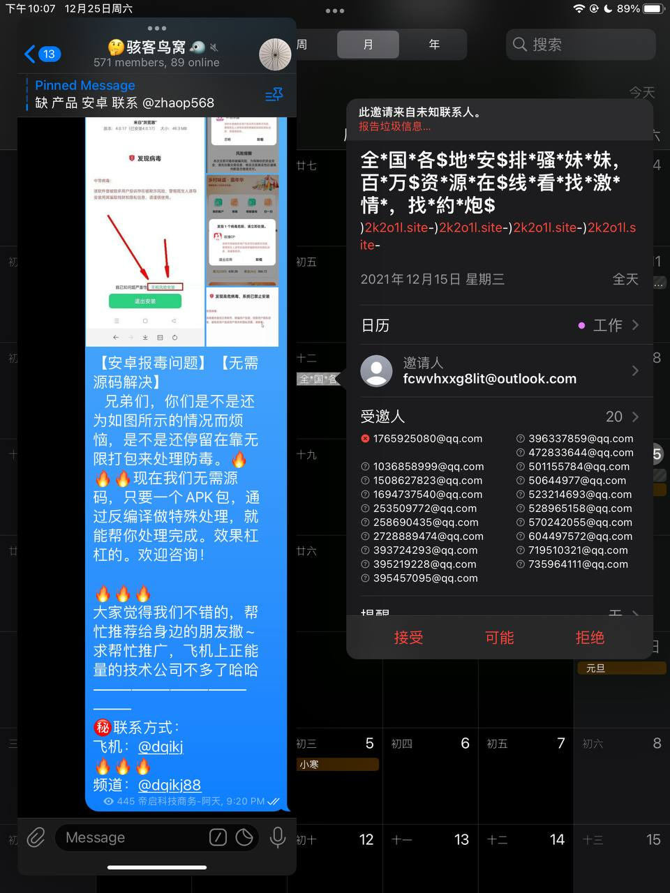
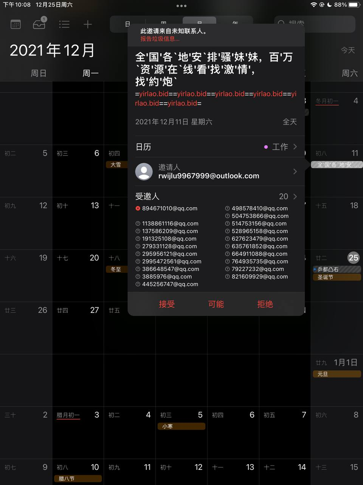
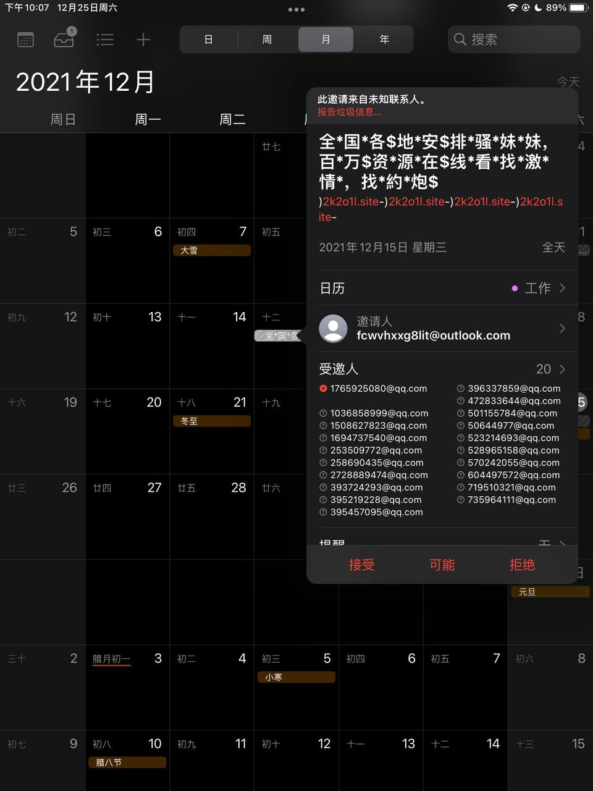

# 苹果系统全系列 系统自带日历 app 强制插广告软件编写制作

> 原文：[苹果系统全系列 系统自带日历 app 强制插广告软件编写制作](https://ji-shu-jian-li.gitbook.io/ben_bird/ping-guo-xi-tong-quan-xi-lie-xi-tong-zi-dai-ri-li-app-qiang-zhi-cha-guang-gao-ruan-jian-bian-xie-zhi.html)

> 来源：GitBook 网页 HTML｜页面时间：2024-09-19 16:43｜日期依据：GitBook 页面更新时间

[Telegram 原帖](示例地址)

[Telegram 原帖](示例地址)

