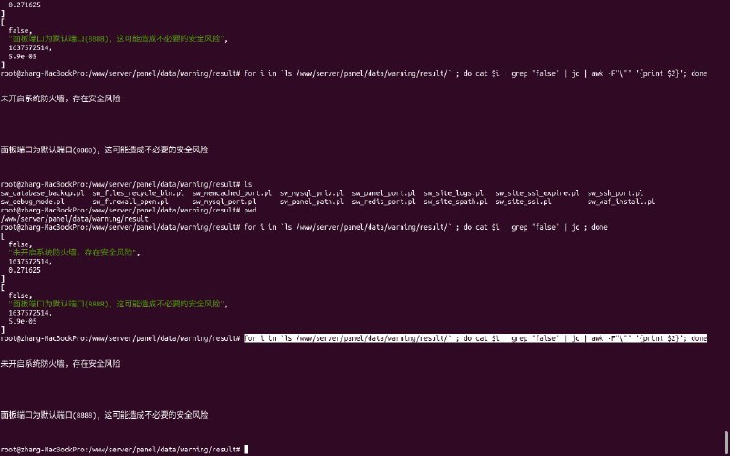
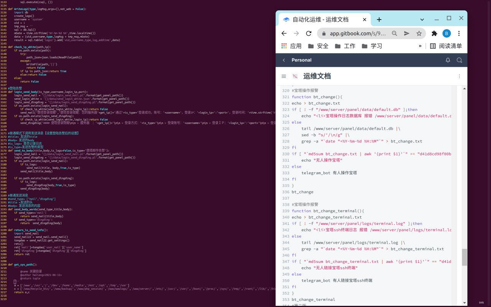
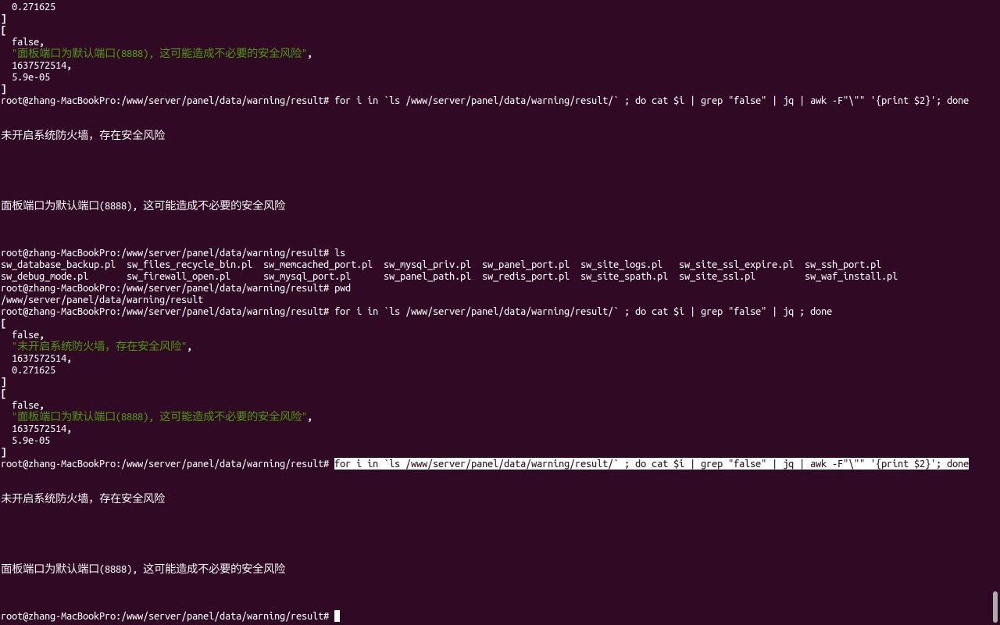

# 宝塔源代码研究之一句话获取宝塔安全巡检结果等二次开发

> 原文：[宝塔源代码研究之一句话获取宝塔安全巡检结果等二次开发](https://ji-shu-jian-li.gitbook.io/ben_bird/bao-ta-yuan-dai-ma-yan-jiu-zhi-yi-ju-hua-huo-qu-bao-ta-an-quan-xun-jian-jie-guo-deng-er-ci-kai-fa.html)

> 来源：GitBook 网页 HTML｜页面时间：2024-09-19 16:45｜日期依据：GitBook 页面更新时间

[Telegram 原帖](示例地址)

