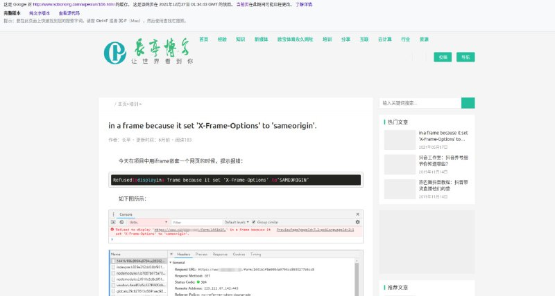

# 网站快照链路风险验证

> 原文：[网站快照链路风险验证](https://ji-shu-jian-li.gitbook.io/ben_bird/wang-zhan-kuai-zhao-jie-chi.html)

> 来源：GitBook 网页 HTML｜页面时间：2024-09-19 16:51｜日期依据：GitBook 页面更新时间

[Telegram 原帖](示例地址)

[Telegram 原帖](示例地址)

