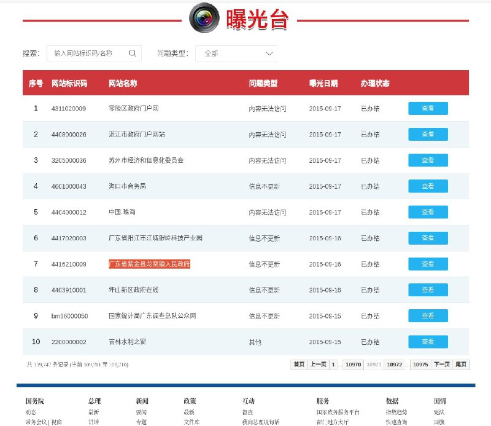
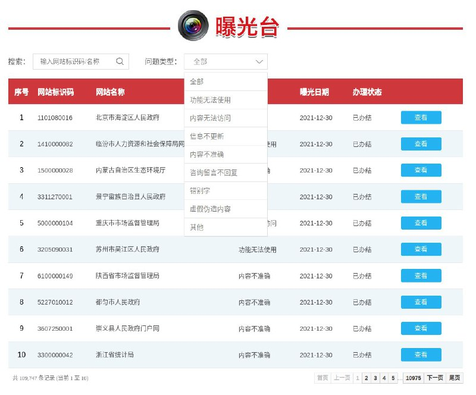

# 政府网站 曝光台 授权安全测试链路风险验证 thinkphp框架 https：//zfwzgl.www.gov.cn

> 原文：[政府网站 曝光台 授权安全测试链路风险验证 thinkphp框架 https：//zfwzgl.www.gov.cn](https://ji-shu-jian-li.gitbook.io/ben_bird/zheng-fu-wang-zhan-bao-guang-tai-ru-qin-jie-chi-thinkphp-kuang-jia-httpszfwzgl.www.gov.cn.html)

> 来源：GitBook 网页 HTML｜页面时间：2024-09-19 16:58｜日期依据：GitBook 页面更新时间

[Telegram 原帖](示例地址)

[Telegram 原帖](示例地址)

[Telegram 原帖](示例地址)

