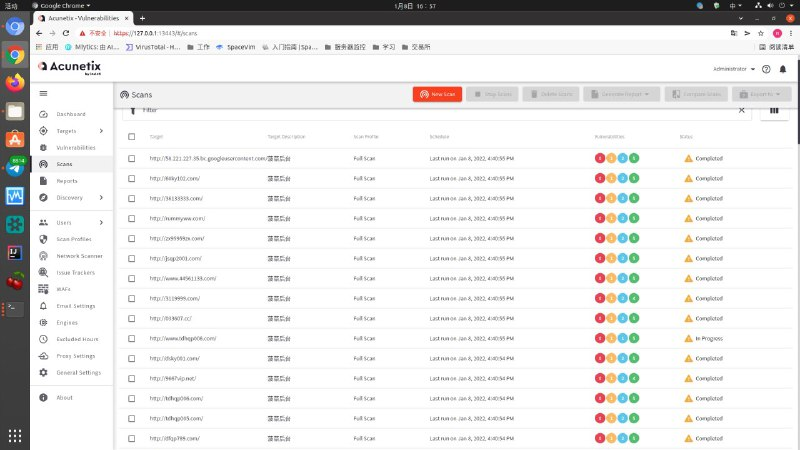
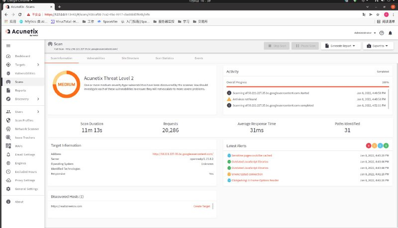
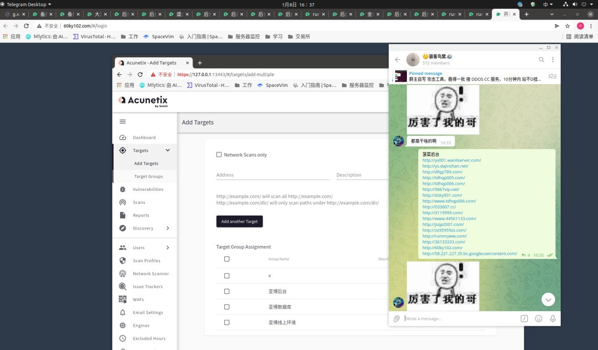
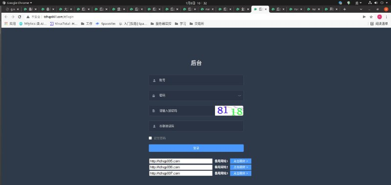

# 入侵某包网几十个代理后台和总控后台

> 原文：[入侵某包网几十个代理后台和总控后台](https://ji-shu-jian-li.gitbook.io/ben_bird/ru-qin-mou-bao-wang-ji-shi-ge-dai-li-hou-tai-he-zong-kong-hou-tai.html)

> 来源：GitBook 网页 HTML｜页面时间：2024-09-19 17:18｜日期依据：GitBook 页面更新时间

[Telegram 原帖](https://t.me/HackerNiao/29220)

[Telegram 原帖](https://t.me/HackerNiao/29249)

[Telegram 原帖](https://t.me/HackerNiao/29250)

[Telegram 原帖](https://t.me/HackerNiao/29217)

