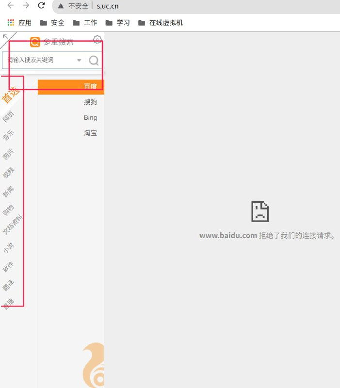
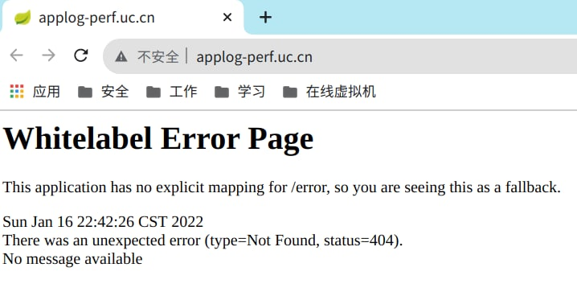
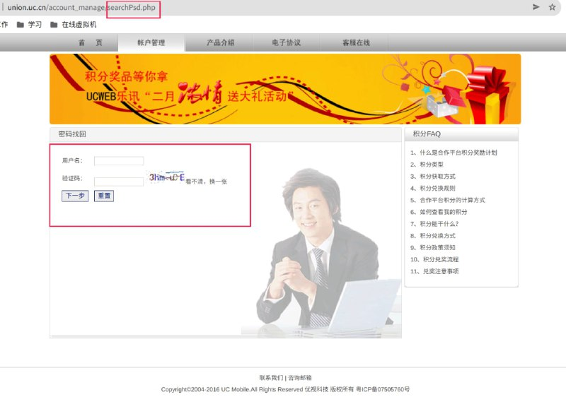
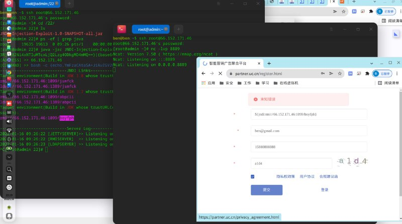

# uc.cn 入侵uc

> GitHub 仓库源文件：[点击打开网页渲染版](https://github.com/ben2023niao/ben-ops-notes/blob/main/doc/md/202409191730-%E5%AE%89%E5%85%A8%E7%AB%9E%E8%B5%9B%E5%A4%8D%E7%9B%98%2BTelegram-%E6%9F%90%E6%B5%8F%E8%A7%88%E5%99%A8%E5%B9%B3%E5%8F%B0%20%E6%8E%88%E6%9D%83%E5%AE%89%E5%85%A8%E6%B5%8B%E8%AF%95%E6%9F%90%E6%B5%8F%E8%A7%88%E5%99%A8%E5%B9%B3%E5%8F%B0.md)

> 原文：[uc.cn 入侵uc](https://ji-shu-jian-li.gitbook.io/ben_bird/uc.cn-ru-qin-uc.html)

> 来源：GitBook 网页 HTML｜页面时间：2024-09-19 17:30｜日期依据：GitBook 页面更新时间

[Telegram 原帖](https://t.me/HackerNiao/31275)

[Telegram 原帖](https://t.me/HackerNiao/31279)

[Telegram 原帖](https://t.me/HackerNiao/31292)

[Telegram 原帖](https://t.me/HackerNiao/31219)

