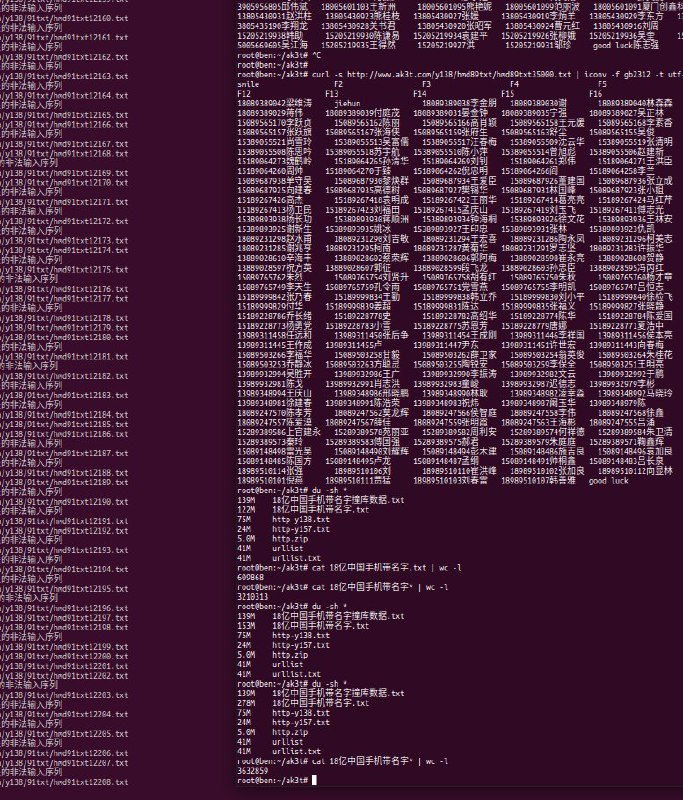
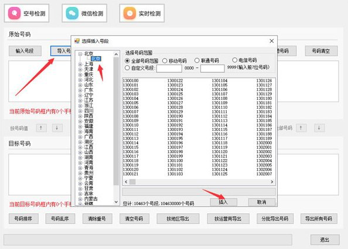
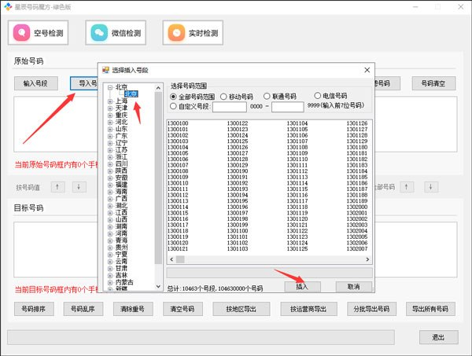
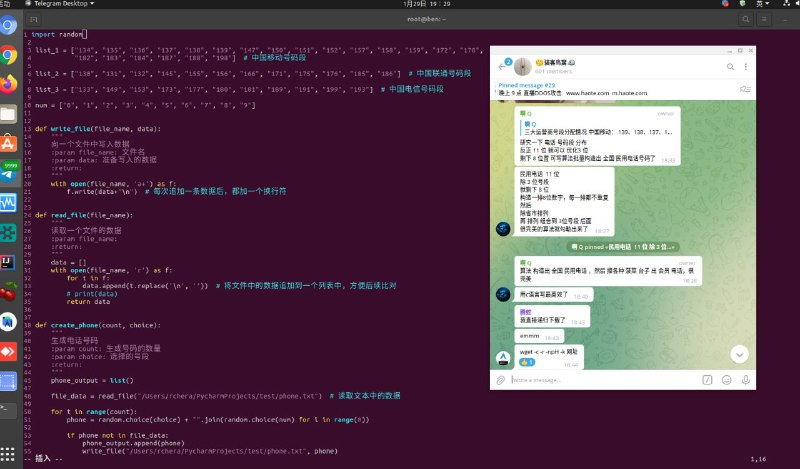

# 编写国内3大运营商电话号码生成去重复等工具

> 原文：[编写国内3大运营商电话号码生成去重复等工具](https://ji-shu-jian-li.gitbook.io/ben_bird/bian-xie-guo-nei-3-da-yun-ying-shang-dian-hua-hao-ma-sheng-cheng-qu-chong-fu-deng-gong-ju.html)

> 来源：GitBook 网页 HTML｜页面时间：2024-09-19 17:56｜日期依据：GitBook 页面更新时间

[Telegram 原帖](https://t.me/HackerNiao/32657)

最终目的：无论脚本运行几次、无论是今天运行、还是明天运行，这期间所产生过的号码，都记录下来，后续再生成号码时，都去和这个记录比对，如果有重复的，就把它剔除

1、固定电话数据处理，座机号码城市归类，非固定号码过滤。
2、过滤固定电话空号，欠费，无效，传真号码。
3、固定电话实号，按城市，号段下载。
4、手机号码处理，号段，过滤重号，无效号码。
5、过滤手机空号，停机号码，有效号码提取。

6、手机实号，可按城市，号段，运营商，乱序多种方式。

[Telegram 原帖](https://t.me/HackerNiao/32635)

[Telegram 原帖](https://t.me/HackerNiao/32644)

1、把每次运行程序时所产生的数据都存储到一个文件或者数据库中
2、后续都以这个文件或者数据库中的数据作为参照，来判断新生成的电话号码是否存在 考虑到只是存储数字，占用电脑存储空间有限，就直接选择把数据存到文件中了

[Telegram 原帖](https://t.me/HackerNiao/32623)

